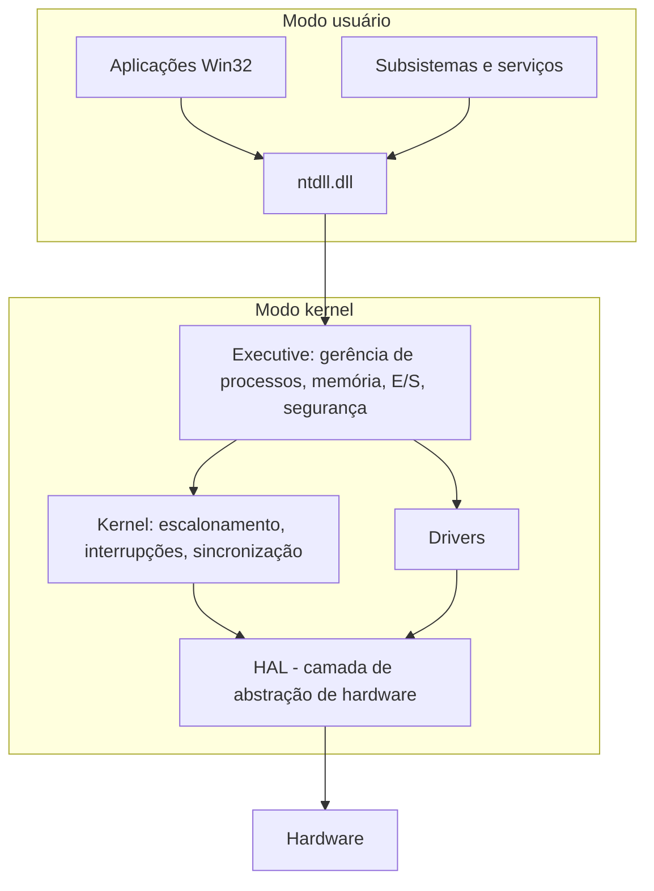
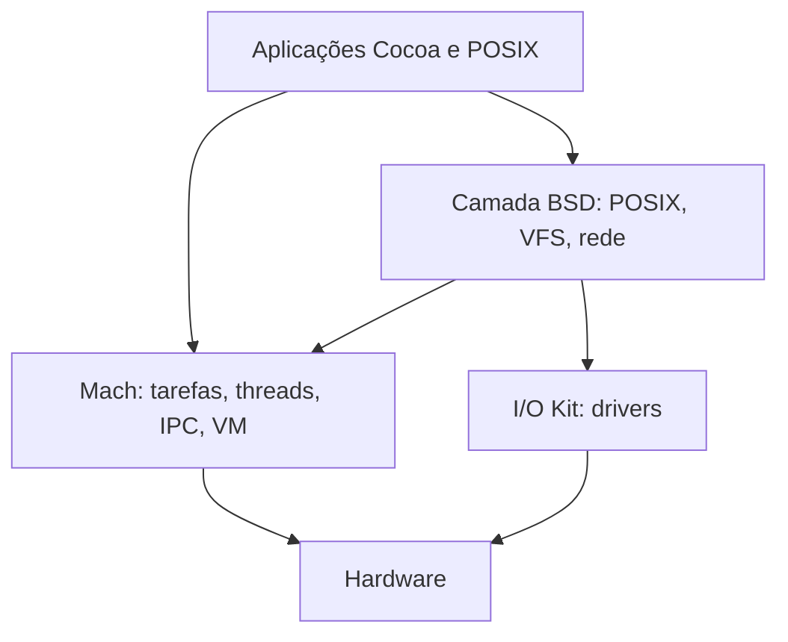

# Kernel Híbrido

## Resumo

O **kernel híbrido** combina ideias dos dois mundos: a **estrutura modular e a passagem de mensagens** de um microkernel, mas com muitos serviços (sistemas de arquivos, drivers, rede) executando **em modo kernel** por desempenho. O rótulo é um tanto controverso: alguns o consideram apenas um monolítico bem organizado.

## Exemplo 1: Windows NT



O NT foi projetado com **Executive** modular, objetos de kernel, **HAL** e subsistemas de ambiente, mas drivers e Executive rodam juntos em ring 0. Ver [[Windows NT]].

## Exemplo 2: macOS/XNU

XNU = **X is Not Unix**: combina o **microkernel Mach** (tarefas, threads, IPC por portas, memória virtual), a camada **BSD** (processos POSIX, sistema de arquivos, rede, usuários) e o **I/O Kit** (drivers em C++ orientados a objetos). Tudo é compilado em um único binário de kernel, no mesmo espaço de endereços. Ver [[macOS e XNU]].



> [!info] Tendência recente
> A Apple migra extensões de kernel (kexts) para **System Extensions / DriverKit** em user space, aproximando-se de um microkernel nos drivers.

## Exemplo prático

```powershell
# Windows: lista drivers (modo kernel) carregados
driverquery /v | more
Get-CimInstance Win32_SystemDriver | Select Name, State | Select -First 5
```

```bash
# macOS: extensões de kernel e de sistema carregadas
kextstat | head
systemextensionsctl list
sysctl kern.version      # mostra Darwin Kernel e xnu
```

## Vantagens e desvantagens

| Vantagens | Desvantagens |
|---|---|
| Bom desempenho (serviços críticos no kernel) | Perde parte do isolamento do microkernel |
| Estrutura modular facilita evolução | Complexidade de dois paradigmas |
| Ecossistema de drivers e compatibilidade (Win32, POSIX) | Driver ruim ainda derruba o sistema (BSOD/panic) |
| Abstrações limpas (HAL, Mach ports) | Rótulo vago: fronteira com o monolítico é difusa |

## Pontos-chave

- Estrutura de microkernel, execução de monolítico.
- Exemplos principais: [[Windows NT]] e [[macOS e XNU]].
- Na prática, a segurança depende de assinatura de drivers e de mover código para user space.

## Veja também

[[Kernel Monolítico]] · [[Microkernel]] · [[MOC - Arquitetura de Kernels]]
