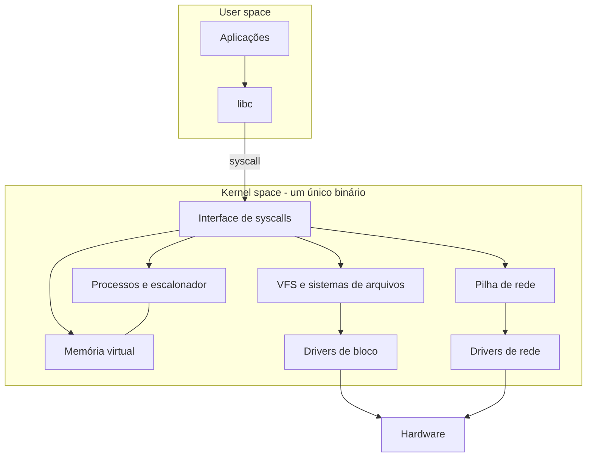

# Kernel Monolítico

## Resumo

No kernel **monolítico**, todos os serviços do SO (escalonador, memória, sistemas de arquivos, pilha de rede, drivers) executam no **mesmo espaço de endereços em modo kernel**, comunicando-se por chamadas de função diretas.

## Estrutura



## Módulos carregáveis

Monolítico **não** significa estático. O Linux e o FreeBSD permitem carregar código no kernel em tempo de execução (**LKM**, *loadable kernel modules*), mantendo o modelo monolítico: o módulo roda com privilégio total, no mesmo espaço do kernel.

```bash
lsmod | head                      # módulos carregados
modinfo ext4                      # informações de um módulo
sudo modprobe dummy               # carrega um módulo
sudo rmmod dummy                  # descarrega
```

Esqueleto de módulo:

```c
#include <linux/module.h>
#include <linux/kernel.h>

static int __init ola_init(void) {
    pr_info("ola: modulo carregado\n");
    return 0;
}
static void __exit ola_exit(void) {
    pr_info("ola: modulo removido\n");
}
module_init(ola_init);
module_exit(ola_exit);
MODULE_LICENSE("GPL");
```

## Exemplos reais

- [[Linux]] (monolítico modular), [[FreeBSD]], Solaris/illumos, UNIX tradicionais.
- Windows NT e macOS/XNU são considerados **híbridos** ([[Kernel Híbrido]]).

## Vantagens e desvantagens

| Vantagens | Desvantagens |
|---|---|
| **Desempenho alto**: chamadas de função, sem troca de contexto entre serviços | Um bug em qualquer driver pode derrubar todo o sistema (*kernel panic*) |
| Menos cópias de dados entre componentes | Base de código enorme (Linux passa de 30 milhões de linhas), difícil de auditar |
| Maturidade e ecossistema de drivers | Superfície de ataque grande: todo código roda com privilégio máximo |
| Simplicidade de acesso a estruturas compartilhadas | Acoplamento forte entre subsistemas; manutenção cara |

> [!warning] Segurança
> Uma vulnerabilidade em um driver de impressora, Wi-Fi ou sistema de arquivos exótico dá ao atacante acesso total ao kernel. Mitigações: módulos assinados, `lockdown`, eBPF verificado, execução de drivers em user space (VFIO, FUSE, UIO).

## Casos de uso

Servidores, nuvem, desktops, dispositivos embarcados com Linux, supercomputadores (cerca de 100% do TOP500 usa Linux).

## Pontos-chave

- Tudo em modo kernel, mesma memória: rápido, porém menos isolado.
- Modularidade (LKM) reduz o tamanho carregado, não o risco.
- Contraponto: [[Microkernel]].

## Veja também

[[MOC - Arquitetura de Kernels]] · [[Comparação de Arquiteturas com Exemplos Reais]] · [[Kernel vs User Space]]
