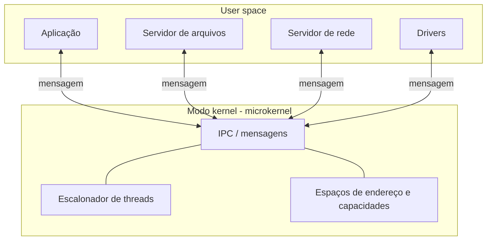

# Microkernel

## Resumo

Um **microkernel** mantém no modo kernel apenas o **mínimo**: gerência básica de espaços de endereço, escalonamento de threads e **comunicação entre processos (IPC)**. Drivers, sistemas de arquivos, pilha de rede e outros serviços rodam como **servidores em user space**.

## Estrutura



## Como uma operação funciona

Ler um arquivo:

1. A aplicação envia uma **mensagem** ao servidor de arquivos (via IPC no microkernel).
2. O servidor de arquivos envia mensagem ao driver de disco.
3. O driver acessa o hardware (com permissão concedida pelo microkernel), recebe a interrupção como mensagem e responde.
4. As respostas voltam pela cadeia.

Cada salto é uma **troca de contexto e cópia de mensagem**: esse é o custo central.

## Desempenho e a segunda geração

Os primeiros microkernels (Mach) eram lentos pelo IPC pesado. A família **L4** (Jochen Liedtke) mostrou que um IPC bem projetado custa centenas de ciclos, usando passagem por registradores e mapeamento de páginas em vez de cópia. **seL4**, derivado de L4, tem **prova formal** de correção da implementação.

## Exemplos reais

| Sistema | Observação |
|---|---|
| [[Minix]] 3 | Didático e autorreparável: reinicia drivers que falham |
| [[QNX]] | Tempo real, automotivo e industrial |
| seL4, L4Re | Pesquisa e sistemas de alta garantia |
| GNU Hurd, Fuchsia (Zircon) | Projetos baseados em microkernel |
| Redox OS | Escrito em Rust |

## Exemplo prático

IPC por mensagem (conceitual, estilo QNX):

```c
// cliente
int chid_servidor = ConnectAttach(0, pid_servidor, canal, 0, 0);
char req[] = "READ /dados.txt";
char resp[256];
MsgSend(chid_servidor, req, sizeof req, resp, sizeof resp);  // bloqueia até resposta

// servidor
int rcvid = MsgReceive(chid, buf, sizeof buf, NULL);
/* processa */
MsgReply(rcvid, EOK, resposta, tamanho);
```

Em um sistema Linux, um paralelo é rodar um driver em user space com **FUSE**:

```bash
sshfs usuario@host:/dados /mnt/remoto   # sistema de arquivos como processo user space
```

## Vantagens e desvantagens

| Vantagens | Desvantagens |
|---|---|
| **Isolamento**: falha em driver derruba só aquele processo, que pode ser reiniciado | Overhead de IPC e trocas de contexto |
| Kernel pequeno (milhares de linhas) é **auditável** e até **verificável formalmente** | Mais difícil projetar interfaces entre servidores |
| Princípio do menor privilégio por componente | Desempenho dependente da qualidade do IPC |
| Flexibilidade: trocar serviços sem reiniciar | Ecossistema de drivers e software menor |

> [!tip] Onde brilha
> Sistemas críticos de segurança e tempo real: automotivo, aviônica, industrial, dispositivos médicos, onde confiabilidade vale mais que vazão bruta.

## Pontos-chave

- Mínimo no kernel: IPC, escalonamento, memória.
- Serviços como processos comuns, comunicando-se por mensagens ([[IPC - Comunicação entre Processos]]).
- Trade-off clássico: **isolamento e segurança x desempenho**.

## Veja também

[[Kernel Monolítico]] · [[Kernel Híbrido]] · [[MOC - Arquitetura de Kernels]]
