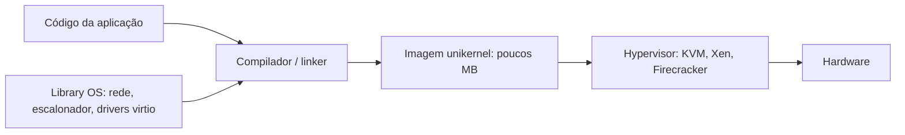

# Unikernel

## Resumo

Um **unikernel** é uma imagem especializada, de **espaço de endereços único**, que junta **a aplicação e apenas as partes do SO que ela usa** (via library OS). É executado diretamente sobre um **hypervisor** (ou hardware embarcado), sem processos, sem usuários e sem separação user/kernel.

## Como é construído



Comparação de pilhas:


## Características

- **Um único processo** por imagem: sem `fork`, sem `exec`, sem shell.
- **Sem troca de modo**: chamadas ao "SO" são chamadas de função.
- Imagem de **KBs a poucos MB**, inicialização em **milissegundos**.
- Superfície de ataque mínima: sem shell, sem utilitários, poucos drivers.
- Linguagens: C, OCaml, Rust, Go, entre outras.

## Projetos

| Projeto | Observação |
|---|---|
| MirageOS | OCaml; pesquisa e produção em nicho |
| OSv | Roda aplicações Java/Linux em uma VM leve |
| Unikraft | Biblioteca modular e eficiente |
| IncludeOS | C++ |
| Nanos / Ops | Rodam binários Linux como unikernel |

## Exemplo prático

```bash
# Rodar um binário como unikernel com Nanos (via ops)
curl https://ops.city/get.sh -sSfL | sh
ops run meu_servidor           # empacota e inicia em uma micro VM
```

```ocaml
(* MirageOS: servidor HTTP mínimo (esqueleto) *)
let main () =
  Http.listen (Port 8080) (fun _req -> Http.respond_string "olá, unikernel")
```

## Vantagens e desvantagens

| Vantagens | Desvantagens |
|---|---|
| Boot muito rápido e baixo uso de memória | Depuração difícil: sem shell, sem ferramentas tradicionais |
| Superfície de ataque pequena | Sem isolamento interno: bug na app = bug no "kernel" |
| Bom desempenho (sem trocas de modo) | Uma aplicação por imagem; ecossistema imaturo |
| Imutável e reproduzível | Compatibilidade limitada com bibliotecas existentes |

> [!warning] Isolamento
> O isolamento vem do **hypervisor**, não de dentro da imagem. Sem ASLR/DEP bem implementados na libOS, uma falha de memória na aplicação compromete toda a imagem.

## Casos de uso

Funções serverless, microserviços de rede, NFV, dispositivos IoT, ambientes multilocatário com requisitos fortes de isolamento e densidade.

## Pontos-chave

- App + libOS em uma só imagem, sobre hypervisor.
- Herdeiro das ideias do [[Exokernel]]; alternativa mais leve a VMs e a [[Containers]].
- Excelente para tarefas simples e especializadas; fraco para uso geral.

## Veja também

[[Virtualização]] · [[Containers]] · [[MOC - Arquitetura de Kernels]]
