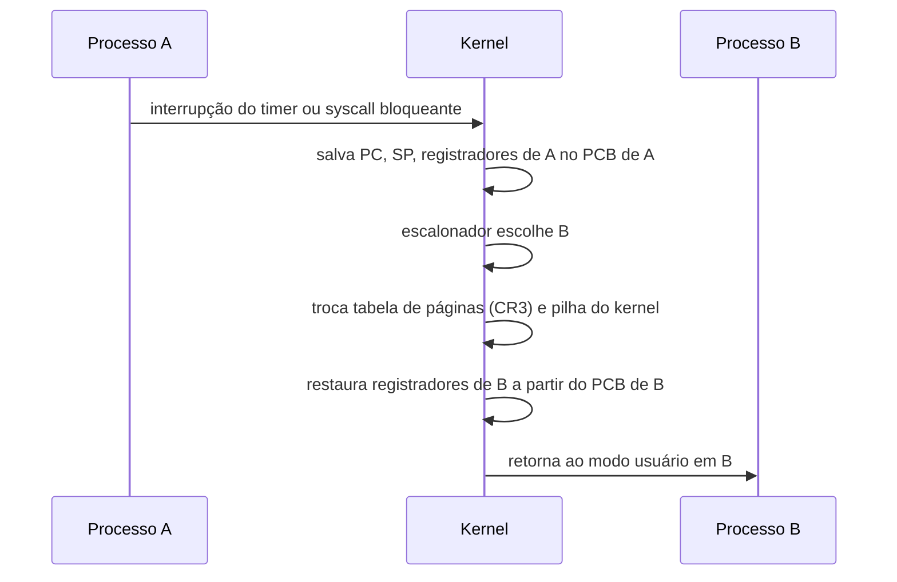

# Context Switch (Troca de Contexto)

## Resumo

A **troca de contexto** é a operação em que o kernel **salva o estado da tarefa em execução** (no [[PCB - Process Control Block]]) e **restaura o estado de outra**, dando a ela a CPU. É puro **overhead**: nenhum trabalho útil é feito durante a troca.

## Passo a passo



## O que é salvo e restaurado

- Registradores de uso geral, contador de programa, ponteiro de pilha, flags.
- Registradores de ponto flutuante/vetoriais (frequentemente de forma **preguiçosa**, só se usados).
- Mapeamento de memória (ponteiro da tabela de páginas).
- Estado de segmentos/TLS.

## Quando ocorre

| Causa | Tipo | Exemplo |
|---|---|---|
| Quantum esgotado | **Involuntária** (preempção) | Timer interrompe processo em laço |
| Processo bloqueia | **Voluntária** | `read` de disco, `sleep`, espera de mutex |
| Prioridade maior ficou pronta | Involuntária | Evento acorda tarefa de maior prioridade |
| Fim do processo | Voluntária | `exit` |

## Custo

- **Direto**: salvar/restaurar registradores, rodar o escalonador (microssegundos).
- **Indireto** (geralmente maior): **TLB invalidada** em troca de processo (sem PCID/ASID), **caches frias** (L1/L2/L3), predição de desvios perdida.
- Trocas entre **threads do mesmo processo** são mais baratas: mesmo espaço de endereços, sem trocar tabela de páginas ([[Threads - SO]]).

> [!tip] Medindo
> Se `vmstat` mostra `cs` (context switches por segundo) muito alto com CPU ociosa, há excesso de threads, travas disputadas ou muitas interrupções.

## Exemplo prático

```bash
# Trocas globais por segundo (coluna cs)
vmstat 1 5
# Trocas de um processo (voluntárias e involuntárias)
grep ctxt /proc/$$/status
# Medir latência de troca entre dois processos
perf bench sched pipe
```

Saída comentada (`vmstat`):

```text
procs -----------memory---------- ---swap-- -----io---- -system-- ------cpu-----
 r  b   swpd   free   buff  cache   si   so    bi    bo   in   cs us sy id wa st
 1  0      0 812340  90112 2012300    0    0     5    12  210  480  3  1 96  0  0
                                                           ^^   ^^
                                                           interrupções/s  trocas de contexto/s
```

Código que força trocas entre dois processos via pipe:

```python
import os, time
r1, w1 = os.pipe(); r2, w2 = os.pipe()
if os.fork() == 0:
    for _ in range(100000):
        os.read(r1, 1); os.write(w2, b"x")
    os._exit(0)
t = time.time()
for _ in range(100000):
    os.write(w1, b"x"); os.read(r2, 1)
print("troca média (us):", (time.time()-t) / 200000 * 1e6)
```

## Vantagens e desvantagens do mecanismo

| Vantagens | Desvantagens |
|---|---|
| Permite multitarefa e ilusão de paralelismo | Overhead puro; degrada cache e TLB |
| Base da preempção e da justiça | Muitas trocas reduzem a vazão |
| Permite escalonar por prioridade | Complexidade de salvar estados vetoriais |

## Pontos-chave

- Salvar estado no PCB, restaurar de outro: essa é a troca.
- O custo indireto (caches e TLB) domina.
- Thread no mesmo processo troca mais rápido que processo diferente.

## Veja também

[[PCB - Process Control Block]] · [[Estados de Processo]] · [[MOC - Processos e Threads]]
