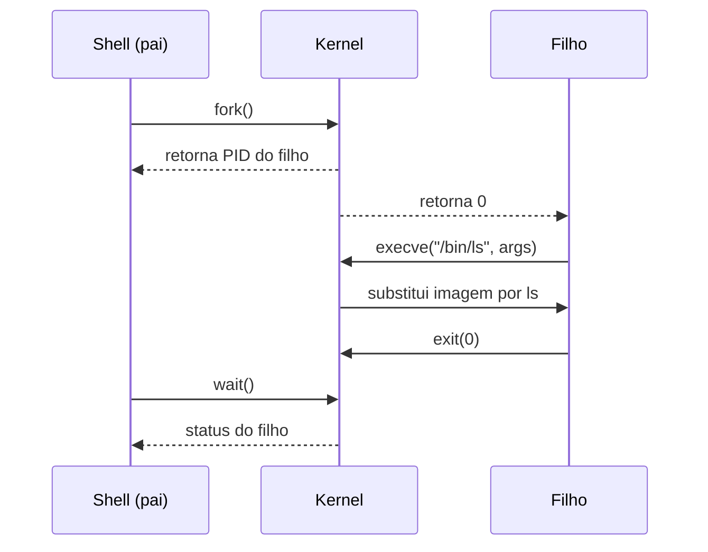

# Criação e Término de Processos

## Resumo

Processos formam uma **árvore**: todo processo é criado por outro (o pai). No UNIX, a criação é separada em duas etapas: **`fork`** clona o processo e **`exec`** substitui a imagem. No Windows, **`CreateProcess`** faz as duas coisas em uma chamada.

## O modelo fork + exec



- `fork()` retorna **duas vezes**: PID do filho no pai; 0 no filho; -1 em erro.
- O kernel usa **copy-on-write (COW)**: pai e filho compartilham páginas somente leitura até que um escreva; só então a página é copiada. Isso torna o `fork` barato ([[Memória Virtual]]).
- `exec` troca código, dados, heap e pilha; **mantém** PID e descritores abertos (por isso redirecionamentos no shell funcionam).

## Exemplo em C

```c
#include <stdio.h>
#include <stdlib.h>
#include <unistd.h>
#include <sys/wait.h>

int main(void) {
    pid_t pid = fork();
    if (pid < 0) { perror("fork"); exit(1); }

    if (pid == 0) {                       // filho
        execlp("ls", "ls", "-l", NULL);   // substitui a imagem
        perror("execlp");                 // só chega aqui se falhar
        _exit(127);
    }
    int status;
    waitpid(pid, &status, 0);             // pai espera
    if (WIFEXITED(status))
        printf("filho terminou com código %d\n", WEXITSTATUS(status));
    return 0;
}
```

## Equivalente em Python

```python
import os

pid = os.fork()
if pid == 0:
    os.execvp("ls", ["ls", "-l"])
else:
    _, status = os.waitpid(pid, 0)
    print("código de saída:", os.WEXITSTATUS(status))
```

## Windows

```powershell
# Criar processo e aguardar o término
$p = Start-Process notepad -PassThru
Wait-Process -Id $p.Id          # aguarda; ou Stop-Process -Id $p.Id para encerrar
```

## Zumbis e órfãos

| Caso | Situação | Tratamento |
|---|---|---|
| **Zumbi** | Filho terminou, mas o pai não chamou `wait`; só resta a entrada no PCB | Pai deve chamar `wait`; ao morrer o pai, `init` adota e coleta |
| **Órfão** | Pai terminou antes do filho | Adotado pelo `init`/`systemd` (PID 1) |
| **Daemon** | Processo em segundo plano, sem terminal | `fork` duplo, `setsid`, ou serviço do systemd |

```bash
# Ver zumbis (estado Z)
ps -eo pid,ppid,stat,cmd | awk '$3 ~ /Z/'
```

> [!warning] Zumbis acumulados
> Zumbis não consomem CPU nem memória relevante, mas ocupam entradas na tabela de processos. Um pai que nunca chama `wait` pode esgotar PIDs.

## Término

- Normal: `exit()`/retorno de `main`.
- Erro: `abort()` ou sinal (`SIGSEGV`, `SIGKILL`).
- O kernel libera memória, fecha arquivos e notifica o pai com `SIGCHLD`.

## Vantagens e desvantagens do modelo fork/exec

| Vantagens | Desvantagens |
|---|---|
| Separação permite ajustar o filho (redirecionar E/S, mudar UID) antes do `exec` | `fork` de processo com muita memória pode ser lento (cópia de tabelas de páginas) |
| COW torna o `fork` econômico | Em processos multithread, `fork` copia só a thread chamante: cuidado com travas |
| Modelo simples e poderoso | Alternativas: `vfork`, `posix_spawn`, `clone` |

## Pontos-chave

- `fork` clona; `exec` substitui; `wait` coleta o status.
- COW evita cópia desnecessária de memória.
- Zumbi = terminou sem ser coletado; órfão = pai morreu.

## Veja também

[[Processos]] · [[Estados de Processo]] · [[MOC - Processos e Threads]]
