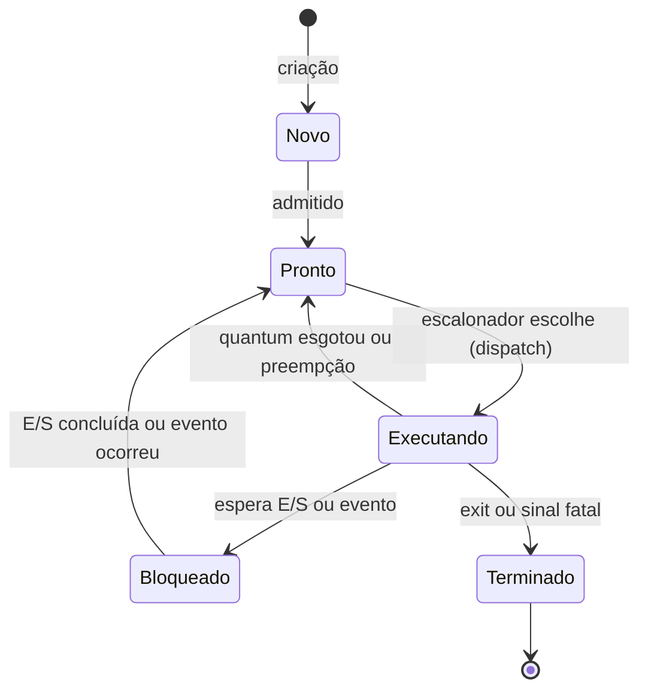

# Estados de Processo

## Resumo

Durante sua vida, um processo passa por estados que indicam o que ele está fazendo e o que espera. O escalonador só considera processos **prontos**.

## Modelo de cinco estados



| Estado | Significado | Quem causa a transição |
|---|---|---|
| Novo | Sendo criado, recursos em alocação | `fork`/`CreateProcess` |
| Pronto | Quer CPU e aguarda na fila | Escalonador |
| Executando | Está usando a CPU | Escalonador ([[Context Switch (Troca de Contexto)]]) |
| Bloqueado (espera) | Aguarda recurso ou evento | Syscall bloqueante, [[Interrupções|interrupção]] ao final |
| Terminado | Finalizado; talvez zumbi até o `wait` | `exit`, sinal |

## Estados de suspensão (modelo de sete estados)

Quando falta memória, o SO pode enviar processos ao disco:

- **Pronto suspenso** e **bloqueado suspenso** (em swap). Voltam à memória ao serem reativados.

## Estados no Linux

O campo `STAT` do `ps` mostra o estado:

| Código | Estado | Descrição |
|---|---|---|
| `R` | Running/Runnable | Executando ou na fila de prontos |
| `S` | Interruptible sleep | Esperando evento; acordável por sinal |
| `D` | Uninterruptible sleep | Esperando E/S; **não** aceita sinais (nem `SIGKILL`) |
| `T` | Stopped | Parado por `SIGSTOP` ou depurador |
| `Z` | Zombie | Terminou, aguardando coleta pelo pai |

> [!warning] Estado D
> Processos em `D` geralmente aguardam disco ou NFS. Muitos em `D` aumentam o *load average* mesmo com CPU ociosa; é sintoma de gargalo de E/S.

## Exemplo prático

```bash
# Processos por estado
ps -eo stat,pid,cmd | sort | head -20

# Gerar estados:
sleep 100 &            # S
kill -STOP %1          # T
ps -o pid,stat,cmd -p $!
kill -CONT %1
kill %1

# Estado e trocas de contexto de um processo
grep -E "State|ctxt" /proc/$$/status
```

```powershell
# Windows: estado de threads (Running, Wait, Ready...)
Get-Process notepad | Select -ExpandProperty Threads | Select Id, ThreadState, WaitReason
```

## Pontos-chave

- Só processos **prontos** concorrem pela CPU.
- Bloqueado ≠ pronto: espera um evento, não a CPU.
- `D` e `Z` merecem atenção em diagnósticos.

## Veja também

[[Processos]] · [[PCB - Process Control Block]] · [[MOC - Processos e Threads]]
