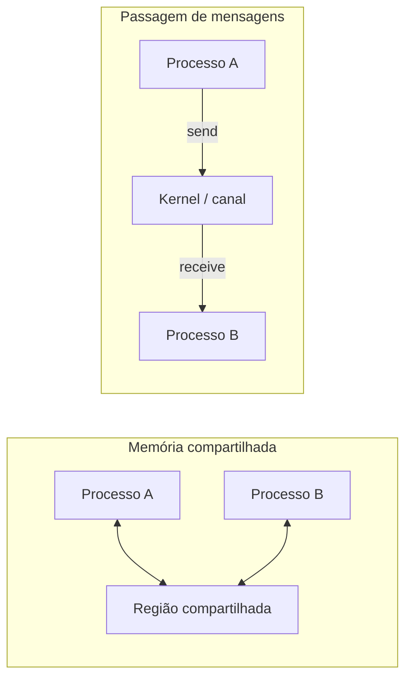
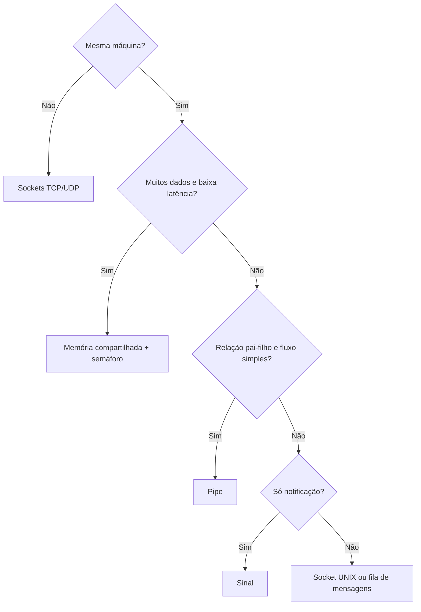

# IPC - Comunicação entre Processos

## Resumo

Como processos têm espaços de endereços isolados, precisam de mecanismos oferecidos pelo kernel para **trocar dados** e **sincronizar-se**. Há dois paradigmas: **memória compartilhada** e **passagem de mensagens**.

## Paradigmas



| Aspecto | Memória compartilhada | Passagem de mensagens |
|---|---|---|
| Velocidade | Muito rápida (sem cópia após configurar) | Mais lenta (cópia e syscalls) |
| Sincronização | **Responsabilidade do programador** | Embutida pelo canal |
| Facilidade | Difícil (corridas) | Mais simples |
| Distribuição | Só mesma máquina | Funciona pela rede ([[Sockets]]) |

## Mecanismos

| Mecanismo | Tipo | Observação |
|---|---|---|
| [[Pipes]] (anônimos e nomeados) | Fluxo de bytes | Unidirecional; relação pai-filho (anônimo) |
| [[Sinais]] | Notificação assíncrona | Sem dados; informação mínima |
| [[Sockets]] | Fluxo ou datagrama | Local (UNIX domain) ou rede |
| Memória compartilhada (`shm_open`, `mmap`) | Memória | Mais rápida; exige sincronização |
| Filas de mensagens (POSIX, System V) | Mensagens | Com prioridade |
| Semáforos | Sincronização | Ver [[Semáforos]] |
| Arquivos mapeados, arquivos comuns | Dados | Persistentes |
| Binder (Android), XPC/Mach ports (macOS/iOS), D-Bus | Mensagens estruturadas | Alto nível |
| Mailslots, named pipes, COM (Windows) | Variados | Windows |

> [!info] IPC e arquitetura
> Em [[Microkernel|microkernels]], o IPC é o mecanismo central: todos os serviços são processos que se comunicam por mensagens. Por isso sua eficiência é vital.

## Exemplo: memória compartilhada (POSIX)

```c
#include <fcntl.h>
#include <stdio.h>
#include <string.h>
#include <sys/mman.h>
#include <unistd.h>

int main(void) {
    int fd = shm_open("/demo", O_CREAT | O_RDWR, 0600);
    ftruncate(fd, 4096);
    char *mem = mmap(NULL, 4096, PROT_READ | PROT_WRITE, MAP_SHARED, fd, 0);

    if (fork() == 0) {                 // filho escreve
        strcpy(mem, "mensagem do filho");
        _exit(0);
    }
    wait(NULL);                         // pai espera e lê
    printf("pai leu: %s\n", mem);
    shm_unlink("/demo");
    return 0;
}
```

## Exemplo: fila de mensagens POSIX

```bash
# Listar objetos IPC existentes
ipcs -a
ls /dev/shm /dev/mqueue 2>/dev/null
```

## Escolhendo o mecanismo



## Vantagens e desvantagens

| Vantagens | Desvantagens |
|---|---|
| Mantém isolamento entre processos | Mais complexo que variáveis compartilhadas |
| Permite modularidade (cada processo faz uma coisa) | Custo de cópia e troca de contexto |
| Funciona entre máquinas (sockets) | Memória compartilhada exige sincronização cuidadosa |

## Pontos-chave

- Dois paradigmas: memória compartilhada (rápida) e mensagens (simples).
- Escolha pelo volume de dados, local e sincronização necessária.
- Base conceitual de microkernels.

## Veja também

[[Pipes]] · [[Sinais]] · [[Sockets]] · [[MOC - Processos e Threads]]
