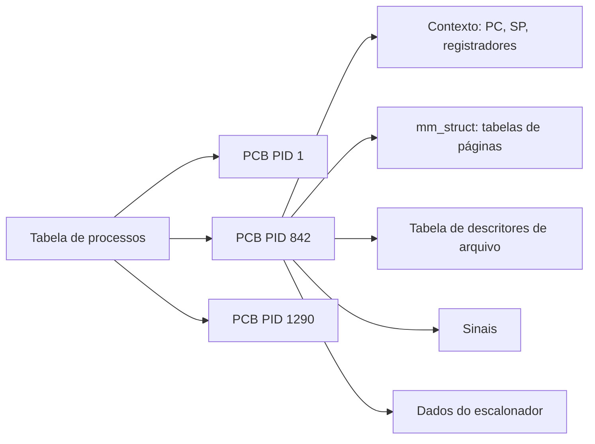

# PCB - Process Control Block

## Resumo

O **PCB** (bloco de controle de processo) é a estrutura de dados do kernel que reúne **tudo que o SO precisa saber** de um processo. É também o que é salvo e restaurado no [[Context Switch (Troca de Contexto)]]. No Linux é a `struct task_struct`; no Windows, `EPROCESS`/`ETHREAD`.

## Conteúdo típico

| Grupo | Campos |
|---|---|
| Identificação | PID, PPID, UID/GID, nome |
| Estado | Estado ([[Estados de Processo]]), motivo da espera |
| Contexto de CPU | Contador de programa (PC), ponteiro de pilha, registradores gerais, flags |
| Escalonamento | Prioridade, tempo de CPU usado, política, classe |
| Memória | Ponteiro para tabelas de páginas, limites, `mm_struct` |
| Arquivos | Tabela de descritores abertos, diretório raiz e corrente |
| Sinais | Máscara e tratadores |
| Contabilidade | Tempos, páginas, E/S realizadas |
| Relações | Ponteiros para pai, filhos, irmãos |



## Esboço em C (simplificado)

```c
struct pcb {
    int      pid, ppid;
    enum { NOVO, PRONTO, EXECUTANDO, BLOQUEADO, TERMINADO } estado;
    struct {
        unsigned long pc, sp, flags;
        unsigned long regs[16];
    } contexto;
    int      prioridade;
    void    *tabela_paginas;
    struct arquivo *fds[256];
    struct pcb *pai, *proximo;   // lista encadeada (fila de prontos, etc.)
};
```

## Observando o PCB de um processo

```bash
# Linux: o /proc expõe campos da task_struct
cat /proc/$$/status | head -20       # nome, estado, PID, PPID, UIDs, memória, ctx switches
cat /proc/$$/stat                    # campos brutos para ferramentas (ps, top)
ls -l /proc/$$/fd                    # tabela de descritores
cat /proc/$$/limits                  # limites de recursos
```

Saída comentada (trecho de `/proc/$$/status`):

```text
Name:   bash                      # nome do programa
State:  S (sleeping)              # estado do processo
Pid:    2381
PPid:   2370                      # pai
Uid:    1000 1000 1000 1000       # real, efetivo, salvo, fs
VmRSS:  4520 kB                   # memória residente
voluntary_ctxt_switches:    63    # trocas por bloqueio
nonvoluntary_ctxt_switches: 12    # trocas por preempção
```

## Fila de PCBs

O kernel organiza PCBs em filas: **fila de prontos**, filas de espera por dispositivo, fila de zumbis. Mudar de estado é **mover o PCB de fila**. Ver [[Escalonamento de Processos]].

## Pontos-chave

- PCB = representação completa do processo no kernel.
- Salvar o contexto no PCB permite retomar o processo depois.
- Threads têm seu próprio bloco de contexto, mas compartilham os recursos do processo ([[Threads - SO]]).

## Veja também

[[Processos]] · [[Context Switch (Troca de Contexto)]] · [[MOC - Processos e Threads]]
