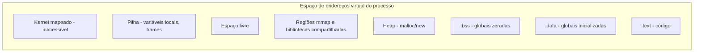

# Processos

## Resumo

Um **processo** é um **programa em execução**: o código mais seu estado (registradores, memória, arquivos abertos, credenciais). O programa é entidade **passiva** (arquivo no disco); o processo é entidade **ativa**.

## Imagem de um processo na memória



| Região | Conteúdo | Cresce |
|---|---|---|
| `.text` | Instruções, somente leitura e executável | Fixo |
| `.data` / `.bss` | Variáveis globais e estáticas | Fixo |
| Heap | Alocação dinâmica | Para cima |
| Pilha | Chamadas, locais, endereço de retorno | Para baixo |

## O que o SO mantém por processo

- Identificadores: **PID**, PPID (pai), UID/GID.
- Tabela de páginas (espaço de endereços).
- Tabela de **descritores de arquivo** (stdin = 0, stdout = 1, stderr = 2).
- Ambiente, diretório corrente, limites de recursos.
- Disposição de [[Sinais]] e estado de escalonamento.

Tudo isso reside no [[PCB - Process Control Block]] (`task_struct` no Linux, `EPROCESS` no Windows).

## Processo x Programa x Thread

| Conceito | Descrição |
|---|---|
| Programa | Arquivo executável (ELF, PE, Mach-O) |
| Processo | Instância em execução com espaço de endereços próprio |
| [[Threads - SO|Thread]] | Fluxo de execução dentro de um processo; compartilha memória |

## Exemplo prático

```bash
# Árvore de processos
pstree -p | head
# Processo atual: PID, pai, estado
ps -o pid,ppid,stat,cmd -p $$
# Imagem de memória e arquivos abertos
cat /proc/$$/maps | head -5
ls -l /proc/$$/fd
```

```c
#include <stdio.h>
#include <unistd.h>

int global = 10;               // .data

int main(void) {
    int local = 5;             // pilha
    int *dyn = malloc(4);      // heap
    printf("PID=%d PPID=%d\n", getpid(), getppid());
    printf(".data=%p pilha=%p heap=%p\n", (void*)&global, (void*)&local, (void*)dyn);
    return 0;
}
```

> [!tip] ASLR
> Executar o programa duas vezes mostra endereços diferentes: é o ASLR (ver [[Memória Virtual]]).

## Vantagens e desvantagens do modelo de processos

| Vantagens | Desvantagens |
|---|---|
| Isolamento forte de memória | Criação e troca de contexto relativamente caras |
| Falha contida em um processo | Comunicação exige [[IPC - Comunicação entre Processos]] |
| Segurança por usuário e permissões | Consome mais memória que threads |

## Pontos-chave

- Processo = código + dados + estado + recursos do SO.
- Cada processo tem seu espaço de endereços virtual isolado.
- O SO representa tudo em uma estrutura: o [[PCB - Process Control Block]].

## Veja também

[[Estados de Processo]] · [[Criação e Término de Processos]] · [[MOC - Processos e Threads]]
