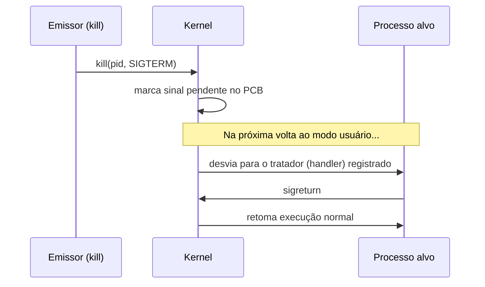

# Sinais

## Resumo

**Sinais** são notificações assíncronas enviadas a um processo (por outro processo, pelo kernel ou pelo terminal) para indicar um evento. Carregam **apenas o número do sinal**, sem dados. É o mecanismo mais leve de [[IPC - Comunicação entre Processos]].

## Sinais principais

| Sinal | Nº (Linux x86) | Padrão | Uso |
|---|---|---|---|
| `SIGHUP` | 1 | Terminar | Terminal fechou; muitos daemons recarregam configuração |
| `SIGINT` | 2 | Terminar | Ctrl+C |
| `SIGQUIT` | 3 | Terminar + core | Ctrl+\ |
| `SIGKILL` | 9 | Terminar | **Não pode ser capturado nem ignorado** |
| `SIGSEGV` | 11 | Terminar + core | Acesso inválido à memória ([[Traps e Exceções]]) |
| `SIGPIPE` | 13 | Terminar | Escrita em pipe sem leitor |
| `SIGTERM` | 15 | Terminar | Pedido educado de término (padrão do `kill`) |
| `SIGCHLD` | 17 | Ignorar | Filho terminou ([[Criação e Término de Processos]]) |
| `SIGSTOP` | 19 | Parar | **Não pode ser capturado** |
| `SIGCONT` | 18 | Continuar | Retoma processo parado |
| `SIGUSR1/2` | 10/12 | Terminar | Definidos pela aplicação |

## Como funciona



Três ações possíveis: **ação padrão**, **ignorar** ou **tratador** definido pelo programa (exceto `SIGKILL`/`SIGSTOP`). Sinais podem ser **bloqueados** (mascarados) e ficam pendentes.

## Exemplo em C

```c
#include <signal.h>
#include <stdio.h>
#include <unistd.h>

volatile sig_atomic_t parar = 0;

void ao_receber(int sig) { parar = 1; }   // só operações seguras aqui

int main(void) {
    struct sigaction sa = { .sa_handler = ao_receber };
    sigemptyset(&sa.sa_mask);
    sigaction(SIGINT, &sa, NULL);
    sigaction(SIGTERM, &sa, NULL);

    while (!parar) { puts("trabalhando..."); sleep(1); }
    puts("encerrando com limpeza");
    return 0;
}
```

> [!warning] Tratadores de sinal
> Dentro de um tratador, só chame funções **async-signal-safe** (`write`, `_exit`, ...). `printf` e `malloc` **não** são seguras. Prefira apenas alterar uma flag.

## Linha de comando

```bash
kill -l                  # lista de sinais
kill -TERM 1234          # pede término
kill -9 1234             # força término (sem limpeza)
kill -HUP $(pidof nginx) # recarrega configuração
pkill -f meu_script
trap 'echo limpando; rm -f /tmp/x' EXIT INT TERM   # em shell script
```

## Vantagens e desvantagens

| Vantagens | Desvantagens |
|---|---|
| Simples e leve | Não transmitem dados |
| Assíncronos: interrompem a qualquer momento | Condições de corrida e reentrância difíceis |
| Úteis para controle de processos | Sinais podem se fundir (não são enfileirados, exceto tempo real) |

## Pontos-chave

- Sinal = notificação assíncrona sem dados.
- `SIGKILL` e `SIGSTOP` não podem ser capturados.
- Tratadores devem ser mínimos e seguros.

## Veja também

[[IPC - Comunicação entre Processos]] · [[Pipes]] · [[MOC - Processos e Threads]]
