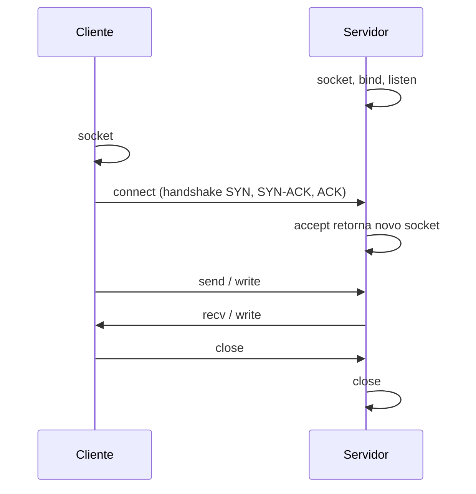

# Sockets

## Resumo

Um **socket** é um ponto final de comunicação bidirecional, identificado por um descritor de arquivo. Serve tanto para **rede (TCP/UDP)** quanto para **comunicação local** (UNIX domain sockets). É o IPC mais geral.

## Famílias e tipos

| Família | Uso | Endereço |
|---|---|---|
| `AF_INET` / `AF_INET6` | Rede IPv4 / IPv6 | IP + porta |
| `AF_UNIX` | Local, mesma máquina | Caminho no sistema de arquivos |
| `AF_NETLINK` | Kernel <-> user space (Linux) | Grupo/processo |

| Tipo | Protocolo | Característica |
|---|---|---|
| `SOCK_STREAM` | TCP | Orientado a conexão, fluxo confiável e ordenado |
| `SOCK_DGRAM` | UDP | Datagramas sem conexão, sem garantia |
| `SOCK_RAW` | IP bruto | Requer privilégio |

## Ciclo de vida TCP



## Servidor TCP mínimo em Python

```python
import socket

srv = socket.socket(socket.AF_INET, socket.SOCK_STREAM)
srv.setsockopt(socket.SOL_SOCKET, socket.SO_REUSEADDR, 1)
srv.bind(("127.0.0.1", 9000))
srv.listen()
conn, addr = srv.accept()
with conn:
    dados = conn.recv(1024)
    conn.sendall(b"eco: " + dados)
```

```python
# Cliente
import socket
with socket.create_connection(("127.0.0.1", 9000)) as c:
    c.sendall(b"ola")
    print(c.recv(1024))
```

## Socket UNIX em C (local, mais rápido que loopback TCP)

```c
#include <string.h>
#include <sys/socket.h>
#include <sys/un.h>
#include <unistd.h>

int main(void) {
    int s = socket(AF_UNIX, SOCK_STREAM, 0);
    struct sockaddr_un a = { .sun_family = AF_UNIX };
    strcpy(a.sun_path, "/tmp/meu.sock");
    unlink(a.sun_path);
    bind(s, (struct sockaddr *)&a, sizeof a);
    listen(s, 5);
    int c = accept(s, NULL, NULL);
    write(c, "ola\n", 4);
    close(c); close(s);
    return 0;
}
```

## E/S multiplexada

Para atender muitos clientes sem uma thread por conexão: `select`, `poll`, **`epoll`** (Linux), `kqueue` (BSD/macOS), **IOCP** (Windows), `io_uring`. Esse é o modelo de Nginx e Node.js.

## Observação e diagnóstico

```bash
ss -tlnp                 # sockets TCP em escuta, com processo
ss -s                    # resumo de sockets
ss -xp                   # sockets UNIX
nc -l 9000 &             # servidor rápido com netcat
echo "teste" | nc localhost 9000
```

```powershell
Get-NetTCPConnection -State Listen | Select LocalAddress, LocalPort, OwningProcess
netstat -ano | findstr LISTENING
```

Ver [[ss]] para detalhes da ferramenta.

## Vantagens e desvantagens

| Vantagens | Desvantagens |
|---|---|
| Uma API serve rede e IPC local | Overhead maior que memória compartilhada |
| Bidirecional; funciona entre máquinas | Tratamento de erros e concorrência é trabalhoso |
| Suportado em todos os SOs | TCP: fluxo sem fronteiras de mensagem (é preciso enquadrar) |

## Pontos-chave

- Socket = descritor de comunicação bidirecional, local ou de rede.
- TCP = fluxo confiável; UDP = datagramas.
- Servidores escaláveis usam multiplexação (`epoll`) em vez de uma thread por cliente.

## Veja também

[[IPC - Comunicação entre Processos]] · [[Pipes]] · [[MOC - Processos e Threads]]
