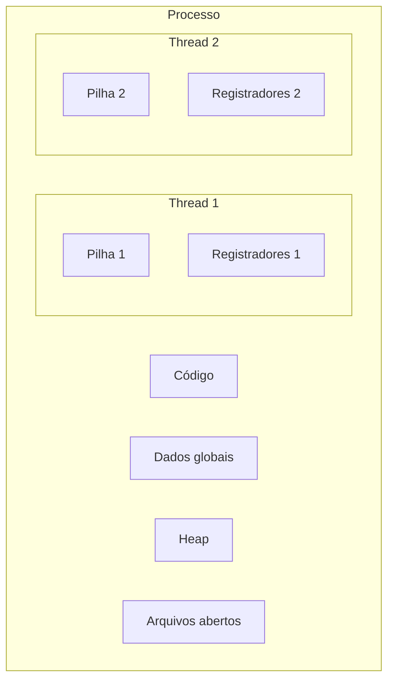

# Threads - SO

## Resumo

Uma **thread** é uma unidade de execução dentro de um processo. Threads do mesmo processo **compartilham** código, dados, heap e arquivos abertos, mas têm **pilha, registradores e contador de programa próprios**.

## Compartilhado x privado

| Compartilhado entre threads | Privado de cada thread |
|---|---|
| Código (`.text`) | Pilha |
| Dados globais e heap | Registradores e PC |
| Descritores de arquivo | TID e prioridade |
| Tratadores de sinais, diretório corrente | Armazenamento local (TLS), `errno` |



## Modelos de implementação

| Modelo | Descrição | Vantagem | Desvantagem |
|---|---|---|---|
| **1:1** (kernel threads) | Cada thread de usuário = uma thread do kernel | Paralelismo real em multicore; bloqueio isolado | Criação e troca mais caras |
| **N:1** (user threads) | Muitas threads em uma do kernel (biblioteca) | Troca muito barata | Uma chamada bloqueante trava todas; sem paralelismo |
| **M:N** (híbrido) | M threads de usuário sobre N do kernel | Flexível | Complexo (goroutines do Go usam variante) |

Linux, Windows e macOS usam **1:1**. No Linux, `clone()` cria threads e processos: a diferença está nas flags que indicam o que compartilhar.

## Exemplo em C com pthreads

```c
#include <pthread.h>
#include <stdio.h>

int contador = 0;                      // compartilhado
pthread_mutex_t lock = PTHREAD_MUTEX_INITIALIZER;

void *trabalho(void *arg) {
    for (int i = 0; i < 100000; i++) {
        pthread_mutex_lock(&lock);     // seção crítica
        contador++;
        pthread_mutex_unlock(&lock);
    }
    return NULL;
}

int main(void) {
    pthread_t t1, t2;
    pthread_create(&t1, NULL, trabalho, NULL);
    pthread_create(&t2, NULL, trabalho, NULL);
    pthread_join(t1, NULL);
    pthread_join(t2, NULL);
    printf("contador = %d\n", contador);   // 200000 com mutex
    return 0;
}
```

Compile com `gcc -pthread threads.c -o threads`. Sem o mutex o resultado é incorreto: [[Condições de Corrida]].

## Python e o GIL

```python
import threading
# No CPython, o GIL permite só uma thread executando bytecode por vez:
# bom para E/S concorrente, ruim para CPU intensiva (use multiprocessing)
def tarefa(n):
    print("thread", n)
ts = [threading.Thread(target=tarefa, args=(i,)) for i in range(3)]
[t.start() for t in ts]; [t.join() for t in ts]
```

## Observando threads

```bash
ps -eLf | head                # LWP = ID da thread
top -H -p $(pgrep firefox | head -1)
ls /proc/$$/task              # uma entrada por thread
```

## Processos x threads

| Critério | Processos | Threads |
|---|---|---|
| Isolamento | Forte | Fraco (memória compartilhada) |
| Criação / troca | Mais caras | Mais baratas |
| Comunicação | [[IPC - Comunicação entre Processos]] | Memória compartilhada direta |
| Falha | Contida | Pode derrubar o processo inteiro |
| Sincronização | Menos necessária | Obrigatória ([[Mutex]], [[Semáforos]]) |

> [!warning] Armadilhas
> Condições de corrida, deadlocks, inversão de prioridade e *false sharing* em caches são problemas comuns de multithreading.

## Pontos-chave

- Threads dividem memória; pilhas e registradores são próprios.
- Modelo 1:1 é o padrão dos SOs modernos.
- Compartilhar memória exige sincronização.

## Veja também

[[Processos]] · [[Context Switch (Troca de Contexto)]] · [[MOC - Processos e Threads]]
