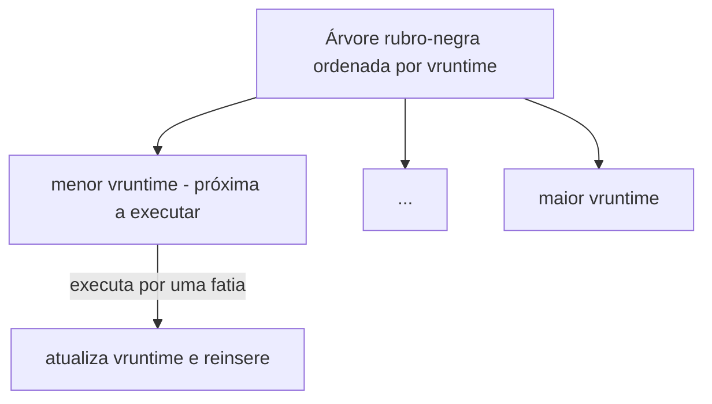

# CFS - Completely Fair Scheduler

## Resumo

O **CFS** foi o escalonador padrão do [[Linux]] de 2007 (kernel 2.6.23) até o kernel 6.5, quando foi substituído pelo **EEVDF** (*Earliest Eligible Virtual Deadline First*), que mantém a ideia de justiça proporcional mas considera também latência. O conceito central do CFS continua sendo a base para entender o escalonamento Linux.

## Ideia central: CPU ideal

Imagine uma CPU ideal que executa **todos os processos simultaneamente, cada um a 1/n da velocidade**. O CFS aproxima isso rastreando quanto cada tarefa já recebeu e escolhendo sempre **a que recebeu menos**.

## `vruntime` (tempo virtual de execução)

- Cada tarefa acumula **`vruntime`**: tempo de CPU consumido, **ponderado pelo peso** (derivado do `nice`).
- Quanto menor a prioridade (nice alto), mais rápido o `vruntime` cresce; tarefas de nice baixo crescem devagar e recebem mais CPU.
- A tarefa escolhida é a de **menor `vruntime`**.

`vruntime += tempo_real × (peso_nice0 / peso_da_tarefa)`

| nice | Peso (aproximado) |
|---|---|
| -20 | 88761 |
| 0 | 1024 |
| +19 | 15 |

Cada passo de `nice` altera o peso em cerca de 25% (10% a menos de CPU entre vizinhos).

## Estrutura: árvore rubro-negra



- Escolher a próxima tarefa: nó mais à esquerda, **O(1)** (em cache); inserir/remover: **O(log n)**.
- Fatia de tempo = `latência_alvo × peso / soma_dos_pesos`, com limite mínimo (granularidade) para evitar trocas excessivas.

## Tarefas que dormem

Uma tarefa que bloqueia por E/S **não acumula `vruntime`**; ao acordar, seu `vruntime` é ajustado ao mínimo da árvore (com pequeno bônus), garantindo boa resposta a interativos sem favorecimento permanente.

## Classes de escalonamento no Linux

| Classe | Políticas | Uso |
|---|---|---|
| `stop` / `deadline` | `SCHED_DEADLINE` | Tempo real com prazos (EDF + CBS) |
| `rt` | `SCHED_FIFO`, `SCHED_RR` | Tempo real por prioridade fixa 1-99 |
| `fair` | `SCHED_OTHER` (CFS/EEVDF), `SCHED_BATCH`, `SCHED_IDLE` | Tarefas normais |

A classe de maior prioridade com tarefas prontas sempre vence.

## Grupos e cgroups

O CFS aplica justiça também entre **grupos** de tarefas ([[cgroups - SO]]): com `cpu.shares`/`cpu.weight`, cada contêiner ou usuário recebe fatia proporcional, independentemente do número de processos internos. Também há `cpu.max` para limite rígido (*quota/period*).

## Exemplo prático

```bash
# Ver política, nice e prioridade
ps -eo pid,cls,ni,pri,vsz,cmd --sort=-pri | head
# Estatísticas de escalonamento por tarefa
cat /proc/$$/sched | head -20
# Rodar dois laços com pesos diferentes e comparar uso de CPU
nice -n 0  sh -c 'while :; do :; done' &
nice -n 10 sh -c 'while :; do :; done' &
top -b -n1 | head -12        # o de nice 0 recebe bem mais CPU
kill %1 %2
# Limitar CPU de um grupo (cgroup v2)
sudo systemd-run --scope -p CPUQuota=50% ./tarefa
```

Saída comentada (`/proc/<pid>/sched`):

```text
se.vruntime                     :        152340.512  # tempo virtual acumulado
se.sum_exec_runtime             :         10234.118  # tempo real de CPU
nr_switches                     :              4581  # trocas de contexto
nr_voluntary_switches           :              4410  # bloqueou voluntariamente
```

## Vantagens e desvantagens

| Vantagens | Desvantagens |
|---|---|
| Justiça proporcional sem filas fixas | Latência não garantida (corrigida parcialmente no EEVDF) |
| Escala bem com muitos processos (O(log n)) | Não é um escalonador de tempo real |
| Integra-se com cgroups | Heurísticas de acordar tarefas são complexas |
| Sem heurísticas frágeis de interatividade | Ajuste fino de parâmetros é difícil |

## Pontos-chave

- Escolhe a tarefa de menor `vruntime`, ponderado por peso (`nice`).
- Árvore rubro-negra organiza os prontos.
- EEVDF herdou o modelo e acrescentou prazos virtuais.

## Veja também

[[MLFQ - Multilevel Feedback Queue]] · [[Escalonamento de Tempo Real]] · [[MOC - Escalonamento]]
