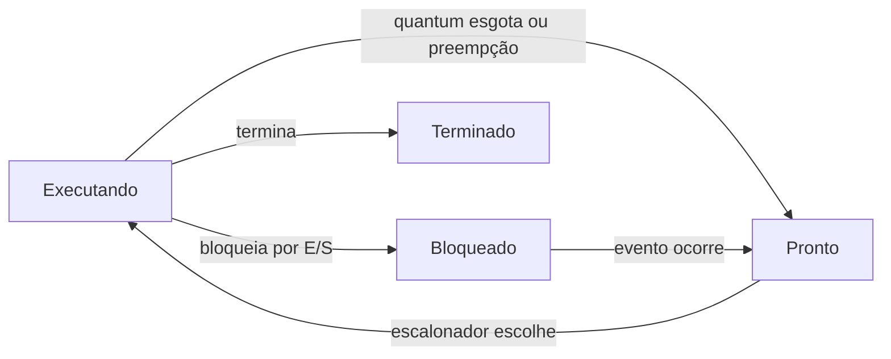

# Escalonamento de Processos

## Resumo

O **escalonador** (*scheduler*) decide, entre os processos **prontos**, qual recebe a CPU. O **dispatcher** executa a decisão (troca de contexto, retorno ao modo usuário). A política escolhida determina a sensação de fluidez, a vazão e a justiça do sistema.

## Quando o escalonador atua



- **Não preemptivo**: o processo roda até bloquear ou terminar (decisões nos eventos 1 e 3).
- **Preemptivo**: o SO pode retirar a CPU (timer, chegada de tarefa mais prioritária). Padrão dos SOs modernos.

## Níveis de escalonamento

| Nível | Decide | Frequência |
|---|---|---|
| Longo prazo (admissão) | Quais jobs entram no sistema | Segundos a minutos |
| Médio prazo | Quais processos vão para swap | Segundos |
| **Curto prazo (CPU)** | Qual processo pronto executa | Milissegundos |

## Métricas

| Métrica | Definição | Quer-se |
|---|---|---|
| Utilização da CPU | % de tempo ocupada | Alta |
| Vazão (*throughput*) | Processos concluídos por unidade de tempo | Alta |
| Tempo de retorno (*turnaround*) | Término - chegada | Baixo |
| Tempo de espera | Tempo total na fila de prontos | Baixo |
| Tempo de resposta | Chegada até a primeira resposta | Baixo |
| Justiça | Distribuição equitativa da CPU | Alta |

Fórmulas: `retorno = espera + execução`; `espera = retorno - burst`.

> [!warning] Conflito de objetivos
> Maximizar vazão tende a prejudicar o tempo de resposta e vice-versa. Não existe política ótima para todas as métricas.

## Cargas: CPU-bound x I/O-bound

- **I/O-bound**: bursts de CPU curtos, muita espera por E/S (editores, servidores). Devem ter prioridade para manter dispositivos ocupados e a interface responsiva.
- **CPU-bound**: bursts longos (compilação, cálculo). Beneficiam-se de quanta maiores.

## Comparação dos algoritmos

| Algoritmo | Preemptivo | Ponto forte | Ponto fraco |
|---|---|---|---|
| [[FCFS - First Come, First Served]] | Não | Simples, justo na ordem | Efeito comboio |
| [[SJF e SRTF - Menor Job Primeiro]] | Não (SRTF: sim) | Menor espera média (ótimo) | Fome; exige prever o burst |
| [[Round Robin]] | Sim | Boa resposta | Depende do quantum |
| [[Escalonamento por Prioridades]] | Ambos | Atende urgência | Inanição |
| [[MLFQ - Multilevel Feedback Queue]] | Sim | Adapta-se ao comportamento | Parâmetros e manipulação |
| [[CFS - Completely Fair Scheduler]] | Sim | Justiça proporcional | Complexidade |
| [[Escalonamento de Tempo Real]] | Sim | Prazos garantidos | Exige análise e reserva |

## Exemplo prático: simulador em Python

```python
from collections import deque

def round_robin(procs, quantum):
    """procs: lista de (nome, chegada, burst). Retorna espera por processo."""
    fila, t, restante = deque(), 0, {n: b for n, _, b in procs}
    chegadas = sorted(procs, key=lambda p: p[1])
    i, espera, fim = 0, {}, {}
    while len(fim) < len(procs):
        while i < len(chegadas) and chegadas[i][1] <= t:
            fila.append(chegadas[i][0]); i += 1
        if not fila:
            t = chegadas[i][1]; continue
        n = fila.popleft()
        run = min(quantum, restante[n]); t += run; restante[n] -= run
        while i < len(chegadas) and chegadas[i][1] <= t:
            fila.append(chegadas[i][0]); i += 1
        if restante[n] > 0: fila.append(n)
        else: fim[n] = t
    for n, c, b in procs:
        espera[n] = fim[n] - c - b
    return espera

print(round_robin([("A", 0, 5), ("B", 1, 3), ("C", 2, 1)], quantum=2))
```

## Observando o escalonador no Linux

```bash
ps -eo pid,cls,pri,ni,cmd | head      # classe (TS, FF, RR), prioridade e nice
chrt -p $$                            # política do shell atual
nice -n 10 ./tarefa_pesada            # reduz prioridade (nice 10)
renice -n -5 -p 1234                  # aumenta prioridade (requer root)
taskset -cp 0,1 1234                  # afinidade de CPU
```

## Pontos-chave

- Escalonar = escolher entre os prontos; despachar = trocar contexto.
- Métricas conflitam; a escolha depende da carga.
- Preempção por timer é o padrão em SOs de uso geral.

## Veja também

[[MOC - Escalonamento]] · [[Context Switch (Troca de Contexto)]] · [[SO de Tempo Compartilhado]]
