# Escalonamento de Tempo Real

## Resumo

Em [[SO de Tempo Real (RTOS)|sistemas de tempo real]], o escalonador precisa **garantir prazos (deadlines)**. Cada tarefa periódica é descrita por **período T**, **tempo de execução no pior caso C** e **prazo D** (geralmente D = T). A **utilização** é U = Σ Ci/Ti.

## Rate Monotonic (RM)

Prioridade **fixa**: **quanto menor o período, maior a prioridade**. É ótimo entre algoritmos de prioridade fixa.

- Teste suficiente (Liu e Layland): U ≤ n(2^(1/n) − 1). Para n → ∞ o limite tende a **ln 2 ≈ 69,3%**.
- Se U passar do limite, o conjunto pode ainda ser escalonável (teste exato por análise do tempo de resposta).

## Earliest Deadline First (EDF)

Prioridade **dinâmica**: executa a tarefa com **prazo absoluto mais próximo**. É ótimo para um único processador: escalonável **se e somente se U ≤ 1** (com D = T).

## Exemplo numérico

Tarefas: T1 (C = 1, T = 4) e T2 (C = 2, T = 6). U = 0,25 + 0,333 = 0,583.

| Teste | Resultado |
|---|---|
| RM, n = 2: limite 0,828 | 0,583 ≤ 0,828: **escalonável** |
| EDF: U ≤ 1 | **escalonável** |

```mermaid
gantt
    title RM - T1 (C=1, T=4) e T2 (C=2, T=6)
    dateFormat  X
    axisFormat %s
    section CPU
    T1 :0, 1
    T2 :1, 2
    T1 :4, 1
    T2 :6, 2
    T1 :8, 1
```



T1 tem prioridade maior (período menor). Os dois cumprem todos os prazos no intervalo [0, 12].

## Simulador simples de RM

```python
def rm_simulacao(tarefas, horizonte):
    """tarefas: lista de (nome, C, T). Retorna linha do tempo por unidade."""
    tarefas = sorted(tarefas, key=lambda x: x[2])        # menor período = maior prioridade
    restante = {n: 0 for n, _, _ in tarefas}
    linha = []
    for t in range(horizonte):
        for n, c, T in tarefas:
            if t % T == 0:
                if restante[n] > 0:
                    print(f"PRAZO PERDIDO: {n} em t={t}")
                restante[n] = c
        escolhida = next((n for n, _, _ in tarefas if restante[n] > 0), "ocioso")
        if escolhida != "ocioso":
            restante[escolhida] -= 1
        linha.append(escolhida)
    return linha

print(rm_simulacao([("T1", 1, 4), ("T2", 2, 6)], 12))
```

## Políticas de tempo real no Linux

| Política | Descrição |
|---|---|
| `SCHED_FIFO` | Prioridade fixa 1-99; roda até bloquear, terminar ou ser preemptada por maior prioridade; sem quantum |
| `SCHED_RR` | Como FIFO, com [[Round Robin]] entre tarefas de mesma prioridade |
| `SCHED_DEADLINE` | EDF com reserva de banda (CBS): parâmetros `runtime`, `deadline`, `period` |

```bash
sudo chrt -f 90 ./controlador                  # SCHED_FIFO prioridade 90
sudo chrt -d --sched-runtime 2000000 --sched-deadline 5000000 --sched-period 10000000 0 ./tarefa
cat /proc/sys/kernel/sched_rt_runtime_us       # limite: por padrão 95% da CPU para RT
```

> [!warning] Cuidado com RT em Linux
> Uma tarefa `SCHED_FIFO` em laço infinito pode monopolizar a CPU. O kernel limita RT a 95% (`sched_rt_runtime_us`) como rede de segurança. Para latência baixa use ainda o patch **PREEMPT_RT** (integrado ao mainline desde o kernel 6.12).

## Problemas típicos

- **Inversão de prioridade**: tratar com herança de prioridade (`PTHREAD_PRIO_INHERIT`) ou teto de prioridade.
- **Jitter** e latência de interrupções.
- Dependência de **WCET** (pior caso de execução), difícil de medir com caches e pipelines.

```c
// Mutex com herança de prioridade (POSIX)
pthread_mutexattr_t attr;
pthread_mutexattr_init(&attr);
pthread_mutexattr_setprotocol(&attr, PTHREAD_PRIO_INHERIT);
pthread_mutex_init(&mtx, &attr);
```

## RM x EDF

| Critério | RM | EDF |
|---|---|---|
| Prioridade | Fixa | Dinâmica |
| Limite de utilização | ~69% (garantido); até 100% em casos especiais | 100% |
| Implementação | Simples; amplamente suportada | Mais complexa |
| Sobrecarga | Falha previsível (as de menor prioridade) | Efeito dominó imprevisível |

## Pontos-chave

- Objetivo: **prazos**, não média de desempenho.
- RM = prioridade fixa por período; EDF = prazo mais próximo.
- Evite inversão de prioridade com herança.

## Veja também

[[SO de Tempo Real (RTOS)]] · [[CFS - Completely Fair Scheduler]] · [[MOC - Escalonamento]]
