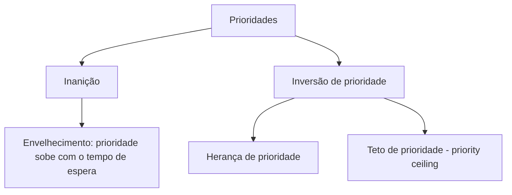
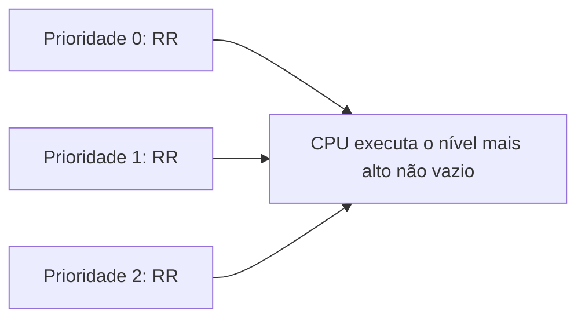

# Escalonamento por Prioridades

## Resumo

Cada processo recebe uma **prioridade**; a CPU vai para o **pronto de maior prioridade**. Pode ser preemptivo (chegada de prioridade maior retira a CPU) ou não. O SJF é um caso particular (prioridade = inverso do burst previsto).

## Origem das prioridades

| Tipo | Exemplo |
|---|---|
| **Interna** (calculada pelo SO) | Limites de tempo, razão E/S x CPU, uso de memória |
| **Externa** (política) | Importância do usuário, tipo de processo, valor pago |
| **Estática** | Fixa durante a vida do processo |
| **Dinâmica** | Ajustada pelo escalonador conforme o comportamento |

## Problemas e soluções



> [!warning] Inanição
> Processos de baixa prioridade podem nunca executar. O **envelhecimento** soma, por exemplo, +1 de prioridade a cada intervalo de espera.

> [!warning] Inversão de prioridade
> Tarefa de alta prioridade (H) espera um mutex preso por uma de baixa (L); uma de prioridade média (M) preempta L e H fica bloqueada indefinidamente. Com **herança de prioridade**, L assume temporariamente a prioridade de H, concluindo logo e liberando o mutex. Ver [[Mutex]].

## Prioridades por classe (mesmo nível, RR)

É comum usar **filas por prioridade** com [[Round Robin]] dentro de cada nível:



## Prioridades nos SOs

| SO | Faixas |
|---|---|
| Linux (tempo compartilhado) | `nice` de -20 (maior) a +19 (menor); mapeado a pesos no [[CFS - Completely Fair Scheduler]] |
| Linux (tempo real) | 1 a 99 (`SCHED_FIFO`, `SCHED_RR`) |
| Windows | 0 a 31 (0-15 dinâmicas, 16-31 tempo real); classes de prioridade do processo + prioridade relativa da thread |
| macOS | QoS classes: user-interactive, user-initiated, utility, background |

## Exemplo prático

```bash
# Linux: iniciar com prioridade menor e depois alterar
nice -n 15 tar czf backup.tgz /dados &
renice -n 5 -p $!
ps -o pid,ni,pri,cmd -p $!
# Tempo real (cuidado: pode travar o sistema se o processo não ceder a CPU)
sudo chrt -f 80 ./controlador
```

```powershell
# Windows: iniciar com prioridade abaixo do normal e alterar
Start-Process notepad -PassThru | ForEach-Object { $_.PriorityClass = "BelowNormal" }
Get-Process notepad | Select Name, PriorityClass
```

```c
// POSIX: definir política e prioridade programaticamente
#include <sched.h>
struct sched_param sp = { .sched_priority = 50 };
sched_setscheduler(0, SCHED_FIFO, &sp);   // requer privilégio (CAP_SYS_NICE)
```

## Vantagens e desvantagens

| Vantagens | Desvantagens |
|---|---|
| Atende tarefas críticas primeiro | Inanição sem envelhecimento |
| Flexível e configurável | Inversão de prioridade |
| Base de tempo real | Definir prioridades corretas é difícil |

## Pontos-chave

- Maior prioridade primeiro; preemptivo ou não.
- Envelhecimento evita inanição; herança evita inversão.
- Quase todo SO combina prioridades com RR por nível.

## Veja também

[[MLFQ - Multilevel Feedback Queue]] · [[Escalonamento de Tempo Real]] · [[MOC - Escalonamento]]
