# FCFS - First Come, First Served

## Resumo

O **FCFS** atende os processos na **ordem de chegada** na fila de prontos. É **não preemptivo** e implementado com uma simples fila FIFO.

## Exemplo numérico

Processos chegando em t = 0, com bursts: P1 = 24, P2 = 3, P3 = 3.

```mermaid
gantt
    title FCFS - ordem P1, P2, P3
    dateFormat  X
    axisFormat %s
    section CPU
    P1 :0, 24
    P2 :24, 3
    P3 :27, 3
```



| Processo | Burst | Espera | Retorno |
|---|---|---|---|
| P1 | 24 | 0 | 24 |
| P2 | 3 | 24 | 27 |
| P3 | 3 | 27 | 30 |
| **Média** | | **17** | **27** |

Se a ordem de chegada fosse P2, P3, P1, a espera média seria (0 + 3 + 6) / 3 = **3**. A ordem de chegada altera drasticamente o desempenho.

## Efeito comboio

> [!warning] Convoy effect
> Um processo longo e CPU-bound à frente prende vários curtos e I/O-bound atrás dele. Os dispositivos ficam ociosos e a utilização do sistema cai.

## Implementação

```python
def fcfs(procs):
    """procs: lista de (nome, chegada, burst)"""
    t, resultado = 0, []
    for nome, chegada, burst in sorted(procs, key=lambda p: p[1]):
        t = max(t, chegada)
        espera = t - chegada
        t += burst
        resultado.append((nome, espera, t - chegada))
    return resultado

print(fcfs([("P1", 0, 24), ("P2", 0, 3), ("P3", 0, 3)]))
```

## Vantagens e desvantagens

| Vantagens | Desvantagens |
|---|---|
| Trivial de implementar | Tempo médio de espera pode ser alto |
| Sem inanição (todos são atendidos) | Efeito comboio |
| Sem sobrecarga de preempção | Péssimo tempo de resposta para interativos |
| Previsível na ordem | Sensível à ordem de chegada |

## Onde aparece

[[SO em Lote (Batch)]], filas de impressão, filas de pacotes (FIFO em roteadores), parte de políticas combinadas (por exemplo, FIFO dentro de cada prioridade).

## Pontos-chave

- Fila FIFO, sem preempção.
- Simples e justo na ordem, mas ineficiente em média.
- Referência para comparar com [[SJF e SRTF - Menor Job Primeiro]] e [[Round Robin]].

## Veja também

[[MOC - Escalonamento]] · [[Escalonamento de Processos]]
