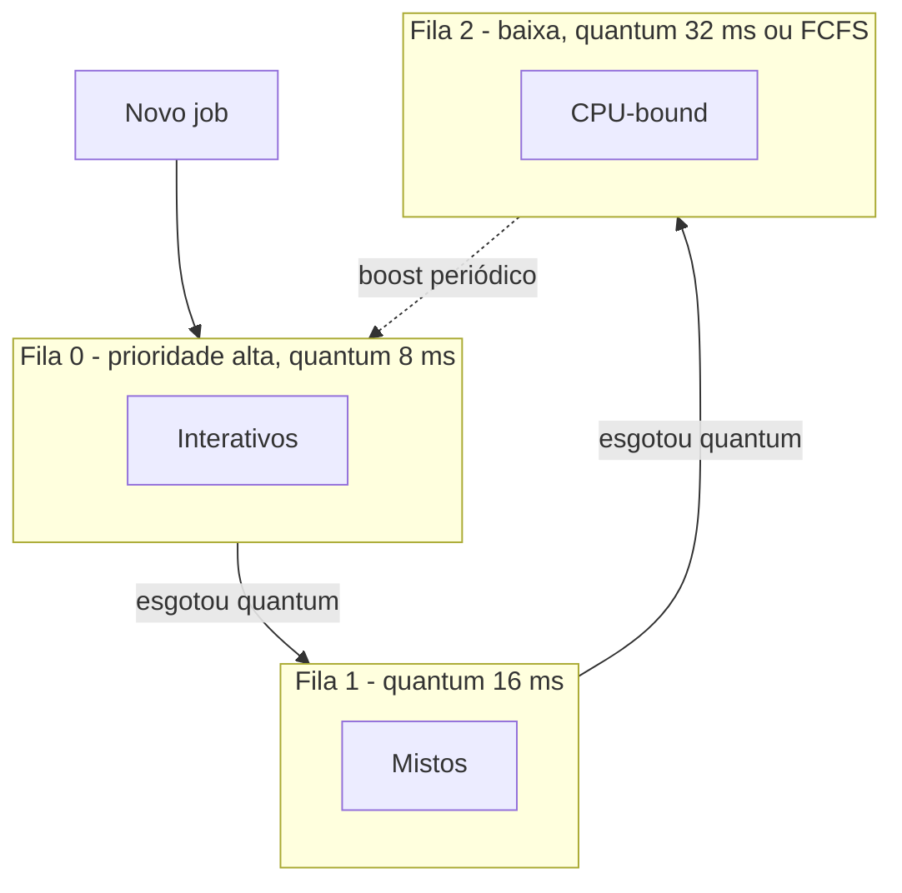

# MLFQ - Multilevel Feedback Queue

## Resumo

O **MLFQ** usa **várias filas de prioridades** e **move os processos entre elas conforme o comportamento observado**, aproximando o SJF **sem conhecer o burst**: processos interativos (bursts curtos) ficam nas filas altas; CPU-bound descem. Variantes são usadas no Windows, macOS, BSD e Solaris.

## Regras clássicas

1. Se prioridade(A) > prioridade(B), executa A.
2. Se iguais, [[Round Robin]] entre eles.
3. Todo job novo entra na **fila de maior prioridade**.
4. Se o job **usa todo o quantum** do nível, **desce** uma fila.
5. Se **libera a CPU** antes do quantum (E/S), **permanece**.
6. A cada período *S*, **todos sobem** para a fila mais alta (*priority boost*) para evitar inanição e adaptar mudanças de comportamento.



## Exemplo de simulação

```python
class Job:
    def __init__(s, nome, burst): s.nome, s.restante, s.nivel = nome, burst, 0

QUANTA = [8, 16, 32]          # quantum por nível

def mlfq(jobs):
    filas = [list(jobs), [], []]
    t = 0
    while any(filas):
        n = next(i for i, f in enumerate(filas) if f)   # nível mais alto não vazio
        j = filas[n].pop(0)
        run = min(QUANTA[n], j.restante)
        t += run; j.restante -= run
        if j.restante == 0:
            print(f"{j.nome} terminou em t={t}")
        else:
            j.nivel = min(n + 1, 2)         # usou o quantum: desce
            filas[j.nivel].append(j)

mlfq([Job("interativo", 5), Job("batch", 60), Job("misto", 20)])
```

## Manipulação (gaming) e a regra de contabilidade

> [!warning] Ataque ao MLFQ
> Um processo pode emitir uma E/S inútil pouco antes do fim do quantum para **nunca descer** de fila. A correção é **contabilizar o tempo total de CPU usado no nível**, independentemente de quantas vezes libera a CPU.

## Parâmetros de projeto

- Número de filas e quantum por fila.
- Intervalo do *priority boost*.
- Política dentro de cada fila.
- Critério de promoção/rebaixamento.

## Em sistemas reais

- **Windows**: prioridades dinâmicas com *boost* ao concluir E/S ou ao receber foco; quantum maior para o processo em primeiro plano.
- **FreeBSD (ULE)** e **Solaris**: tabelas de despacho multinível.
- **Linux** usa o [[CFS - Completely Fair Scheduler]] (ou EEVDF), que abandonou a abordagem de filas explícitas para tempo compartilhado.

## Vantagens e desvantagens

| Vantagens | Desvantagens |
|---|---|
| Bom tempo de resposta para interativos | Muitos parâmetros a ajustar |
| Boa vazão para CPU-bound (quanta maiores) | Pode ser manipulado sem contabilização |
| Adapta-se sem conhecer bursts | Boost pode prejudicar interativos momentaneamente |
| Combina ideias de SJF e RR | Complexidade maior que RR simples |

## Pontos-chave

- Prioridade dinâmica: usa muito a CPU, desce; libera a CPU, fica.
- Boost periódico evita inanição.
- Aproxima SJF com observação de comportamento.

## Veja também

[[Escalonamento por Prioridades]] · [[SJF e SRTF - Menor Job Primeiro]] · [[MOC - Escalonamento]]
