# Round Robin

## Resumo

O **Round Robin (RR)** é o FCFS com **preempção por quantum**: cada processo recebe a CPU por, no máximo, uma fatia de tempo *q*; se não terminar, volta ao **fim da fila de prontos**. É o algoritmo clássico de [[SO de Tempo Compartilhado]].

## Exemplo (q = 4)

| Processo | Burst |
|---|---|
| P1 | 24 |
| P2 | 3 |
| P3 | 3 |

```mermaid
gantt
    title Round Robin com quantum 4
    dateFormat  X
    axisFormat %s
    section CPU
    P1 :0, 4
    P2 :4, 3
    P3 :7, 3
    P1 :10, 4
    P1 :14, 4
    P1 :18, 4
    P1 :22, 4
    P1 :26, 4
```



Esperas: P1 = 10 - 4 = 6, P2 = 4, P3 = 7. **Média = 5,67** (contra 17 no [[FCFS - First Come, First Served]] com a mesma ordem).

## Escolha do quantum

| Quantum | Efeito |
|---|---|
| Muito grande | Degenera para FCFS; resposta ruim |
| Muito pequeno | Muitas trocas de contexto; overhead alto ([[Context Switch (Troca de Contexto)]]) |
| Regra prática | Maior que o custo da troca; cerca de 80% dos bursts devem caber em um quantum |

Se há *n* processos prontos e quantum *q*, nenhum espera mais que **(n−1)·q** para receber a CPU: **resposta limitada**.

> [!tip] Valores típicos
> Entre 10 ms e 100 ms em sistemas de uso geral; o custo da troca é de microssegundos.

## Implementação

```c
// Núcleo do RR em um simulador
while (!fila_vazia(&prontos)) {
    pcb *p = desenfileirar(&prontos);
    int fatia = (p->restante < QUANTUM) ? p->restante : QUANTUM;
    executar(p, fatia);
    tempo += fatia;
    p->restante -= fatia;
    if (p->restante > 0) enfileirar(&prontos, p);   // volta ao fim
    else registrar_termino(p, tempo);
}
```

## No Linux

A classe `SCHED_RR` de tempo real usa RR dentro de cada prioridade:

```bash
cat /proc/sys/kernel/sched_rr_timeslice_ms     # quantum do SCHED_RR (padrão 100 ms)
sudo chrt -r 20 ./tarefa                        # SCHED_RR, prioridade 20
```

## Vantagens e desvantagens

| Vantagens | Desvantagens |
|---|---|
| Justo e simples | Tempo de retorno médio pior que SJF |
| Boa resposta para interativos | Overhead de trocas |
| Sem inanição | Desempenho depende do quantum |
| Previsível (resposta limitada) | Trata todos igualmente, ignorando prioridade (sem extensões) |

## Pontos-chave

- FCFS + preempção por quantum.
- Quantum equilibra resposta e overhead.
- Base de muitos escalonadores reais, combinados com prioridades ([[MLFQ - Multilevel Feedback Queue]]).

## Veja também

[[FCFS - First Come, First Served]] · [[MLFQ - Multilevel Feedback Queue]] · [[MOC - Escalonamento]]
