# SJF e SRTF - Menor Job Primeiro

## Resumo

O **SJF** (*Shortest Job First*) escolhe, entre os prontos, o processo com **menor próximo burst de CPU**. Sua versão **preemptiva** é o **SRTF** (*Shortest Remaining Time First*): se chega um processo com tempo restante menor que o do atual, ele toma a CPU. O SJF é **comprovadamente ótimo** para **tempo médio de espera**.

## Exemplo (SJF não preemptivo)

| Processo | Chegada | Burst |
|---|---|---|
| P1 | 0 | 7 |
| P2 | 2 | 4 |
| P3 | 4 | 1 |
| P4 | 5 | 4 |

```mermaid
gantt
    title SJF não preemptivo
    dateFormat  X
    axisFormat %s
    section CPU
    P1 :0, 7
    P3 :7, 1
    P2 :8, 4
    P4 :12, 4
```



Esperas: P1 = 0, P3 = 7 - 4 = 3, P2 = 8 - 2 = 6, P4 = 12 - 5 = 7. **Média = 4**.

## SRTF (preemptivo) no mesmo exemplo

```mermaid
gantt
    title SRTF
    dateFormat  X
    axisFormat %s
    section CPU
    P1 :0, 2
    P2 :2, 2
    P3 :4, 1
    P2 :5, 2
    P4 :7, 4
    P1 :11, 5
```



Esperas: P1 = 16 - 0 - 7 = 9, P2 = 7 - 2 - 4 = 1, P3 = 0, P4 = 2. **Média = 3**, melhor que o não preemptivo.

## O problema: prever o próximo burst

O kernel não conhece o futuro. Estima-se por **média exponencial** dos bursts anteriores:

`τ(n+1) = α · t(n) + (1 − α) · τ(n)`, com 0 ≤ α ≤ 1 (α = 0,5 é comum).

```python
def prever(historico, alpha=0.5, tau0=10):
    tau = tau0
    for t in historico:
        tau = alpha * t + (1 - alpha) * tau
    return tau

print(prever([6, 4, 6, 4, 13, 13, 13]))   # estimativa do próximo burst
```

## Inanição

> [!warning] Starvation
> Processos longos podem nunca executar se houver fluxo contínuo de curtos. Solução: **envelhecimento** (*aging*), aumentando a prioridade de quem espera muito. Ver [[Escalonamento por Prioridades]].

## Vantagens e desvantagens

| Vantagens | Desvantagens |
|---|---|
| Menor tempo médio de espera (ótimo) | Exige conhecer/estimar o burst |
| Favorece tarefas interativas curtas | Inanição de processos longos |
| Alta vazão em lote | SRTF aumenta trocas de contexto |

## Onde aparece

Escalonadores de [[SO em Lote (Batch)]], filas de pedidos de disco (SSTF, shortest seek time first), e como inspiração dos escalonadores multinível como o [[MLFQ - Multilevel Feedback Queue]], que aproxima SJF sem conhecer os bursts.

## Pontos-chave

- Ótimo em espera média, mas impraticável sem previsão.
- SRTF é a versão preemptiva.
- Envelhecimento evita inanição.

## Veja também

[[FCFS - First Come, First Served]] · [[MLFQ - Multilevel Feedback Queue]] · [[MOC - Escalonamento]]
