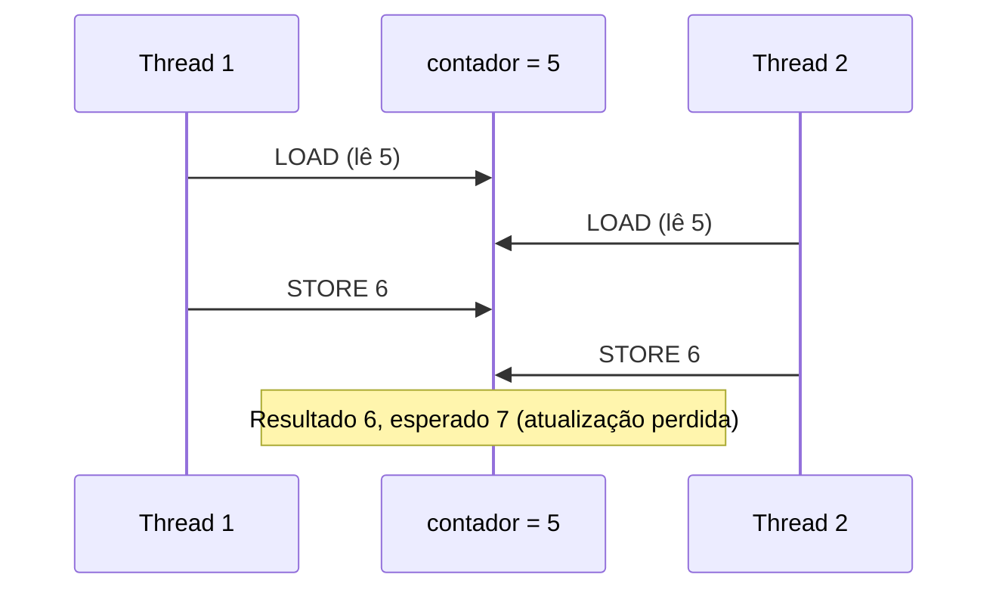

# Condições de Corrida

## Resumo

Uma **condição de corrida** (*race condition*) ocorre quando o resultado de um programa depende da **ordem de intercalação** de acessos concorrentes a dados compartilhados, com pelo menos uma escrita. O resultado é **não determinístico** e muitas vezes raro, o que torna o bug difícil de reproduzir.

## Exemplo clássico: `contador++`

A instrução `contador++` não é atômica; compila para três passos:

```text
1. LOAD  R, [contador]
2. ADD   R, 1
3. STORE [contador], R
```



## Código que demonstra a corrida

```c
#include <pthread.h>
#include <stdio.h>

long contador = 0;

void *incrementa(void *arg) {
    for (int i = 0; i < 1000000; i++)
        contador++;                 // corrida de dados
    return NULL;
}

int main(void) {
    pthread_t a, b;
    pthread_create(&a, NULL, incrementa, NULL);
    pthread_create(&b, NULL, incrementa, NULL);
    pthread_join(a, NULL);
    pthread_join(b, NULL);
    printf("esperado 2000000, obtido %ld\n", contador);   // valor menor, varia a cada execução
    return 0;
}
```

```bash
gcc -pthread -O2 corrida.c -o corrida && for i in 1 2 3; do ./corrida; done
# Detectar automaticamente com ThreadSanitizer
gcc -pthread -fsanitize=thread -g corrida.c -o corrida_tsan && ./corrida_tsan
```

## Tipos relacionados

| Tipo | Descrição |
|---|---|
| **Data race** | Acesso concorrente sem sincronização, com ao menos uma escrita (comportamento indefinido em C/C++) |
| **Race condition** de lógica | Mesmo com acessos atômicos, a ordem dos eventos altera o resultado |
| **TOCTOU** | *Time of check to time of use*: verifica uma condição e age depois, mas o estado mudou |
| **Check-then-act** | Verifica `if (!existe)` e depois cria; outro cria no meio |

> [!warning] TOCTOU em segurança
> Um programa privilegiado que verifica `access("/tmp/f")` e depois `open("/tmp/f")` pode ser enganado por um link simbólico trocado entre as chamadas. Solução: abrir diretamente com flags (`O_NOFOLLOW`, `O_EXCL`) e checar permissões no descritor.

## Como evitar

1. **Não compartilhar** (dados locais da thread, imutáveis, passagem de mensagens).
2. **Exclusão mútua** com [[Mutex]] protegendo a [[Seção Crítica]].
3. **Operações atômicas** para casos simples ([[Operações Atômicas e Spinlocks]]).
4. Estruturas de dados *lock-free* ou **concorrentes** prontas.
5. Ferramentas: ThreadSanitizer, Helgrind (`valgrind --tool=helgrind`), análise estática.

```python
# Python: mesmo com GIL, check-then-act e += não são atômicos
import threading
total = 0
lock = threading.Lock()
def soma():
    global total
    for _ in range(100000):
        with lock:
            total += 1
ts = [threading.Thread(target=soma) for _ in range(4)]
[t.start() for t in ts]; [t.join() for t in ts]
print(total)   # 400000
```

## Pontos-chave

- Corrida = resultado dependente da intercalação de acessos concorrentes.
- `x++` não é atômico.
- Proteja dados compartilhados ou evite compartilhar.

## Veja também

[[Seção Crítica]] · [[Mutex]] · [[MOC - Sincronização]]
