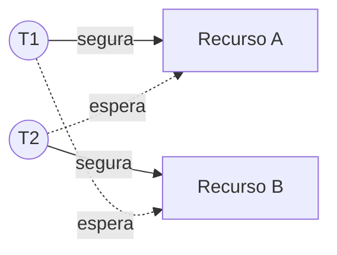

# Deadlock (Impasse)

## Resumo

Um **deadlock** ocorre quando um conjunto de processos ou threads fica **bloqueado para sempre**, cada um esperando por um recurso que outro do conjunto detém. Nenhum progresso é possível sem intervenção externa.

## Exemplo mínimo

```c
pthread_mutex_t A = PTHREAD_MUTEX_INITIALIZER, B = PTHREAD_MUTEX_INITIALIZER;

void *t1(void *x) { pthread_mutex_lock(&A); sleep(1); pthread_mutex_lock(&B); /* ... */ }
void *t2(void *x) { pthread_mutex_lock(&B); sleep(1); pthread_mutex_lock(&A); /* ... */ }
// T1 segura A e espera B; T2 segura B e espera A: deadlock
```



## As quatro condições de Coffman

Todas precisam ocorrer **simultaneamente**:

| Condição | Significado |
|---|---|
| **Exclusão mútua** | O recurso só pode ser usado por um de cada vez |
| **Posse e espera** (*hold and wait*) | Quem segura recursos pode pedir outros |
| **Não preempção** | Recurso não pode ser tomado à força |
| **Espera circular** | Existe um ciclo de esperas T1 → T2 → ... → T1 |

> [!tip] Estratégia
> Para evitar deadlocks, basta **quebrar uma** dessas condições. Ver [[Soluções para Deadlock]].

## Grafo de alocação de recursos

- Nós de **processo** (círculos) e de **recurso** (retângulos).
- Aresta recurso → processo: alocação. Processo → recurso: requisição.
- Com **uma instância** por recurso: ciclo = deadlock.
- Com **várias instâncias**: ciclo é necessário, mas não suficiente.

## Deadlock x livelock x inanição

| Fenômeno | Estado | Exemplo |
|---|---|---|
| **Deadlock** | Bloqueados, sem progresso | Dois mutexes em ordem oposta |
| **Livelock** | Ativos, mas sem progresso útil | Duas pessoas num corredor, ambas se desviando para o mesmo lado; retentativas coordenadas demais |
| **Inanição** | Alguém nunca é atendido, o sistema progride | Escritor esperando para sempre numa política que favorece leitores |

## Deadlocks reais

- **Bancos de dados**: duas transações travam linhas em ordens diferentes. O SGBD detecta e aborta uma (`deadlock detected`).
- **Kernel**: tentar pegar o mesmo spinlock em uma ISR (`lockdep` detecta).
- **Aplicações GUI**: thread de interface esperando a de trabalho, que espera a de interface.
- **Recursos de rede/IPC**: pipes cheios com ambos os lados escrevendo antes de ler.

## Diagnóstico

```bash
# Linux: onde as threads estão presas?
gdb -p $(pidof app) -batch -ex "thread apply all bt" | head -60
cat /proc/$(pidof app)/stack           # pilha no kernel (root)
cat /proc/$(pidof app)/wchan; echo     # função do kernel em que dorme
ps -eLo pid,tid,stat,wchan:32,cmd | awk '$3 ~ /D/'
# Detecção em desenvolvimento
valgrind --tool=helgrind ./app         # ordem de travas inconsistente
```

```bash
# Java
jstack <pid> | grep -A5 "Found one Java-level deadlock"
```

```sql
-- PostgreSQL: bloqueios em espera
SELECT pid, wait_event_type, wait_event, query FROM pg_stat_activity WHERE wait_event_type = 'Lock';
```

## Pontos-chave

- Quatro condições de Coffman, todas necessárias.
- Ciclo no grafo de espera = deadlock (instância única).
- Diferente de livelock e inanição.

## Veja também

[[Soluções para Deadlock]] · [[Problemas Clássicos de Sincronização]] · [[MOC - Sincronização]]
