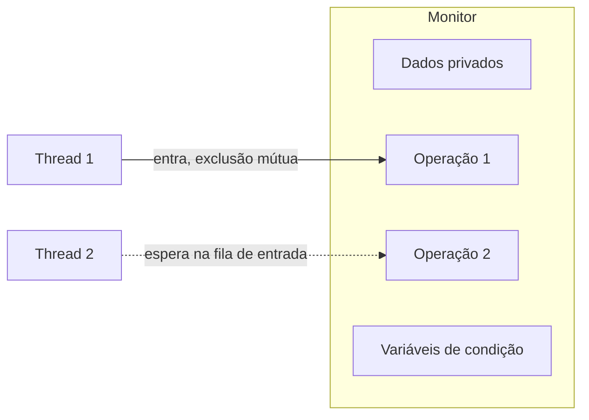

# Monitores e Variáveis de Condição

## Resumo

Um **monitor** (Hoare, Brinch Hansen) é um módulo que encapsula **dados compartilhados** e as **operações** sobre eles, garantindo que **no máximo uma thread execute dentro do monitor por vez**. A exclusão mútua é **automática**, definida pela linguagem ou biblioteca. Para esperar condições, usam-se **variáveis de condição**.

## Estrutura



## Variáveis de condição

| Operação | Efeito |
|---|---|
| `wait(cond, mutex)` | Libera o mutex **atomicamente** e dorme; ao acordar, readquire o mutex |
| `signal(cond)` | Acorda uma thread que espera na condição |
| `broadcast(cond)` | Acorda todas |

> [!warning] Sempre use `while`, nunca `if`
> Pode haver **despertares espúrios**, e em monitores estilo **Mesa** (padrão em pthreads, Java, Go) o estado pode ter mudado entre o `signal` e a retomada. Reteste a condição em laço:
> `while (!condicao) wait(cond, mutex);`

**Hoare** (signal-and-wait): quem sinaliza cede o monitor imediatamente ao acordado; condição é garantida. **Mesa** (signal-and-continue): quem sinaliza continua; acordado precisa retestar.

## Exemplo: buffer limitado com pthreads

```c
#include <pthread.h>
#define N 8

int buf[N], entrada = 0, saida = 0, cont = 0;
pthread_mutex_t m = PTHREAD_MUTEX_INITIALIZER;
pthread_cond_t nao_cheio = PTHREAD_COND_INITIALIZER;
pthread_cond_t nao_vazio = PTHREAD_COND_INITIALIZER;

void produzir(int x) {
    pthread_mutex_lock(&m);
    while (cont == N)                         // while, não if
        pthread_cond_wait(&nao_cheio, &m);
    buf[entrada] = x; entrada = (entrada + 1) % N; cont++;
    pthread_cond_signal(&nao_vazio);
    pthread_mutex_unlock(&m);
}

int consumir(void) {
    pthread_mutex_lock(&m);
    while (cont == 0)
        pthread_cond_wait(&nao_vazio, &m);
    int x = buf[saida]; saida = (saida + 1) % N; cont--;
    pthread_cond_signal(&nao_cheio);
    pthread_mutex_unlock(&m);
    return x;
}
```

## Monitores nas linguagens

```java
// Java: cada objeto é um monitor; synchronized + wait/notify
class Buffer {
    private final int[] dados = new int[8];
    private int cont = 0, entrada = 0, saida = 0;

    public synchronized void produzir(int x) throws InterruptedException {
        while (cont == dados.length) wait();
        dados[entrada] = x; entrada = (entrada + 1) % dados.length; cont++;
        notifyAll();
    }
    public synchronized int consumir() throws InterruptedException {
        while (cont == 0) wait();
        int x = dados[saida]; saida = (saida + 1) % dados.length; cont--;
        notifyAll();
        return x;
    }
}
```

```python
import threading
cond = threading.Condition()
fila = []
def consumir():
    with cond:
        while not fila:
            cond.wait()
        return fila.pop(0)
def produzir(x):
    with cond:
        fila.append(x)
        cond.notify()
```

Em Go, a alternativa idiomática é usar **canais** (CSP): "não comunique compartilhando memória; compartilhe memória comunicando".

## Vantagens e desvantagens

| Vantagens | Desvantagens |
|---|---|
| Exclusão mútua automática: menos erros | Exige suporte da linguagem ou disciplina de uso |
| Código mais legível que semáforos | Monitor grande vira gargalo de paralelismo |
| Condições explícitas e localizadas | Despertares espúrios exigem laço `while` |

## Pontos-chave

- Monitor = dados + operações + exclusão mútua implícita.
- Variáveis de condição: `wait` libera o mutex atomicamente.
- Reteste a condição em `while`.

## Veja também

[[Semáforos]] · [[Problemas Clássicos de Sincronização]] · [[MOC - Sincronização]]
