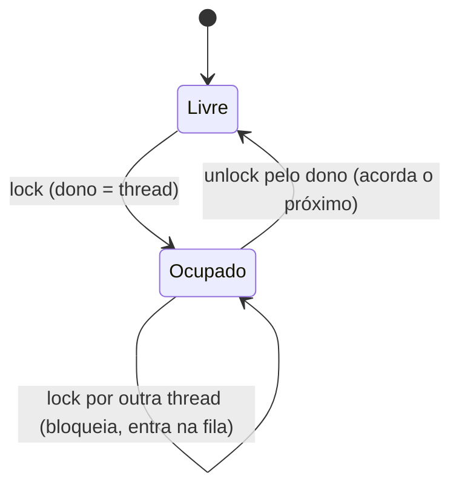

# Mutex

## Resumo

O **mutex** (*mutual exclusion lock*) é uma trava binária com **dono**: apenas a thread que o adquiriu pode liberá-lo. Garante exclusão mútua na [[Seção Crítica]]. Threads que não conseguem a trava **dormem** (saem da fila de prontos) em vez de girar.

## Operações

| Operação | Efeito |
|---|---|
| `lock` | Obtém a trava; bloqueia se ocupada |
| `trylock` | Tenta obter; retorna falha imediatamente se ocupada |
| `unlock` | Libera; acorda um dos bloqueados |
| `timedlock` | Espera com limite de tempo |



## Implementação típica (futex no Linux)

O **futex** (*fast userspace mutex*) evita syscall no caso comum:

1. **Caminho rápido (sem contenção)**: uma instrução atômica (CAS) em user space.
2. **Caminho lento (contenção)**: `futex(FUTEX_WAIT)` coloca a thread para dormir no kernel; `FUTEX_WAKE` acorda.

```c
// Esquema simplificado de mutex sobre futex (3 estados: 0 livre, 1 ocupado, 2 ocupado com esperando)
void lock(atomic_int *m) {
    int c = 0;
    if (atomic_compare_exchange_strong(m, &c, 1)) return;       // fast path
    if (c != 2) c = atomic_exchange(m, 2);
    while (c != 0) {
        futex_wait(m, 2);                                        // dorme no kernel
        c = atomic_exchange(m, 2);
    }
}
void unlock(atomic_int *m) {
    if (atomic_exchange(m, 0) == 2) futex_wake(m, 1);            // só chama o kernel se há esperando
}
```

## Exemplo com pthreads

```c
#include <pthread.h>
#include <stdio.h>

pthread_mutex_t m = PTHREAD_MUTEX_INITIALIZER;
int saldo = 100;

void *saque(void *arg) {
    pthread_mutex_lock(&m);
    if (saldo >= 80) {
        // check-then-act protegido: sem mutex, duas threads sacariam
        saldo -= 80;
        printf("sacou, saldo=%d\n", saldo);
    }
    pthread_mutex_unlock(&m);
    return NULL;
}
```

## Tipos

| Tipo | Comportamento |
|---|---|
| Normal | Relock pela mesma thread causa deadlock |
| **Recursivo** | A mesma thread pode adquirir várias vezes; precisa liberar o mesmo número |
| **Error-checking** | Detecta relock e unlock indevido, retorna erro |
| **Robusto** | Se o dono morre, o próximo recebe `EOWNERDEAD` |
| **Com herança de prioridade** | Evita inversão de prioridade ([[Escalonamento de Tempo Real]]) |

## Em outras linguagens

```python
import threading
m = threading.Lock()
with m:
    ...                       # seção crítica
```

```go
var mu sync.Mutex
mu.Lock()
defer mu.Unlock()             // libera ao sair da função
```

```powershell
# Windows: mutex nomeado entre processos
$m = New-Object System.Threading.Mutex($false, "Global\MeuMutex")
if ($m.WaitOne(1000)) { try { "na seção crítica" } finally { $m.ReleaseMutex() } }
```

## Mutex x Semáforo binário

| | Mutex | Semáforo binário |
|---|---|---|
| Dono | Sim: só quem trancou libera | Não: qualquer um pode fazer `signal` |
| Uso | Exclusão mútua | Exclusão ou sinalização entre threads |
| Herança de prioridade | Possível | Não aplicável |

## Armadilhas

> [!warning] Erros comuns
> - Esquecer de liberar em caminhos de erro (use RAII/`with`/`defer`).
> - Adquirir várias travas em ordens diferentes: [[Deadlock (Impasse)]].
> - Segurar a trava durante E/S ou chamadas desconhecidas.
> - Trava global única que serializa tudo (*lock contention*).

## Vantagens e desvantagens

| Vantagens | Desvantagens |
|---|---|
| Simples e correto para exclusão mútua | Contenção reduz paralelismo |
| Não desperdiça CPU ao esperar | Risco de deadlock e inversão de prioridade |
| Disponível em todas as linguagens e SOs | Custo de troca de contexto sob contenção |

## Pontos-chave

- Trava com dono; espera dormindo.
- Futex: caminho rápido em user space, kernel só sob contenção.
- Use sempre liberação automática e ordem global de travas.

## Veja também

[[Semáforos]] · [[Monitores e Variáveis de Condição]] · [[MOC - Sincronização]]
