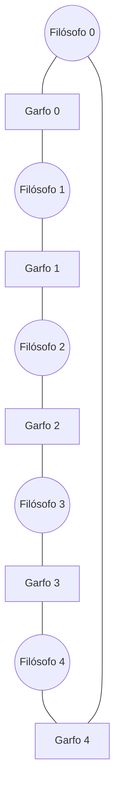

# Problemas Clássicos de Sincronização

## Resumo

Três problemas-modelo aparecem em sistemas reais: **produtor-consumidor** (filas e buffers), **leitores-escritores** (caches e bancos de dados) e **jantar dos filósofos** (aquisição de múltiplos recursos).

## 1. Produtor-Consumidor (buffer limitado)

Produtores inserem itens em um buffer de N posições; consumidores os retiram. Requisitos: não inserir em buffer cheio, não retirar de vazio, exclusão mútua no acesso.


Solução com três semáforos:

```c
sem_t vazias;   // inicial N  - posições livres
sem_t cheias;   // inicial 0  - itens disponíveis
sem_t mutex;    // inicial 1  - exclusão mútua no buffer

void produtor(void) {
    for (;;) {
        item x = produzir_item();
        sem_wait(&vazias);       // espera espaço
        sem_wait(&mutex);
        inserir(x);
        sem_post(&mutex);
        sem_post(&cheias);       // sinaliza item
    }
}
void consumidor(void) {
    for (;;) {
        sem_wait(&cheias);       // espera item
        sem_wait(&mutex);
        item x = remover();
        sem_post(&mutex);
        sem_post(&vazias);       // sinaliza espaço
        consumir_item(x);
    }
}
```

> [!warning] Ordem importa
> Se o produtor fizesse `wait(mutex)` **antes** de `wait(vazias)`, com o buffer cheio ele seguraria o mutex dormindo, e o consumidor nunca conseguiria entrar: **deadlock**.

Na prática, use filas bloqueantes prontas:

```python
import queue, threading
q = queue.Queue(maxsize=8)       # bloqueia automaticamente
def prod():
    for i in range(20): q.put(i)
def cons():
    for _ in range(20): print(q.get())
threading.Thread(target=prod).start(); threading.Thread(target=cons).start()
```

## 2. Leitores-Escritores

Vários leitores podem acessar simultaneamente; um escritor precisa de acesso exclusivo.

| Variante | Prioridade | Risco |
|---|---|---|
| Primeiro problema | Leitores | Inanição de escritores |
| Segundo problema | Escritores | Inanição de leitores |
| Justa | Ordem de chegada | Menos paralelismo |

```c
// Prioridade aos leitores
sem_t mutex_cont;   // 1: protege 'leitores'
sem_t area;         // 1: acesso exclusivo à área
int leitores = 0;

void leitor(void) {
    sem_wait(&mutex_cont);
    if (++leitores == 1) sem_wait(&area);     // primeiro leitor bloqueia escritores
    sem_post(&mutex_cont);

    ler();

    sem_wait(&mutex_cont);
    if (--leitores == 0) sem_post(&area);     // último leitor libera
    sem_post(&mutex_cont);
}
void escritor(void) {
    sem_wait(&area);
    escrever();
    sem_post(&area);
}
```

Em bibliotecas: `pthread_rwlock_t`, `std::shared_mutex`, `sync.RWMutex` (Go). Em kernels: **RCU** (Read-Copy-Update), com leituras sem trava.

## 3. Jantar dos Filósofos

Cinco filósofos em uma mesa, um garfo entre cada par. Para comer, cada um precisa dos **dois** garfos adjacentes. Se todos pegarem o garfo esquerdo ao mesmo tempo, ocorre **deadlock**.



Soluções:

| Solução | Como evita o deadlock |
|---|---|
| **Ordem global de recursos** | Sempre pegar primeiro o garfo de menor número; quebra a espera circular |
| Limitar a N−1 filósofos à mesa | Sempre sobra um garfo livre |
| Garfos pegos atomicamente | Elimina "segura e espera" |
| Árbitro/garçom | Controle centralizado |

```c
// Ordem global: o filósofo i pega primeiro o menor índice
void filosofo(int i) {
    int a = i, b = (i + 1) % 5;
    int primeiro = a < b ? a : b, segundo = a < b ? b : a;
    for (;;) {
        pensar();
        pthread_mutex_lock(&garfo[primeiro]);
        pthread_mutex_lock(&garfo[segundo]);
        comer();
        pthread_mutex_unlock(&garfo[segundo]);
        pthread_mutex_unlock(&garfo[primeiro]);
    }
}
```

## Pontos-chave

- Produtor-consumidor: três semáforos (`vazias`, `cheias`, `mutex`) ou fila bloqueante.
- Leitores-escritores: escolha a política para evitar inanição.
- Filósofos: ordem global de aquisição elimina o deadlock.

## Veja também

[[Semáforos]] · [[Monitores e Variáveis de Condição]] · [[Deadlock (Impasse)]] · [[MOC - Sincronização]]
