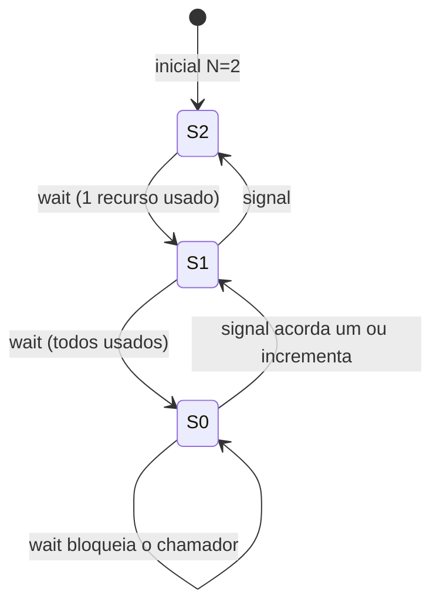

# Semáforos

## Resumo

O **semáforo** (Dijkstra, 1965) é um inteiro não negativo com duas operações **atômicas**:

- **`P` / `wait` / `down`**: se o valor > 0, decrementa; senão, bloqueia o chamador.
- **`V` / `signal` / `up`**: incrementa e, se há bloqueados, acorda um.

## Tipos

| Tipo | Valor inicial | Uso |
|---|---|---|
| **Binário** | 0 ou 1 | Exclusão mútua (similar a mutex, sem dono) |
| **Contador** | N | Controlar acesso a um conjunto de N recursos idênticos (conexões, buffers) |
| **Sinalização** | 0 | Uma thread espera um evento que outra sinaliza |



## Implementação conceitual

```c
typedef struct { int valor; fila_t espera; } semaforo;

void wait(semaforo *s) {          // atômico
    s->valor--;
    if (s->valor < 0) {
        enfileirar(&s->espera, thread_atual());
        bloquear();               // dorme
    }
}
void signal(semaforo *s) {        // atômico
    s->valor++;
    if (s->valor <= 0)
        acordar(desenfileirar(&s->espera));
}
```

## Exemplo POSIX

```c
#include <semaphore.h>
#include <pthread.h>
#include <stdio.h>
#include <unistd.h>

sem_t vagas;     // no máximo 3 threads simultâneas

void *trabalhador(void *arg) {
    sem_wait(&vagas);
    printf("thread %ld usando recurso\n", (long)arg);
    sleep(1);
    sem_post(&vagas);
    return NULL;
}

int main(void) {
    sem_init(&vagas, 0, 3);
    pthread_t t[8];
    for (long i = 0; i < 8; i++) pthread_create(&t[i], NULL, trabalhador, (void*)i);
    for (int i = 0; i < 8; i++) pthread_join(t[i], NULL);
    sem_destroy(&vagas);
    return 0;
}
```

## Sinalização (ordem de execução)

```python
import threading
pronto = threading.Semaphore(0)

def produtor():
    print("preparando dados...")
    pronto.release()            # signal

def consumidor():
    pronto.acquire()            # wait: só continua após o produtor
    print("usando dados")

threading.Thread(target=consumidor).start()
threading.Thread(target=produtor).start()
```

## Semáforos entre processos

- **POSIX nomeados**: `sem_open("/nome", ...)`, em `/dev/shm`.
- **System V**: `semget`, `semop`, `semctl`; veja com `ipcs -s`.
- **Windows**: `CreateSemaphore`.

```bash
ls -l /dev/shm | grep sem
ipcs -s
```

## Armadilhas

> [!warning] Erros típicos
> - Trocar a ordem de `wait`/`signal` causa **deadlock** ([[Deadlock (Impasse)]]).
> - Esquecer `signal` deixa threads dormindo para sempre.
> - Sem dono: qualquer thread pode `signal`, o que facilita erros.
> - **Inversão de prioridade** sem herança.

## Vantagens e desvantagens

| Vantagens | Desvantagens |
|---|---|
| Versáteis: exclusão, contagem e sinalização | Baixo nível; propensos a erro |
| Funcionam entre processos | Sem noção de dono (difícil depurar) |
| Base de problemas clássicos ([[Problemas Clássicos de Sincronização]]) | Mais difíceis de raciocinar que [[Monitores e Variáveis de Condição]] |

## Pontos-chave

- `wait` decrementa/bloqueia; `signal` incrementa/acorda.
- Contador gerencia N recursos; binário aproxima um mutex.
- Cuidado com a ordem das operações.

## Veja também

[[Mutex]] · [[Monitores e Variáveis de Condição]] · [[Problemas Clássicos de Sincronização]] · [[MOC - Sincronização]]
