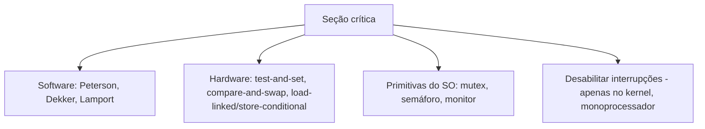

# Seção Crítica

## Resumo

A **seção crítica** é o trecho de código que acessa dados compartilhados e que **não pode ser executado por mais de uma thread ao mesmo tempo**. O problema da seção crítica consiste em projetar um protocolo de entrada e saída que garanta a correção.

## Estrutura

```c
while (true) {
    /* seção de entrada: pede permissão */
    /* SEÇÃO CRÍTICA: acessa dados compartilhados */
    /* seção de saída: libera */
    /* seção restante */
}
```

## Os três requisitos

| Requisito | Significado |
|---|---|
| **Exclusão mútua** | No máximo uma thread na seção crítica |
| **Progresso** | Se ninguém está na seção e alguns querem entrar, a escolha de quem entra não pode ser adiada indefinidamente e só depende dos que querem entrar |
| **Espera limitada** | Existe um limite de quantas vezes outros entram antes de uma thread que já pediu (sem inanição) |

## Solução de Peterson (duas threads, software puro)

```c
// i = 0 ou 1; j = 1 - i
volatile int quer[2] = {0, 0};
volatile int vez = 0;

void entrar(int i) {
    int j = 1 - i;
    quer[i] = 1;          // declaro interesse
    vez = j;              // cedo a vez ao outro
    while (quer[j] && vez == j) ;   // espera ocupada
}
void sair(int i) { quer[i] = 0; }
```

> [!warning] Peterson em hardware moderno
> Em CPUs reais com **reordenação de memória** e caches, o algoritmo só funciona com **barreiras de memória** (`atomic_thread_fence`, `std::atomic` com `seq_cst`). Por isso, na prática, usam-se primitivas de hardware e do SO.

## Soluções por nível



| Técnica | Quando usar |
|---|---|
| Desabilitar interrupções | Kernel, seções muito curtas, monoprocessador |
| [[Operações Atômicas e Spinlocks]] | Seções curtíssimas em multiprocessador |
| [[Mutex]] | Seções de duração média, com bloqueio e sono |
| [[Semáforos]] | Recursos contáveis e sinalização |
| [[Monitores e Variáveis de Condição]] | Estrutura orientada a objetos com condições |

## Boas práticas

- **Mantenha a seção crítica curta**: a granularidade da trava afeta o paralelismo.
- Nunca faça **E/S bloqueante** dentro da seção crítica, se possível.
- Respeite uma **ordem global** de aquisição de várias travas ([[Deadlock (Impasse)]]).
- Prefira **RAII/`with`/`defer`** para garantir a liberação mesmo com exceções.

```python
import threading
lock = threading.Lock()
with lock:                 # libera automaticamente, mesmo com exceção
    atualizar_estado_compartilhado()
```

```cpp
{
    std::lock_guard<std::mutex> g(mtx);   // RAII: destrutor libera
    saldo += valor;
}
```

## Pontos-chave

- Três requisitos: exclusão mútua, progresso e espera limitada.
- Software puro existe (Peterson), mas na prática usa-se hardware e SO.
- Seções críticas curtas e com ordem de travas definida evitam problemas.

## Veja também

[[Condições de Corrida]] · [[Mutex]] · [[MOC - Sincronização]]
