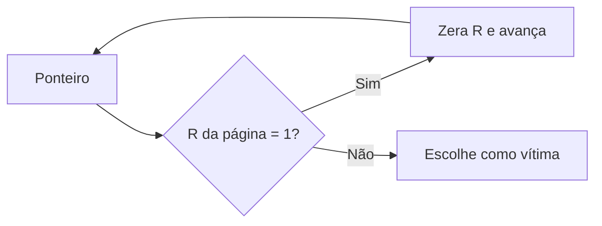

# Algoritmos de Substituição de Páginas

## Resumo

Quando ocorre um [[Page Faults|page fault]] e **não há quadro livre**, o SO precisa **escolher uma vítima** a remover. O objetivo é minimizar o número de faltas futuras. Se a vítima está **suja** (bit D), precisa ser gravada em disco antes de reutilizar o quadro.

## Algoritmos

| Algoritmo | Critério de remoção | Observação |
|---|---|---|
| **Ótimo (Belady/OPT)** | Página que será usada mais tarde no futuro | Inviável (exige futuro); serve de referência |
| **FIFO** | Mais antiga na memória | Simples; sofre **anomalia de Belady** |
| **LRU** | Menos recentemente usada | Bom; caro de implementar exatamente |
| **Clock (segunda chance)** | Aproxima LRU com bit de referência | Usado na prática |
| **NRU** | Classes por bits R e D | Simples e barato |
| **LFU** | Menos frequentemente usada | Frequência antiga pode enganar |
| **Working set / WSClock** | Páginas fora do conjunto de trabalho | Combina ideias |

## Exemplo comparativo

Sequência de referências: `7 0 1 2 0 3 0 4 2 3 0 3 2 1 2 0 1 7 0 1` com **3 quadros**.

| Algoritmo | Faltas |
|---|---|
| FIFO | 15 |
| LRU | 12 |
| Ótimo | 9 |

```python
from collections import OrderedDict, deque

def fifo(refs, k):
    mem, fila, faltas = set(), deque(), 0
    for r in refs:
        if r not in mem:
            faltas += 1
            if len(mem) == k: mem.remove(fila.popleft())
            mem.add(r); fila.append(r)
    return faltas

def lru(refs, k):
    mem, faltas = OrderedDict(), 0
    for r in refs:
        if r in mem: mem.move_to_end(r)
        else:
            faltas += 1
            if len(mem) == k: mem.popitem(last=False)
            mem[r] = True
    return faltas

def otimo(refs, k):
    mem, faltas = [], 0
    for i, r in enumerate(refs):
        if r in mem: continue
        faltas += 1
        if len(mem) < k: mem.append(r); continue
        futuro = {p: (refs[i+1:].index(p) if p in refs[i+1:] else float("inf")) for p in mem}
        mem.remove(max(futuro, key=futuro.get)); mem.append(r)
    return faltas

refs = [7,0,1,2,0,3,0,4,2,3,0,3,2,1,2,0,1,7,0,1]
print(fifo(refs, 3), lru(refs, 3), otimo(refs, 3))   # 15 12 9
```

## Anomalia de Belady

No FIFO, **aumentar** o número de quadros pode **aumentar** as faltas. Exemplo: `1 2 3 4 1 2 5 1 2 3 4 5`: 9 faltas com 3 quadros e **10** com 4. LRU e Ótimo não sofrem disso (são algoritmos de pilha).

## Clock (segunda chance)

Páginas em uma lista circular com bit R. O ponteiro avança: se R = 1, zera e passa; se R = 0, é a vítima.



## Alocação e escopo

- **Local x global**: substituir entre as páginas do próprio processo ou de qualquer um. Global é mais flexível, mas um processo pode prejudicar outros.
- **Conjunto de trabalho** (*working set*): páginas usadas nas últimas Δ referências; se a soma excede a RAM, ocorre **thrashing** ([[Swap e Thrashing]]).
- Frequência de faltas (PFF): ajusta a quantidade de quadros de cada processo.

## No Linux

O kernel mantém listas **active/inactive** (anônimas e de arquivo), com envelhecimento semelhante a Clock/LRU de duas listas; a partir do 6.1, o **MGLRU** (*multi-generational LRU*) melhora decisões. Parâmetros: `vm.swappiness`, `vm.vfs_cache_pressure`.

```bash
cat /proc/sys/vm/swappiness             # 60 por padrão: tendência a usar swap
grep -E "Active|Inactive" /proc/meminfo
sudo sysctl vm.swappiness=10            # prefere descartar cache a usar swap
```

## Pontos-chave

- Ótimo é o limite teórico; LRU é a referência prática; Clock a aproxima.
- FIFO pode sofrer anomalia de Belady.
- Dirty bit decide se a vítima precisa de gravação em disco.

## Veja também

[[Page Faults]] · [[Swap e Thrashing]] · [[Memória Virtual]] · [[MOC - Gerenciamento de Memória]]
