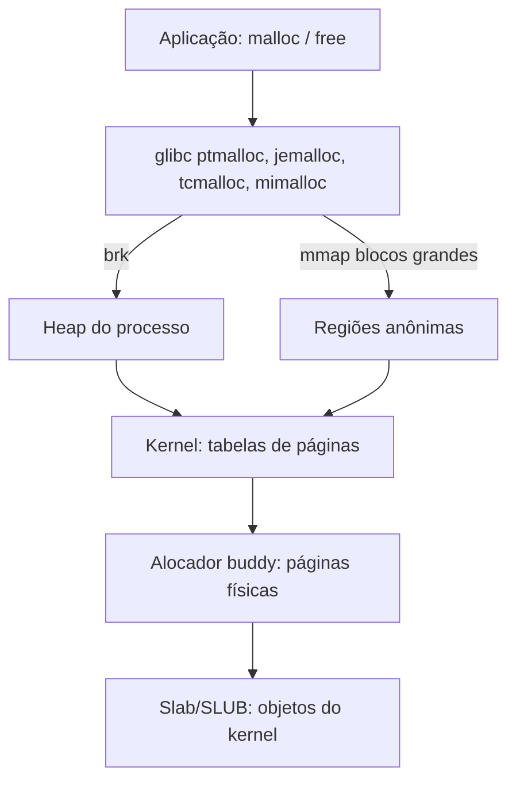

# Alocadores de Memória

## Resumo

Existem dois níveis de alocação:

1. **Kernel → processo**: páginas inteiras, por `brk`/`sbrk` e `mmap`.
2. **Biblioteca (user space)**: `malloc`/`free` dividem essas páginas em blocos de qualquer tamanho.
3. **Dentro do kernel**: alocadores de páginas (**buddy**) e de objetos (**slab/slub**).



## `brk` e `mmap`

| Chamada | Uso |
|---|---|
| `brk`/`sbrk` | Move o fim do **heap** (segmento de dados) |
| `mmap` anônimo | Região independente; usada para alocações grandes (≥ 128 KiB na glibc) e arenas |
| `munmap` | Devolve a região ao SO |

```c
#include <stdio.h>
#include <stdlib.h>
#include <unistd.h>

int main(void) {
    void *antes = sbrk(0);
    char *p = malloc(1000);          // pequeno: heap via brk
    void *depois = sbrk(0);
    printf("brk: %p -> %p\n", antes, depois);
    char *g = malloc(1 << 20);       // grande: mmap
    printf("pequeno=%p grande=%p\n", (void*)p, (void*)g);
    free(p); free(g);
    return 0;
}
```

```bash
strace -e trace=brk,mmap,munmap ./a.out     # veja as chamadas ao kernel
ltrace -e malloc+free ./a.out               # chamadas à biblioteca
```

## Estruturas internas do `malloc`

- **Cabeçalho** do bloco (tamanho e flags) antes do ponteiro devolvido.
- **Listas livres** por tamanho (*bins*): *fastbins*, *small*, *large*, *unsorted*.
- **Coalescência**: blocos livres vizinhos são unidos.
- **Arenas por thread** para reduzir contenção.
- **Alinhamento** (16 bytes em x86-64).

Problemas clássicos: **fragmentação**, **vazamento** (esquecer `free`), **uso após liberação**, **double free**, **buffer overflow no heap**.

## Alocadores populares

| Alocador | Característica |
|---|---|
| **ptmalloc (glibc)** | Padrão do Linux; arenas por thread |
| **jemalloc** | Baixa fragmentação; usado em FreeBSD, Firefox, Redis |
| **tcmalloc** | Caches por thread; do Google |
| **mimalloc** | Moderno, rápido; da Microsoft |
| **Windows Heap / LFH** | Heap do Windows com *Low-Fragmentation Heap* |

Trocar alocador sem recompilar:

```bash
LD_PRELOAD=/usr/lib/x86_64-linux-gnu/libjemalloc.so.2 ./meu_programa
```

## Alocadores no kernel Linux

**Buddy system**: páginas físicas em blocos de potência de 2 (ordem 0 a 10: 4 KiB a 4 MiB). Ao alocar, divide um bloco maior em "amigos"; ao liberar, une com o amigo livre.

```text
Pedido de 3 páginas -> arredonda para 4 (ordem 2)
Bloco de 16 páginas -> divide em 8+8 -> divide um 8 em 4+4 -> entrega 4
```

**Slab/SLUB**: *caches* de objetos de tamanho fixo (`task_struct`, `inode`, `dentry`), evitando fragmentação e reutilizando objetos já inicializados.

```bash
cat /proc/buddyinfo        # blocos livres por ordem, por zona
sudo cat /proc/slabinfo | head
sudo slabtop -o | head -15 # maiores caches de objetos do kernel
```

APIs do kernel: `kmalloc`/`kfree` (memória contígua física), `vmalloc` (virtual contígua), `alloc_pages`, `kmem_cache_alloc`.

## Detecção de erros de memória

```bash
gcc -g -fsanitize=address -fno-omit-frame-pointer prog.c -o prog && ./prog   # AddressSanitizer
valgrind --leak-check=full ./prog
```

## Vantagens e desvantagens por técnica

| Técnica | Vantagens | Desvantagens |
|---|---|---|
| Listas livres (malloc) | Flexível, qualquer tamanho | Fragmentação, metadados |
| Buddy | Coalescência rápida | Fragmentação interna (arredondamento a 2^n) |
| Slab | Objetos reutilizados, sem fragmentação | Consome memória em caches ociosos |
| Arenas por thread | Menos contenção | Maior uso de memória total |

## Pontos-chave

- `malloc` gerencia blocos sobre páginas obtidas por `brk`/`mmap`.
- O kernel usa buddy (páginas) e slab (objetos).
- Use ASan/Valgrind para achar bugs de heap.

## Veja também

[[Memória Virtual]] · [[Gerenciamento de Memória]] · [[MOC - Gerenciamento de Memória]]
