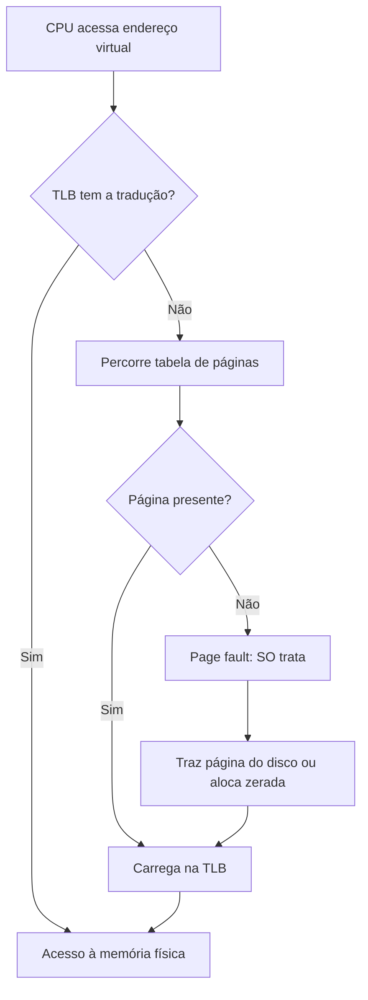

# Memória Virtual

## Resumo

**Memória virtual** dá a cada processo a ilusão de um espaço de endereços **grande, contíguo e privado**, independentemente da RAM física. Usa [[Paginação]], a MMU e o disco como retaguarda: só as páginas realmente usadas ficam na RAM (**paginação sob demanda**).

## Benefícios

| Benefício | Como |
|---|---|
| **Isolamento** | Cada processo tem tabela própria; não enxerga a memória dos outros |
| **Programas maiores que a RAM** | Páginas pouco usadas vão para disco |
| **Carregamento rápido** | Só se traz o que é tocado (*lazy loading*) |
| **Compartilhamento** | Bibliotecas e código mapeados uma vez para vários processos |
| **Simplicidade** | Programas usam endereços fixos; o SO realoca |
| **Segurança** | Permissões por página, NX, ASLR ([[ASLR - Address Space Layout Randomization]]) |

## Paginação sob demanda



## Técnicas importantes

| Técnica | Descrição |
|---|---|
| **Copy-on-Write (COW)** | Páginas compartilhadas são copiadas só na primeira escrita; torna `fork` barato |
| **Zero-fill-on-demand** | Alocação de páginas zeradas só no primeiro acesso (`malloc` grande, `.bss`) |
| **Arquivos mapeados (`mmap`)** | Arquivo aparece como memória; leitura por page fault |
| **Memória compartilhada** | Várias tabelas apontam para os mesmos quadros |
| **Overcommit** | Linux permite alocar mais do que a RAM+swap, assumindo que nem tudo será usado |
| **Huge pages / THP** | Páginas de 2 MiB reduzem pressão sobre a TLB |
| **KSM / deduplicação** | Mescla páginas idênticas (VMs) |

## Exemplo: COW e `mmap`

```c
#include <stdio.h>
#include <sys/mman.h>
#include <fcntl.h>
#include <sys/stat.h>
#include <unistd.h>

int main(void) {
    int fd = open("/etc/hostname", O_RDONLY);
    struct stat st; fstat(fd, &st);
    // Mapeia o arquivo: nada é lido ainda; páginas vêm por page fault
    char *p = mmap(NULL, st.st_size, PROT_READ, MAP_PRIVATE, fd, 0);
    write(1, p, st.st_size);
    munmap(p, st.st_size);
    return 0;
}
```

```bash
# Quanto da memória é residente x virtual
ps -o pid,vsz,rss,cmd -p $$       # VSZ = virtual, RSS = residente
cat /proc/$$/status | grep -E "VmSize|VmRSS|VmSwap"
cat /proc/sys/vm/overcommit_memory
```

## Endereços: virtual, linear, físico

Em x86-64 os endereços virtuais têm 48 bits "canônicos" (ou 57 com 5 níveis): metade baixa para user space e metade alta para o kernel. Um acesso fora do mapeamento gera [[Page Faults|page fault]] e, se inválido, `SIGSEGV`.

## O que pode dar errado

> [!warning] Thrashing
> Se os processos precisam de mais páginas que a RAM comporta, o sistema gasta mais tempo trocando páginas do que executando. A utilização da CPU cai. Ver [[Swap e Thrashing]].

> [!warning] OOM Killer
> Com overcommit, quando a memória se esgota, o Linux pode encerrar um processo (`Out of memory: Killed process`). Veja `dmesg | grep -i oom`.

## Vantagens e desvantagens

| Vantagens | Desvantagens |
|---|---|
| Isolamento e proteção fortes | Sobrecarga de tradução (TLB, tabelas) |
| Uso eficiente da RAM | Page faults têm custo alto (disco: milissegundos) |
| Programas simples de escrever | Thrashing se houver pouca RAM |
| Compartilhamento e COW | Latência imprevisível (ruim para tempo real) |

## Pontos-chave

- Virtual = ilusão de memória grande e privada.
- Paginação sob demanda: só o usado fica na RAM.
- COW, `mmap` e huge pages são ferramentas centrais.

## Veja também

[[Paginação]] · [[TLB - Translation Lookaside Buffer]] · [[Page Faults]] · [[Swap e Thrashing]] · [[MOC - Gerenciamento de Memória]]
