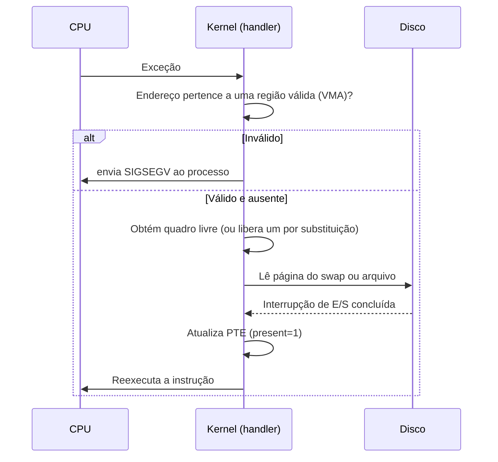

# Page Faults

## Resumo

Um **page fault** é uma [[Traps e Exceções|exceção]] gerada pela MMU quando um acesso não pode ser resolvido pela tabela de páginas: página ausente, ou acesso proibido pelas permissões. O kernel trata e, se possível, **reexecuta a instrução**.

## Tipos

| Tipo | Causa | Custo | Resultado |
|---|---|---|---|
| **Menor (minor/soft)** | Página já está na RAM, só faltava mapear (ex.: COW, página em cache de arquivos, zero page) | Microssegundos | Corrigido sem disco |
| **Maior (major/hard)** | Página precisa ser lida do disco (swap ou arquivo) | **Milissegundos** | Processo dorme até a E/S |
| **Inválido** | Endereço não mapeado ou permissão violada | - | `SIGSEGV`/`SIGBUS` |

## Tratamento passo a passo



## Casos comuns

- **Primeiro acesso** a página alocada (`malloc`, pilha crescente): *zero-fill*.
- **COW**: escrita em página compartilhada após `fork`: copia e marca como escrita.
- **`mmap` de arquivo**: leitura traz a página do *page cache*.
- **Swap-in**: página tinha sido enviada ao disco.
- **Guard pages**: estouro de pilha cai em página protegida -> `SIGSEGV`.

## Custo de um page fault maior

Com t_mem = 100 ns, tempo de serviço de falha = 8 ms e taxa de falhas p:

`EAT = (1 − p) × 100 ns + p × 8.000.000 ns`

Para perder menos de 10% de desempenho, p precisa ser menor que **1 falha a cada ~800.000 acessos**.

```python
def eat(p, t_mem=100, t_fault=8_000_000):
    return (1 - p) * t_mem + p * t_fault
print(eat(1 / 800_000))      # ~110 ns: 10% de degradação
```

## Exemplo prático

```bash
# Contar page faults de um comando
/usr/bin/time -v ls -R / >/dev/null 2>&1 | grep -E "(Major|Minor).*faults"
# Monitorar em tempo real: colunas si/so (swap in/out)
vmstat 1 5
# Por processo
ps -o pid,min_flt,maj_flt,cmd -p $$
# Rastrear page faults com perf
perf stat -e page-faults,major-faults,minor-faults ./programa
```

Provocando faults:

```c
#include <stdio.h>
#include <stdlib.h>

int main(void) {
    size_t n = 512UL * 1024 * 1024;       // 512 MiB virtuais
    char *p = malloc(n);                  // quase nenhuma falha ainda
    for (size_t i = 0; i < n; i += 4096)
        p[i] = 1;                         // 1 minor fault por página tocada
    puts("pronto");
    return 0;
}
```

Segmentation fault intencional:

```c
int main(void) { int *p = 0; *p = 1; return 0; }   // endereço 0 não mapeado
```

> [!tip] Depuração
> Uma enxurrada de *major faults* indica falta de RAM ou conjunto de trabalho grande demais. Compare `free -h`, `vmstat` e `sar -B`.

## Pontos-chave

- Page fault ≠ erro: a maioria é rotina (lazy allocation, COW).
- Major fault envolve disco e é milhares de vezes mais lento.
- Faltas inválidas viram `SIGSEGV`.

## Veja também

[[Memória Virtual]] · [[Algoritmos de Substituição de Páginas]] · [[Swap e Thrashing]] · [[MOC - Gerenciamento de Memória]]
