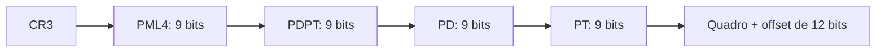

# Paginação

## Resumo

A **paginação** divide o espaço de endereços virtual em blocos de tamanho fixo, as **páginas** (tipicamente 4 KiB), e a memória física em **quadros** (*frames*) do mesmo tamanho. Uma **tabela de páginas** por processo mapeia página → quadro. Elimina a fragmentação externa; resta apenas a interna (última página).

## Tradução de endereços

Endereço virtual = **número da página (VPN)** + **deslocamento (offset)**. Com páginas de 4 KiB, o offset ocupa 12 bits.

```mermaid
flowchart LR
    V[Endereço virtual: VPN | offset] --> TP[Tabela de páginas]
    TP -->|PFN| F[Endereço físico: PFN | offset]
    V -->|offset sem alteração| F
```

### Exemplo numérico

Páginas de 4 KiB, endereço virtual `0x00003A7C`:

- VPN = `0x3`, offset = `0xA7C`.
- Se a tabela diz página 3 → quadro `0x7`, o físico é `0x7 × 0x1000 + 0xA7C = 0x7A7C`.

```python
TAM = 4096
tabela = {0: 5, 1: 9, 2: 1, 3: 7}

def traduz(virt):
    vpn, off = divmod(virt, TAM)
    if vpn not in tabela:
        raise MemoryError("page fault")
    return tabela[vpn] * TAM + off

print(hex(traduz(0x3A7C)))   # 0x7a7c
```

## Entrada da tabela de páginas (PTE)

| Bit | Significado |
|---|---|
| **P** (present) | Página na memória? Se 0 -> [[Page Faults|page fault]] |
| **R/W** | Escrita permitida |
| **U/S** | Acesso de usuário ou só supervisor |
| **NX** | Não executável (base do DEP) |
| **A** (accessed) | Referenciada recentemente (usado por substituição) |
| **D** (dirty) | Modificada; precisa gravar em disco ao remover |
| **PFN** | Número do quadro físico |

## Tabelas multinível

Uma tabela linear para 48 bits de endereço virtual teria bilhões de entradas. Usa-se **hierarquia**: só são alocadas as partes utilizadas.

x86-64 com 4 níveis (9 bits por nível + 12 de offset = 48 bits):



- Cada tabela tem 512 entradas de 8 bytes = 4 KiB (cabe em uma página).
- **Páginas grandes** (*huge pages*): 2 MiB (pula o nível PT) ou 1 GiB, reduzem pressão sobre a [[TLB - Translation Lookaside Buffer]].
- Processadores recentes suportam **5 níveis** (57 bits).
- Alternativas: **tabela invertida** (uma entrada por quadro, usada em PowerPC), **tabelas com hash**.

## Tamanho da tabela: exemplo

Espaço virtual de 32 bits com páginas de 4 KiB: 2^20 páginas × 4 bytes = **4 MiB por processo** em tabela linear; com multinível, só se alocam os trechos usados.

## Exemplo prático

```bash
getconf PAGESIZE                          # 4096
grep -i huge /proc/meminfo               # huge pages
cat /proc/$$/smaps_rollup                # RSS, PSS por processo
# Traduzir endereço virtual para físico (requer root)
sudo python3 - <<'EOF'
import os, struct
pid, vaddr = os.getpid(), id(object)
with open(f"/proc/{pid}/pagemap", "rb") as f:
    f.seek(vaddr // 4096 * 8)
    e = struct.unpack("Q", f.read(8))[0]
print("presente:", bool(e >> 63), "PFN:", hex(e & ((1 << 55) - 1)))
EOF
```

## Vantagens e desvantagens

| Vantagens | Desvantagens |
|---|---|
| Sem fragmentação externa | Fragmentação interna (média meia página por região) |
| Permite memória virtual e compartilhamento | Tabelas ocupam memória |
| Proteção por página (R/W/X) | Tradução exige acessos extras (mitigados pela [[TLB - Translation Lookaside Buffer]]) |
| Alocação simples (qualquer quadro serve) | Custo de percorrer tabelas multinível |

## Pontos-chave

- Virtual = (VPN, offset); a tabela troca VPN por PFN.
- Multinível economiza memória em espaços esparsos.
- Bits da PTE implementam proteção, substituição e DEP.

## Veja também

[[Memória Virtual]] · [[TLB - Translation Lookaside Buffer]] · [[Page Faults]] · [[MOC - Gerenciamento de Memória]]
