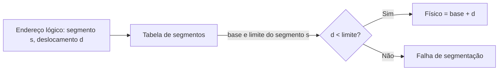

# Segmentação

## Resumo

Na **segmentação**, o espaço de endereços é dividido em **segmentos lógicos de tamanho variável** (código, dados, pilha, heap, bibliotecas). Um endereço é um par **(segmento, deslocamento)**.

## Tradução



| Entrada da tabela de segmentos | Conteúdo |
|---|---|
| Base | Endereço físico inicial |
| Limite | Tamanho do segmento |
| Proteção | R/W/X, nível de privilégio |
| Presente | Se está na memória |

## Exemplo numérico

| Segmento | Base | Limite |
|---|---|---|
| 0 (código) | 1400 | 1000 |
| 1 (dados) | 6300 | 400 |
| 2 (pilha) | 4300 | 1100 |

- (2, 53) → 4300 + 53 = **4353**
- (1, 852) → 852 ≥ 400: **falha de segmentação**

## Vantagens e desvantagens

| Vantagens | Desvantagens |
|---|---|
| Reflete a estrutura lógica do programa | **Fragmentação externa** |
| Proteção e compartilhamento por segmento (ex.: bibliotecas) | Alocação de tamanhos variáveis é complexa |
| Segmentos crescem independentemente (pilha, heap) | Tabelas e verificação por acesso |

## Segmentação + paginação

O x86 de 32 bits combinava as duas: a **unidade de segmentação** gerava um endereço linear e a **paginação** o traduzia em físico (MULTICS inspirou o modelo). Em **x86-64**, a segmentação foi praticamente desativada (modelo plano), restando `FS`/`GS` para TLS e dados por CPU.

> [!info] Falha de segmentação (segfault)
> O termo permanece historicamente: em Linux moderno, `SIGSEGV` indica acesso inválido à memória (página não mapeada ou sem permissão), tratado em [[Page Faults]].

## Exemplo prático

```bash
# Segmentos lógicos de um executável ELF
readelf -S /bin/ls | head -20
size /bin/ls              # tamanho de text, data e bss
cat /proc/self/maps | head -8
```

## Pontos-chave

- Segmento = unidade lógica de tamanho variável; endereço = (segmento, deslocamento).
- Gera fragmentação externa; por isso a paginação venceu.
- Sistemas modernos usam modelo plano com paginação.

## Veja também

[[Paginação]] · [[Memória Virtual]] · [[MOC - Gerenciamento de Memória]]
