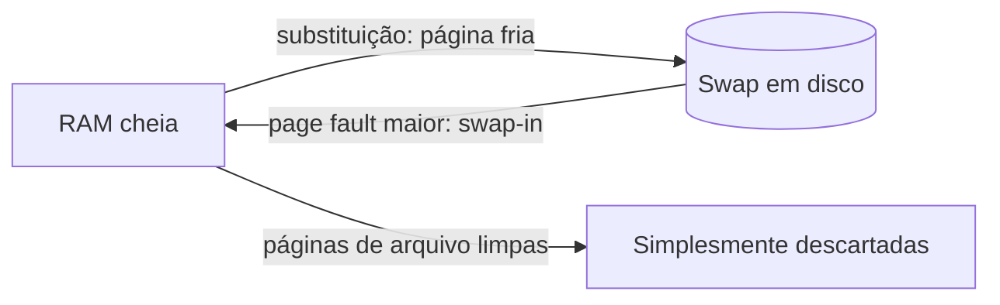

# Swap e Thrashing

## Resumo

**Swap** é a área em disco usada como extensão da RAM para guardar páginas pouco usadas. No Linux pode ser uma **partição** ou **arquivo**; no Windows é o **pagefile.sys** (e `swapfile.sys` para apps); no macOS, arquivos em `/private/var/vm`.

## Como funciona



- Só páginas **anônimas** (heap, pilha) precisam ir ao swap; páginas **de arquivo** limpas são descartadas (podem ser relidas do arquivo); sujas são gravadas no arquivo original.
- **Swap-out**: gravar página no swap e liberar o quadro; **swap-in**: lê de volta em page fault.
- **Swapping** de processo inteiro (antigo) é diferente da **paginação** do swap (moderno).

## Para que serve

1. Liberar RAM de páginas inativas para dar ao **cache de disco** (melhora desempenho geral).
2. Permitir **overcommit** com segurança, evitando o OOM killer.
3. **Hibernação**: o conteúdo da RAM é gravado no swap.

## Thrashing

> [!warning] Thrashing
> Quando a soma dos conjuntos de trabalho excede a RAM, o sistema passa a maior parte do tempo trocando páginas. O uso da CPU despenca, e o SO pode até admitir mais processos (achando que a CPU está ociosa), piorando tudo.

Sintomas: disco 100% ocupado, latência altíssima, `si`/`so` altos no `vmstat`, `wa` alto na CPU.

```bash
vmstat 1                 # si = KB lidos do swap/s, so = KB gravados no swap/s
free -h                  # uso de swap
swapon --show            # dispositivos de swap ativos
cat /proc/pressure/memory   # PSI: "some" e "full" indicam tempo parado por falta de memória
```

Saída comentada (`free -h`):

```text
               total   used   free  shared  buff/cache  available
Mem:           15Gi    9.1Gi  412Mi  310Mi      6.0Gi      5.8Gi   # available estima o que dá para usar sem swap
Swap:          4.0Gi   1.2Gi  2.8Gi                              # 1,2 GiB de páginas frias em disco
```

Soluções: mais RAM, reduzir processos, limitar memória por [[cgroups - SO]], ajustar `vm.swappiness`, usar **zram/zswap**.

## Memória comprimida: zram, zswap e macOS/Windows

| Tecnologia | Como funciona |
|---|---|
| **zram** (Linux) | Dispositivo de swap **na própria RAM**, comprimido; ideal para pouca memória |
| **zswap** (Linux) | Cache comprimido na RAM **na frente** do swap em disco |
| **Compressed memory** (macOS, Windows 10+) | Comprime páginas inativas antes de recorrer ao disco |

## Configurando swap no Linux

```bash
# Criar arquivo de swap de 2 GiB
sudo fallocate -l 2G /swapfile
sudo chmod 600 /swapfile          # só root
sudo mkswap /swapfile
sudo swapon /swapfile
echo '/swapfile none swap sw 0 0' | sudo tee -a /etc/fstab
# Ajuste de tendência
sudo sysctl vm.swappiness=10
# Desativar
sudo swapoff -a
```

```powershell
# Windows: informações do pagefile
Get-CimInstance Win32_PageFileUsage | Select Name, AllocatedBaseSize, CurrentUsage
```

> [!tip] Servidores de banco de dados
> Muitos DBAs reduzem `swappiness` (1 a 10) para evitar que o banco seja paginado. Contudo, zerar o swap elimina a rede de segurança e pode antecipar o OOM killer.

## Vantagens e desvantagens

| Vantagens | Desvantagens |
|---|---|
| Permite rodar mais que a RAM comporta | Disco é ordens de magnitude mais lento que a RAM |
| Libera RAM para o cache de arquivos | Thrashing degrada o sistema |
| Possibilita hibernação | Desgaste de SSD em swap intenso |
| Evita OOM em picos | Dados sensíveis podem ficar no disco (use swap criptografado) |

## Pontos-chave

- Swap guarda páginas anônimas frias; páginas de arquivo são descartadas ou gravadas no arquivo.
- Thrashing = excesso de page faults por falta de RAM.
- zram/zswap e compressão aliviam o problema.

## Veja também

[[Memória Virtual]] · [[Algoritmos de Substituição de Páginas]] · [[MOC - Gerenciamento de Memória]]
