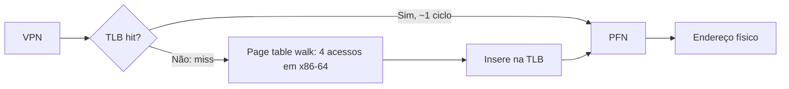

# TLB - Translation Lookaside Buffer

## Resumo

A **TLB** é um cache pequeno e muito rápido, dentro da MMU, que guarda **traduções recentes página virtual → quadro físico**. Sem ela, cada acesso à memória exigiria vários acessos extras para percorrer as tabelas de páginas ([[Paginação]]).

## Funcionamento



- **Hit**: tradução em cerca de 1 ciclo.
- **Miss**: *page walk* por hardware (x86, ARM) ou por software (MIPS, antigos SPARC): dezenas a centenas de ciclos.
- Estrutura: totalmente associativa ou associativa por conjuntos; **L1** (dezenas de entradas, separada para dados e instruções) e **L2 TLB** (algumas centenas a milhares).

## Tempo efetivo de acesso (EAT)

`EAT = h × (t_tlb + t_mem) + (1 − h) × (t_tlb + n × t_mem + t_mem)`

Com t_tlb = 1 ns, t_mem = 100 ns, 4 níveis (n = 4) e taxa de acerto h = 99%:

`EAT ≈ 0,99 × 101 + 0,01 × (1 + 400 + 100) = 100 + 5,0 ≈ 105 ns` (apenas 5% mais lento que acesso direto).

```python
def eat(h, t_tlb, t_mem, niveis):
    hit = t_tlb + t_mem
    miss = t_tlb + niveis * t_mem + t_mem
    return h * hit + (1 - h) * miss

print(eat(0.99, 1, 100, 4))   # ~105
print(eat(0.90, 1, 100, 4))   # ~150: taxa de acerto importa muito
```

## Coerência e invalidação

A TLB é cache da tabela de páginas, e o SO deve invalidá-la quando altera mapeamentos:

| Situação | Ação |
|---|---|
| Troca de processo (CR3 muda) | Invalidar tudo, **ou** usar **ASID/PCID** para manter entradas de vários processos |
| `munmap`, mudança de permissão | `invlpg` de uma entrada |
| Multicore | **TLB shootdown**: IPI para outras CPUs invalidarem |

> [!warning] Custo do shootdown
> Em máquinas com muitos núcleos, mudar mapeamentos de processos multithread dispara interrupções entre CPUs, causando perda de desempenho. Por isso se agrupam invalidações e se usam *huge pages*.

## Alcance da TLB (TLB reach)

`alcance = nº de entradas × tamanho da página`. Com 1536 entradas × 4 KiB = **6 MiB**; com páginas de 2 MiB, **3 GiB**. Aplicações com grandes conjuntos de dados (bancos, JVM, HPC) ganham muito com **huge pages**.

## Exemplo prático

```bash
# Ver contadores de TLB (requer perf)
perf stat -e dTLB-loads,dTLB-load-misses,iTLB-load-misses ./programa
# Ativar Transparent Huge Pages
cat /sys/kernel/mm/transparent_hugepage/enabled
echo always | sudo tee /sys/kernel/mm/transparent_hugepage/enabled
# Reservar huge pages explícitas
echo 512 | sudo tee /proc/sys/vm/nr_hugepages
```

```c
// Acesso com salto de página provoca mais misses de TLB que acesso sequencial
#include <stdlib.h>
#define N (1 << 26)
int main(void) {
    char *a = malloc(N);
    for (int passo = 1; passo <= 4096; passo *= 64)
        for (long i = 0; i < N; i += passo) a[i]++;   // meça com `perf stat`
    return 0;
}
```

## Vantagens e desvantagens

| Vantagens | Desvantagens |
|---|---|
| Torna a paginação viável (hit ~1 ciclo) | Tamanho limitado: depende de localidade |
| Hardware transparente | Invalidações (troca de contexto, shootdown) |
| ASID/PCID reduzem flush | Mitigações de segurança (KPTI) aumentam flushes |

## Pontos-chave

- TLB = cache de traduções; o *miss* custa um *page walk*.
- Alta taxa de acerto é essencial; *huge pages* ampliam o alcance.
- Mudanças de mapeamento exigem invalidação (e *shootdown* em multicore).

## Veja também

[[Paginação]] · [[Memória Virtual]] · [[Context Switch (Troca de Contexto)]] · [[MOC - Gerenciamento de Memória]]
