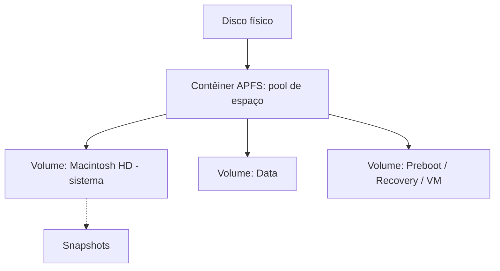

# APFS

## Resumo

O **APFS** (*Apple File System*), introduzido em 2016-2017 (iOS 10.3, macOS 10.13), substituiu o HFS+. É **copy-on-write**, otimizado para **SSD/flash**, com **snapshots, clones, criptografia nativa** e **compartilhamento de espaço** entre volumes de um contêiner.

## Contêineres e volumes



- Um **contêiner** agrupa volumes que **compartilham o espaço livre** dinamicamente (sem particionar tamanhos fixos).
- No macOS moderno, o volume do **sistema é somente leitura e selado** (*signed system volume*), separado do volume de **dados**; ambos aparecem como um só no Finder (*firmlinks*).

## Recursos

| Recurso | Descrição |
|---|---|
| **Copy-on-write** | Metadados nunca sobrescritos; consistência por *crash protection* (sem journal clássico) |
| **Snapshots** | Estado somente leitura do volume; base do **Time Machine** local e de atualizações do sistema |
| **Clones** | `cp -c` cria cópia instantânea que só gasta espaço quando divergir |
| **Criptografia nativa** | Sem criptografia, de chave única ou **chaves múltiplas por arquivo** (metadados e dados) |
| **Space sharing** | Volumes dividem o espaço do contêiner |
| **Arquivos esparsos** | Alocação sob demanda |
| **Nanossegundos nos timestamps** | Precisão maior |
| **Atomic safe-save** | Renomeação atômica de documentos |
| **Limites** | Até 2^63 arquivos; arquivo/volume de **8 EiB** |

> [!info] Sem checksums de dados
> O APFS faz checksums **de metadados**, mas **não de dados de usuário** (a Apple confia na correção do hardware de armazenamento). Por isso difere do [[ZFS]] e do [[Btrfs]].

## Comandos no macOS

```bash
diskutil list                              # discos, contêineres e volumes
diskutil apfs list                         # detalhes do APFS
diskutil apfs addVolume disk1 APFS Backup  # novo volume no contêiner
tmutil listlocalsnapshots /                # snapshots locais
tmutil localsnapshot                       # cria snapshot
cp -c arquivo_grande.mov clone.mov         # clone instantâneo (copy-on-write)
mount | grep apfs
df -h /System/Volumes/Data
```

Saída comentada (`diskutil apfs list`, trecho):

```text
APFS Container Reference:     disk3
Size (Capacity Ceiling):      494384795648 B (494.4 GB)
Capacity In Use By Volumes:   301723627520 B (301.7 GB) (61.0% used)
Capacity Not Allocated:       192661168128 B (192.7 GB) (39.0% free)   # espaço compartilhado
|-> Volume disk3s1  "Macintosh HD"   (System, sealed)
|-> Volume disk3s5  "Macintosh HD - Data" (Data)
```

## Vantagens e desvantagens

| Vantagens | Desvantagens |
|---|---|
| Snapshots e clones instantâneos | Sem checksums de dados de usuário |
| Criptografia integrada e eficiente | Pouco suporte fora do ecossistema Apple (Linux só leitura experimental) |
| Ótimo em SSD; compartilhamento de espaço | Desempenho em HDD abaixo do HFS+ |
| Operações atômicas e rápidas (renomear, copiar) | Sem compressão transparente configurável pelo usuário (como no HFS+/NTFS) |
| Estruturas escaláveis | Espaço livre aparente confuso (contêiner compartilhado) |

## Pontos-chave

- CoW com contêiner e volumes que compartilham espaço.
- Snapshots e clones são a base de Time Machine e das atualizações.
- Metadados com checksum, dados não.

## Veja também

[[Journaling e Copy-on-Write]] · [[Btrfs]] · [[ZFS]] · [[MOC - Sistemas de Arquivos]]
