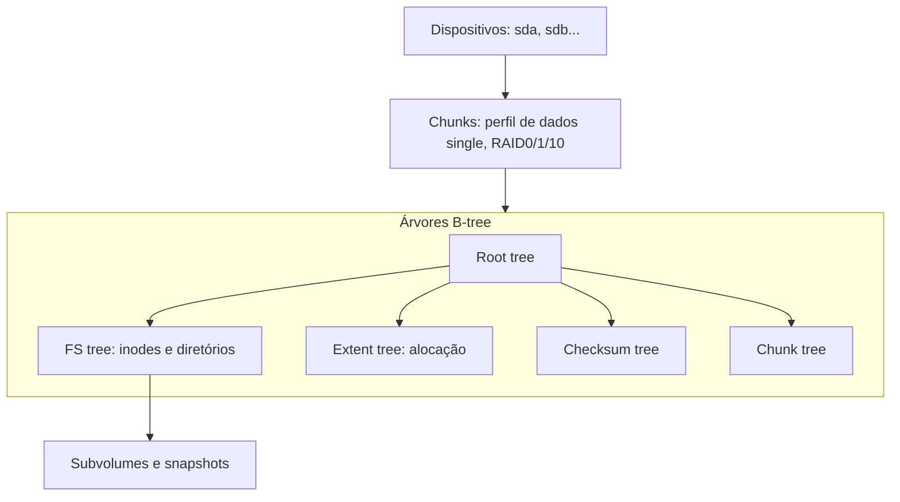

# Btrfs

## Resumo

O **Btrfs** (*B-tree FS*) é um sistema de arquivos **copy-on-write** do kernel [[Linux]], com **snapshots**, **subvolumes**, **checksums**, **compressão transparente**, múltiplos dispositivos (RAID) e *send/receive*. É padrão no openSUSE e no Fedora Workstation, e usado no Synology e em ferramentas como Snapper e Timeshift.

## Estrutura



Tudo (dados e metadados) vive em **árvores B** com CoW: ao alterar um bloco, copia-se o caminho até a raiz e troca-se a raiz atomicamente.

## Recursos

| Recurso | Descrição |
|---|---|
| **Subvolumes** | Árvores de arquivos independentes dentro do mesmo FS, montáveis separadamente |
| **Snapshots** | Cópias CoW instantâneas de subvolumes (graváveis ou somente leitura) |
| **Checksums** | CRC32c (ou xxhash/sha256/blake2) em dados e metadados; detecta corrupção |
| **Compressão** | `zstd`, `lzo`, `zlib` por montagem ou por arquivo |
| **RAID integrado** | `single`, `dup`, RAID0/1/1c3/10 estáveis; RAID5/6 com ressalvas |
| **Send/receive** | Replicação incremental de snapshots |
| **Scrub** | Verifica e repara com cópias saudáveis |
| **Deduplicação offline**, `reflink` | Compartilha extents (`cp --reflink`) |
| **Redimensionamento online**, balanceamento | Adicionar/remover dispositivos a quente |

## Comandos essenciais

```bash
sudo mkfs.btrfs -L dados /dev/sdb1
sudo mount -o compress=zstd,noatime /dev/sdb1 /mnt/dados

# Subvolumes e snapshots
sudo btrfs subvolume create /mnt/dados/@home
sudo btrfs subvolume snapshot -r /mnt/dados/@home /mnt/dados/@home-2026-10-26
sudo btrfs subvolume list /mnt/dados
sudo btrfs subvolume delete /mnt/dados/@home-2026-10-26

# Cópia instantânea (reflink)
cp --reflink=always grande.iso copia.iso

# Saúde e manutenção
sudo btrfs filesystem usage /mnt/dados        # alocação real (use isto, não df)
sudo btrfs scrub start -B /mnt/dados          # verifica checksums
sudo btrfs balance start -dusage=50 /mnt/dados
sudo btrfs device add /dev/sdc1 /mnt/dados    # adiciona disco

# Replicação incremental
sudo btrfs send -p /mnt/dados/snap1 /mnt/dados/snap2 | ssh backup "btrfs receive /backup"
```

Saída comentada (`btrfs filesystem usage`, trecho):

```text
Overall:
    Device size:        931.51GiB
    Device allocated:   120.03GiB   # chunks reservados
    Used:                96.40GiB   # dados realmente usados
    Free (estimated):   810.52GiB   # estimativa; depende do perfil RAID
Data,single: Size:112.00GiB, Used:94.10GiB
Metadata,DUP: Size:4.00GiB, Used:2.30GiB   # metadados duplicados (padrão em HDD)
```

> [!warning] Pontos de atenção
> - `df` engana: use `btrfs filesystem usage`.
> - RAID5/6 do Btrfs tem problemas conhecidos de integridade em quedas de energia; evite em dados críticos.
> - Bancos de dados e imagens de VM sofrem fragmentação por CoW: use `chattr +C` (NOCOW) nesses diretórios.
> - Espaço pode acabar nos **metadados** antes dos dados; mantenha `balance` periódico.

## Vantagens e desvantagens

| Vantagens | Desvantagens |
|---|---|
| Snapshots e subvolumes baratos | RAID5/6 não confiável para dados críticos |
| Checksums detectam corrupção silenciosa | Fragmentação CoW em bancos de dados e VMs |
| Compressão transparente economiza espaço | Contabilidade de espaço complexa |
| Replicação incremental com send/receive | Menos maduro que ext4/XFS; desempenho variável |
| Flexibilidade de dispositivos e RAID | Exige manutenção (balance, scrub) |

## Casos de uso

Estações com rollback por snapshots (Snapper + GRUB), NAS, backup incremental, containers (overlay/driver btrfs).

## Pontos-chave

- CoW em árvores B com checksums.
- Subvolumes e snapshots como unidades de gestão.
- Use `btrfs filesystem usage` e `scrub` regularmente.

## Veja também

[[ZFS]] · [[ext4]] · [[Journaling e Copy-on-Write]] · [[MOC - Sistemas de Arquivos]]
