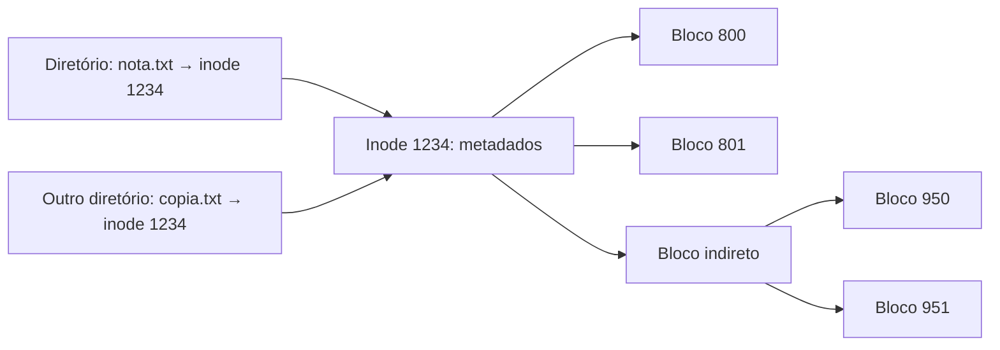

# Inodes

## Resumo

O **inode** (*index node*) é a estrutura que guarda **todos os metadados de um arquivo, exceto o nome**, e aponta para seus blocos de dados. Cada arquivo, diretório, link simbólico ou dispositivo tem um inode identificado por um número único por sistema de arquivos.

## O que contém

| Campo | Descrição |
|---|---|
| Tipo e permissões | Arquivo, diretório, link, dispositivo; bits `rwx`, setuid/setgid/sticky |
| UID / GID | Dono e grupo |
| Tamanho | Em bytes |
| Contador de links | Número de nomes (hard links) |
| Timestamps | `atime` (acesso), `mtime` (conteúdo), `ctime` (metadados), `crtime`/birth (ext4) |
| Ponteiros de dados | Blocos diretos/indiretos ou **extents** |
| Atributos estendidos | ACLs, SELinux, etc. |

> [!info] O nome não está no inode
> O nome vive no **diretório** (entrada nome → número do inode). Por isso um arquivo pode ter vários nomes (hard links) e `mv` dentro do mesmo FS só altera diretórios.



## Estrutura de ponteiros (ext2/ext3)

15 ponteiros no inode: 12 diretos, 1 indireto, 1 duplamente indireto, 1 triplamente indireto. Arquivos pequenos são servidos com poucos acessos. Em **ext4**, usa-se **árvore de extents** (início + comprimento), menos metadados e melhor para arquivos grandes. Arquivos muito pequenos podem ficar no próprio inode (*inline data*).

## Diretórios e remoção

- Um **diretório** é um arquivo cujo conteúdo é uma lista de pares (nome, nº do inode).
- `rm` remove a **entrada** e decrementa o contador de links; o inode e os blocos só são liberados quando o contador chega a 0 **e** nenhum processo mantém o arquivo aberto.

```bash
# Arquivo apagado mas ainda aberto continua ocupando espaço
lsof +L1                          # arquivos abertos com 0 links (apagados)
```

## Esgotamento de inodes

O número de inodes é fixado na criação do FS em ext4 (`mkfs.ext4 -i bytes-por-inode`). Muitos arquivos pequenos podem esgotar inodes **sem encher o disco**: erro `No space left on device` com espaço livre.

```bash
df -i                              # uso de inodes por FS
df -h                              # uso de espaço
find /var -xdev -type f | wc -l    # quantos arquivos
```

Saída comentada:

```text
Filesystem      Inodes  IUsed   IFree IUse% Mounted on
/dev/sda2      3276800 3276800     0  100%   /        # sem inodes livres, mesmo com espaço
```

Alguns FS (XFS, Btrfs, ZFS, NTFS) alocam inodes dinamicamente.

## Explorando inodes

```bash
ls -i arquivo.txt                  # número do inode
stat arquivo.txt                   # metadados completos
find / -xdev -inum 393230 2>/dev/null   # todos os nomes de um inode
sudo debugfs -R "stat <393230>" /dev/sda2   # inode bruto em ext4 (somente leitura)
```

```c
#include <stdio.h>
#include <sys/stat.h>

int main(int argc, char **argv) {
    struct stat st;
    if (stat(argv[1], &st) == 0)
        printf("inode=%lu links=%lu tamanho=%ld modo=%o\n",
               (unsigned long)st.st_ino, (unsigned long)st.st_nlink,
               (long)st.st_size, st.st_mode & 07777);
    return 0;
}
```

## Equivalentes em outros SOs

| SO / FS | Estrutura |
|---|---|
| NTFS | Registro na **MFT** (*Master File Table*); atributos (nome, dados, ACL) |
| APFS | Registros de inode em árvores B (*file system tree*) |
| FAT | Entrada de diretório + tabela FAT (sem inodes) |

## Vantagens e desvantagens

| Vantagens | Desvantagens |
|---|---|
| Separa nome de metadados: hard links, renomeação barata | Número fixo de inodes em alguns FS |
| Acesso aleatório eficiente | Inodes lidos separadamente dos dados (localidade) |
| Estrutura uniforme para todos os tipos de arquivo | Hard links dificultam contabilidade e backup |

## Pontos-chave

- Inode = metadados + ponteiros; o nome fica no diretório.
- Arquivo é liberado quando links = 0 e ninguém o mantém aberto.
- `df -i` revela esgotamento de inodes.

## Veja também

[[Sistemas de Arquivos - Conceitos]] · [[VFS - Virtual File System]] · [[Permissões de Arquivos]] · [[MOC - Sistemas de Arquivos]]
