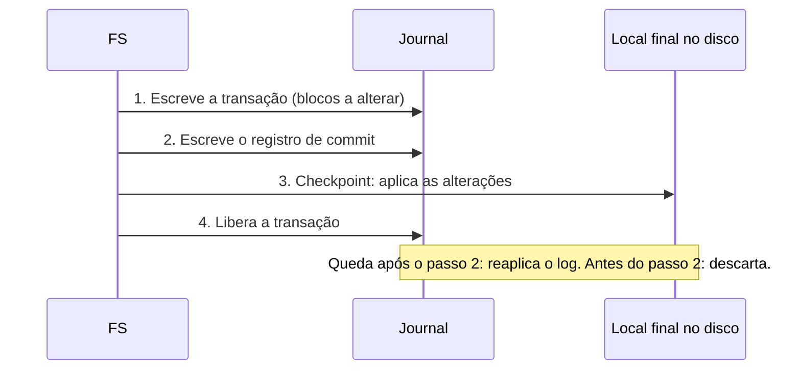
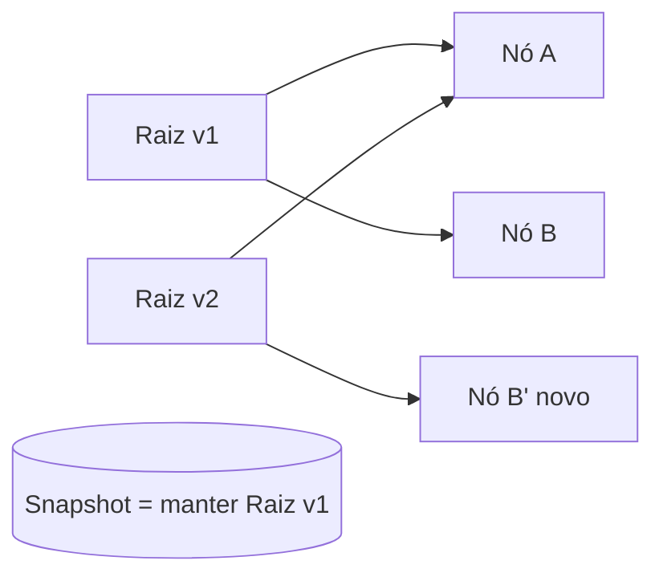

# Journaling e Copy-on-Write

## Resumo

Operações em FS envolvem **várias escritas** (inode, bitmap, bloco de dados, diretório). Uma queda no meio deixa o FS **inconsistente**. Duas técnicas resolvem: **journaling** (registrar a intenção antes) e **copy-on-write** (nunca sobrescrever dados vivos).

## O problema

Criar um arquivo exige: (1) alocar um inode, (2) marcar bitmap, (3) escrever os dados, (4) adicionar a entrada no diretório. Falhar entre os passos gera **blocos órfãos**, **inodes sem nome** ou **nomes apontando para lixo**. Antes do journaling, o `fsck` varria o disco inteiro após uma queda (horas em discos grandes).

## Journaling (log de escrita antecipada)



Após uma falha, a recuperação **relê o journal** e reaplica transações concluídas, descartando as incompletas. Dura segundos.

### Modos do ext3/ext4

| Modo | O que vai ao journal | Segurança | Desempenho |
|---|---|---|---|
| `journal` | Dados **e** metadados | Máxima | Menor (escrita dupla) |
| `ordered` (padrão) | Só metadados; dados escritos **antes** do commit | Boa | Bom |
| `writeback` | Só metadados, sem ordem | Menor (dados antigos podem aparecer em arquivos novos) | Melhor |

```bash
mount | grep " / "                 # opções de montagem (data=ordered)
sudo dumpe2fs -h /dev/sda2 | grep -i journal
sudo tune2fs -l /dev/sda2 | grep -i features   # has_journal
```

## Copy-on-Write (CoW)

Em vez de sobrescrever, o FS **escreve em novo local** e depois **atualiza o ponteiro** para a nova versão de forma atômica. A raiz da árvore muda de uma só vez (como um *commit*).



Consequências:

- **Sempre consistente**: o estado antigo é intacto até a troca da raiz.
- **Snapshots** quase instantâneos e baratos: guardar a raiz antiga.
- **Clones** compartilham blocos.
- **Checksums** de dados e metadados detectam corrupção silenciosa.
- Custo: **fragmentação** com o tempo e escrita adicional de metadados.

## Comparação

| Aspecto | Journaling | Copy-on-Write |
|---|---|---|
| Exemplos | ext4, XFS, NTFS, HFS+ | ZFS, [[Btrfs]], [[APFS]], ReFS |
| Mecanismo | Log + escrita no local | Nunca sobrescreve; troca de raiz |
| Snapshots | Difíceis (LVM) | Nativos |
| Integridade de dados | Só metadados (normalmente) | Checksums de ponta a ponta |
| Fragmentação | Menor | Maior |
| Recuperação | Replay do log | Instantânea |

## Outras defesas

- **Soft updates** (FFS/BSD): ordena escritas para manter a consistência sem log.
- **Barreiras de escrita e `fsync`**: garantem ordem real no dispositivo.
- **Cache de escrita do disco** com bateria ou super capacitor em discos corporativos.

> [!warning] Journaling não garante dados do aplicativo
> O journal protege a **estrutura do FS**, não a lógica da aplicação. Para gravar um arquivo de forma atômica, use o padrão: escrever em arquivo temporário → `fsync` → `rename` sobre o original → `fsync` do diretório.

```python
import os, tempfile

def gravar_atomico(caminho, dados: bytes):
    dir_ = os.path.dirname(caminho) or "."
    fd, tmp = tempfile.mkstemp(dir=dir_)
    try:
        os.write(fd, dados)
        os.fsync(fd)                      # dados no disco
        os.close(fd)
        os.replace(tmp, caminho)          # rename atômico
        dfd = os.open(dir_, os.O_DIRECTORY)
        os.fsync(dfd); os.close(dfd)      # persiste a entrada de diretório
    except Exception:
        os.unlink(tmp); raise

gravar_atomico("config.json", b'{"ok": true}')
```

## Verificação de consistência

```bash
sudo fsck -n /dev/sdb1          # somente verifica (-n: não altera). Nunca em FS montado
sudo e2fsck -f /dev/sdb1        # força verificação em ext4 desmontado
sudo btrfs scrub start /mnt     # verifica checksums em Btrfs
sudo zpool scrub tank           # idem em ZFS
```

```powershell
chkdsk C: /scan                 # NTFS: verificação online
```

## Pontos-chave

- Journaling = registra antes, aplica depois; recuperação por replay.
- CoW = nunca sobrescreve; snapshots e checksums quase de graça.
- Aplicações precisam de `fsync` + `rename` para atomicidade.

## Veja também

[[ext4]] · [[Btrfs]] · [[ZFS]] · [[MOC - Sistemas de Arquivos]]
