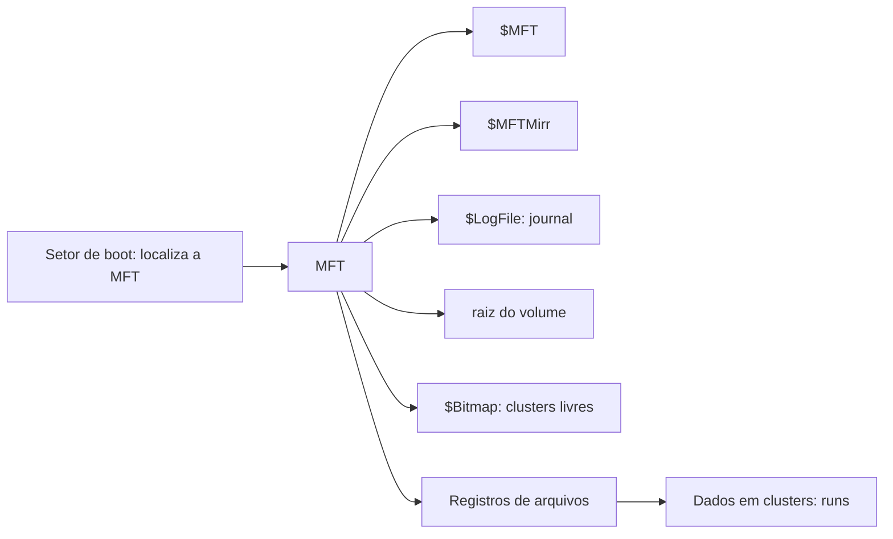

# NTFS

## Resumo

O **NTFS** (*New Technology File System*) é o sistema de arquivos padrão do [[Windows NT|Windows NT]] desde 1993. Oferece **journaling de metadados**, **ACLs**, compressão, criptografia (EFS), cotas, links e arquivos muito grandes. Seu coração é a **MFT**.

## MFT - Master File Table

Todo objeto do volume é um **registro de 1 KiB na MFT**, composto por **atributos**:

| Atributo | Conteúdo |
|---|---|
| `$STANDARD_INFORMATION` | Datas, flags |
| `$FILE_NAME` | Nome (até 255 caracteres UTF-16) |
| `$DATA` | Conteúdo; **residente** na MFT se pequeno (< ~700 bytes) ou em **runs** (extents) |
| `$SECURITY_DESCRIPTOR` | Dono e ACL |
| `$INDEX_ROOT/$INDEX_ALLOCATION` | Diretórios (árvores B+) |
| `$ATTRIBUTE_LIST` | Quando os atributos não cabem em um registro |



Arquivos de metadados especiais: `$MFT`, `$MFTMirr`, `$LogFile` (journal), `$Bitmap`, `$Secure`, `$UpCase`, `$Boot`, `$AttrDef`, `$BadClus`, `$Volume`, `$Extend` (`$USN`, `$Quota`...). O `$LogFile` registra transações de **metadados**; dados de usuário não são protegidos por padrão.

## Recursos

| Recurso | Descrição |
|---|---|
| **ACLs** | Permissões granulares com herança ([[Permissões de Arquivos]]) |
| **Alternate Data Streams (ADS)** | Vários fluxos de dados por arquivo (`arquivo.txt:fluxo`); usado em `Zone.Identifier` |
| **Compressão** | Por arquivo/pasta (LZNT1) |
| **EFS** | Criptografia transparente por arquivo; **BitLocker** cifra o volume inteiro |
| **Cópias de sombra (VSS)** | Snapshots de volume (backup, "versões anteriores") |
| **Links** | Hard links, junctions, links simbólicos |
| **Arquivos esparsos** | Sem alocar zeros |
| **Cotas** e **USN Journal** | Limites por usuário; registro de mudanças para indexação e backup |
| **Limites** | Volume ~8 PiB (clusters de 2 MiB); arquivo até 16 EiB teórico |

## Comandos

```powershell
fsutil fsinfo ntfsinfo C:                    # parâmetros do volume (tamanho de cluster, MFT)
fsutil file layout C:\arquivo.dat            # alocação do arquivo
fsutil usn queryjournal C:                   # USN Journal
chkdsk C: /scan                              # verificação online (/f exige desmontar)
compact /c C:\pasta                          # compressão
cipher /e C:\pasta                           # EFS
vssadmin list shadows                        # cópias de sombra
Get-Item C:\arquivo.txt -Stream *            # lista fluxos alternativos (ADS)
Get-Content C:\arquivo.txt -Stream Zone.Identifier
```

Criar um fluxo alternativo:

```powershell
Set-Content -Path C:\teste.txt -Value "visível"
Set-Content -Path C:\teste.txt -Stream oculto -Value "dados escondidos"
Get-Item C:\teste.txt -Stream *     # mostra :$DATA e oculto
```

> [!warning] ADS e segurança
> Fluxos alternativos podem esconder dados e malware; ferramentas que copiam para FAT/exFAT perdem esses fluxos. O `Zone.Identifier` marca arquivos baixados da Internet ("Mark of the Web").

## No Linux e macOS

- Linux: driver **ntfs3** (kernel 5.15+) e **ntfs-3g** (FUSE) permitem leitura/escrita.
- macOS: leitura nativa; escrita exige software de terceiros.

```bash
sudo mount -t ntfs3 /dev/sdb1 /mnt/win
```

## Vantagens e desvantagens

| Vantagens | Desvantagens |
|---|---|
| Journal de metadados e recuperação confiável | Sem checksums de dados (corrupção silenciosa) |
| ACLs poderosas, EFS, VSS, cotas | Fragmentação ao longo do tempo (HDD) |
| Suporta arquivos e volumes grandes | Escrita nativa limitada fora do Windows |
| Compressão e arquivos esparsos | Sem snapshots nativos de FS (usa VSS) |
| Maduro, amplamente compatível no Windows | Sensibilidade a maiúsculas/minúsculas opcional e confusa |

## Sucessor: ReFS

O **ReFS** (*Resilient File System*) traz checksums, CoW e integridade para servidores e Storage Spaces; ainda não substitui o NTFS como volume de boot.

## Pontos-chave

- Tudo é registro de atributos na MFT.
- Journal só protege metadados; ADS e ACLs são marcas do NTFS.
- BitLocker cifra volume; EFS cifra arquivos.

## Veja também

[[Journaling e Copy-on-Write]] · [[Permissões de Arquivos]] · [[MOC - Sistemas de Arquivos]]
