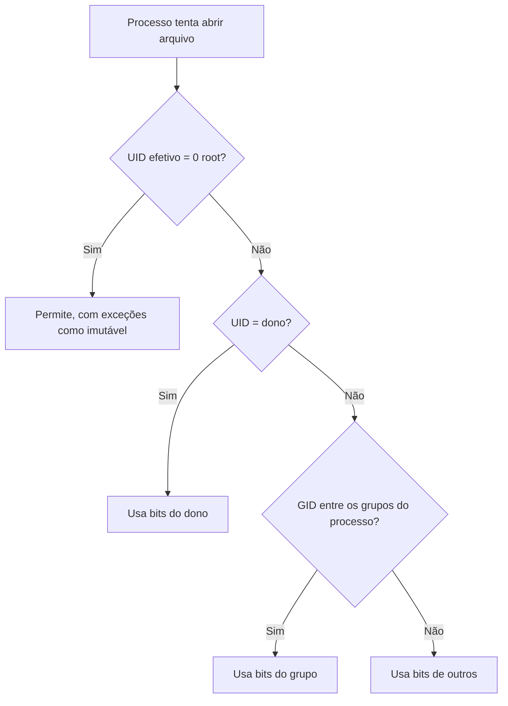

# Permissões de Arquivos

## Resumo

O SO decide quem pode **ler, escrever e executar** cada arquivo. O modelo clássico do UNIX usa três classes (dono, grupo, outros) e três bits (r, w, x). Sistemas modernos adicionam **ACLs** e rótulos de segurança ([[Controle de Acesso]]).

## Modelo UNIX

```text
-rwxr-xr--  1 ana devs 4096 out 26 01:10 script.sh
│└┬┘└┬┘└┬┘
│ │  │  └─ outros: r--  (4)
│ │  └──── grupo:  r-x  (5)
│ └─────── dono:   rwx  (7)
└───────── tipo: - arquivo, d diretório, l link, c/b dispositivo
```

| Bit | Em arquivo | Em diretório |
|---|---|---|
| `r` (4) | Ler conteúdo | Listar nomes |
| `w` (2) | Modificar conteúdo | Criar, remover, renomear entradas |
| `x` (1) | Executar | **Atravessar** (acessar itens pelo nome) |

> [!warning] Diretório sem `x`
> Sem `x`, não é possível acessar nem os arquivos dentro, mesmo que se conheça o nome. Sem `r` mas com `x`, dá para acessar por nome, mas não listar.

Modo numérico: soma de `r=4`, `w=2`, `x=1`. `755` = `rwxr-xr-x`; `644` = `rw-r--r--`; `600` = `rw-------`.

## Bits especiais

| Bit | Octal | Efeito |
|---|---|---|
| **setuid** | 4000 | Executável roda com o UID do **dono** (ex.: `passwd`, `sudo`) |
| **setgid** | 2000 | Executável roda com o GID do grupo; em diretório, novos arquivos herdam o grupo |
| **sticky** | 1000 | Em diretório: só o dono do arquivo (ou do diretório) remove (ex.: `/tmp`) |

```bash
ls -l /usr/bin/passwd /tmp          # -rwsr-xr-x e drwxrwxrwt
find / -xdev -perm -4000 -type f 2>/dev/null   # lista binários setuid (superfície de ataque)
```

## Como a verificação ocorre



Apenas **uma classe** é aplicada: se você é o dono e o dono não tem `w`, não escreve, mesmo que o grupo tenha.

## `umask`

Define quais bits **são removidos** na criação. Arquivos nascem com `666 & ~umask`; diretórios com `777 & ~umask`. Com `umask 022`: arquivos 644, diretórios 755.

## ACLs POSIX

Permitem regras por usuário/grupo adicionais.

```bash
setfacl -m u:maria:rw projeto.txt     # dá rw à maria
setfacl -m g:auditoria:r projeto.txt
getfacl projeto.txt
setfacl -b projeto.txt                # remove todas
```

## Windows (NTFS)

Modelo de **ACLs ricas**: cada objeto tem uma lista de **ACEs** (permitir/negar) para usuários/grupos (SIDs), com herança de pastas.

```powershell
icacls C:\dados                              # exibe ACLs
icacls C:\dados /grant "Maria:(OI)(CI)R"     # leitura herdada por arquivos e subpastas
icacls C:\dados /remove Maria
Get-Acl C:\dados | Format-List
```

## macOS

Mistura de modo POSIX, **ACLs** e **extended attributes**; mais camadas como SIP e TCC.

```bash
ls -le arquivo         # mostra ACLs
chmod +a "maria allow read" arquivo
xattr -l arquivo       # atributos estendidos (ex.: quarentena)
```

## Exemplos de `chmod` e `chown`

```bash
chmod 640 segredo.txt            # rw-r-----
chmod u+x,g-w script.sh          # simbólico
chmod -R go-rwx ~/.ssh           # só o dono acessa
chown ana:devs projeto/          # dono e grupo
chown -R www-data: /var/www
```

```python
import os, stat
os.chmod("segredo.txt", stat.S_IRUSR | stat.S_IWUSR)    # 600
print(oct(os.stat("segredo.txt").st_mode & 0o777))
```

## Boas práticas

- Princípio do **menor privilégio**: `600` para chaves, `644` para arquivos públicos, `755` para executáveis e diretórios.
- Evite `chmod 777`.
- Audite binários **setuid/setgid** e permissões de escrita global.
- Prefira **grupos** a ACLs complicadas.

## Pontos-chave

- Três classes (dono, grupo, outros) × três bits (rwx).
- `x` em diretório = atravessar.
- setuid/setgid/sticky mudam comportamento; ACLs estendem o modelo.

## Veja também

[[chmod e chown]] · [[Controle de Acesso]] · [[MOC - Sistemas de Arquivos]]
