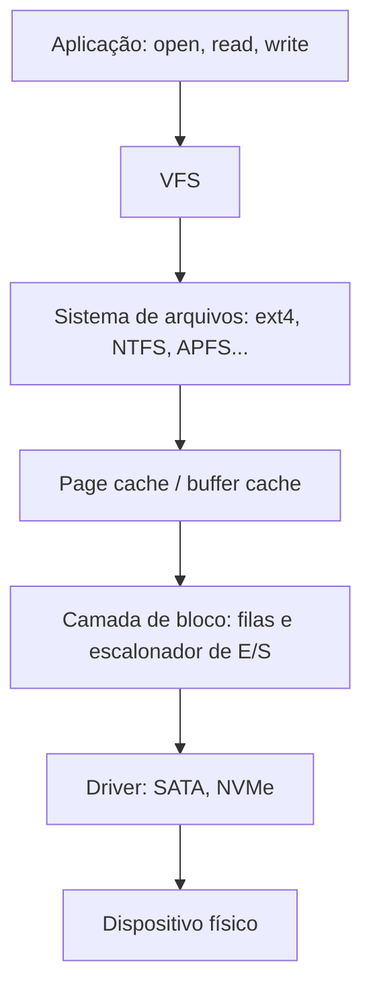

# Sistemas de Arquivos - Conceitos

## Resumo

Um **sistema de arquivos** (FS) organiza dados em dispositivos de armazenamento como **arquivos** nomeados dentro de uma **hierarquia de diretórios**, mantendo **metadados** (tamanho, dono, permissões, datas) e controlando a alocação do espaço.

## Camadas da pilha de armazenamento



## Estrutura em disco (típica)

| Região | Conteúdo |
|---|---|
| **Superbloco** | Parâmetros do FS: tamanho do bloco, nº de inodes, estado |
| **Mapas de alocação** (bitmaps) | Quais blocos e inodes estão livres |
| **Tabela de inodes / MFT** | Metadados de cada arquivo |
| **Blocos de dados** | Conteúdo dos arquivos e diretórios |
| **Journal** (se houver) | Registro de operações para recuperação |

## Métodos de alocação

| Método | Como funciona | Prós | Contras |
|---|---|---|---|
| **Contígua** | Arquivo em blocos consecutivos | Leitura sequencial rápida | Fragmentação externa; difícil crescer |
| **Encadeada** | Cada bloco aponta para o próximo | Sem fragmentação externa | Acesso aleatório lento; ponteiro frágil |
| **FAT** (encadeada em tabela) | Tabela global de encadeamento | Simples | Tabela grande; sem permissões |
| **Indexada (inodes)** | Bloco de índice com ponteiros | Bom acesso aleatório | Overhead de índice; indireção para arquivos grandes |
| **Extents** | Faixas (início, tamanho) | Poucos metadados, bom para grandes arquivos | Mais complexo |

Exemplo de cálculo (inode clássico ext2: 12 ponteiros diretos, 1 indireto simples, 1 duplo, 1 triplo; bloco de 4 KiB, ponteiro de 4 bytes = 1024 por bloco):

- Diretos: 12 × 4 KiB = 48 KiB
- Indireto simples: 1024 × 4 KiB = 4 MiB
- Duplo: 1024² × 4 KiB = 4 GiB
- Triplo: 1024³ × 4 KiB = 4 TiB

## Diretórios, links e arquivos especiais

- **Diretório**: arquivo especial que mapeia **nomes → inodes**.
- **Hard link**: outro nome para o **mesmo inode** (mesmo FS, não para diretórios); contador de links controla a remoção.
- **Link simbólico**: arquivo cujo conteúdo é um **caminho**; pode apontar para outro FS ou para algo inexistente.
- **Arquivos especiais**: dispositivos (`/dev`), FIFOs, sockets UNIX, pseudo-FS (`/proc`, `/sys`).

```bash
ln arquivo.txt hard.txt         # hard link: mesmo inode
ln -s arquivo.txt simbolico.txt # link simbólico
ls -li arquivo.txt hard.txt simbolico.txt
stat arquivo.txt                # inode, links, blocos, datas
```

Saída comentada (`stat`):

```text
  File: arquivo.txt
  Size: 1200        Blocks: 8          IO Block: 4096   regular file
Device: 801h/2049d  Inode: 393230      Links: 2          # dois nomes para o mesmo inode
Access: (0644/-rw-r--r--)  Uid: ( 1000/ usuario)   Gid: ( 1000/ usuario)
Modify: 2026-10-26 01:10:22 -0300                         # mtime: conteúdo mudou
Change: 2026-10-26 01:10:22 -0300                         # ctime: metadados mudaram
```

## Operações e descritores

Fluxo: `open` retorna um **descritor** (índice na tabela de arquivos abertos do processo), que aponta para uma entrada global com **posição corrente (offset)** e flags, e então para o inode.

```c
#include <fcntl.h>
#include <unistd.h>
#include <stdio.h>

int main(void) {
    int fd = open("dados.bin", O_RDWR | O_CREAT, 0644);
    write(fd, "abc", 3);
    lseek(fd, 0, SEEK_SET);            // reposiciona o offset
    char b[4] = {0};
    read(fd, b, 3);
    printf("%s\n", b);
    fsync(fd);                         // força gravação em disco
    close(fd);
    return 0;
}
```

## Cache, buffering e consistência

- O **page cache** guarda blocos recentes na RAM: leituras repetidas não vão ao disco; escritas são **adiadas** (*write-back*) e gravadas depois.
- `fsync`/`fdatasync` garantem que dados chegaram ao dispositivo; sem isso, uma queda de energia pode perder escritas.
- Montagem: todo FS é **montado** em um ponto da árvore ([[mount]]).

> [!warning] Desligamento sem desmontar
> Escritas pendentes no cache podem ser perdidas, deixando o FS inconsistente. [[Journaling e Copy-on-Write]] e copy-on-write existem para reduzir o dano.

## Organização de diretórios e padrões

| Padrão | SO |
|---|---|
| **FHS** (`/bin`, `/etc`, `/home`, `/var`, `/usr`, `/tmp`, `/proc`, `/dev`) | Linux |
| Letras de unidade (`C:\`), `\Users`, `\Windows`, `\Program Files` | Windows |
| `/System`, `/Library`, `/Users`, `/Applications`, `/Volumes` | macOS |

## Comparação rápida de sistemas de arquivos

| FS | Tamanho máx. de arquivo | Journaling/CoW | Plataforma principal |
|---|---|---|---|
| FAT32 | 4 GiB - 1 B | Não | Pen drives, UEFI (ESP) |
| exFAT | 16 EiB | Não | Mídias removíveis |
| [[ext4]] | 16 TiB (blocos de 4 KiB) | Journal | Linux |
| [[NTFS]] | ~16 EiB teórico | Journal | Windows |
| [[APFS]] | 8 EiB | CoW | macOS/iOS |
| [[Btrfs]] | 16 EiB | CoW | Linux |
| [[ZFS]] | 16 EiB | CoW | FreeBSD, Linux, illumos |

## Pontos-chave

- Diretório mapeia nome → inode; metadados ficam no inode.
- Alocação indexada/extents domina nos FS modernos.
- Cache melhora o desempenho, mas exige `fsync` para durabilidade.

## Veja também

[[VFS - Virtual File System]] · [[Inodes]] · [[Journaling e Copy-on-Write]] · [[MOC - Sistemas de Arquivos]]
