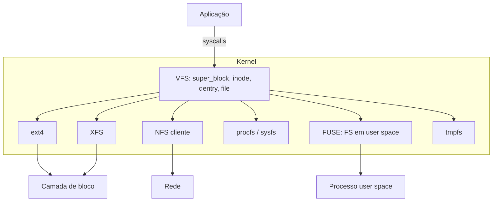

# VFS - Virtual File System

## Resumo

O **VFS** é a camada do kernel que oferece **uma interface única** (`open`, `read`, `write`, `stat`...) para qualquer sistema de arquivos concreto: ext4, NTFS, NFS, tmpfs, `/proc`, FUSE. Aplicações não precisam saber qual FS está por trás.

## Arquitetura



## Objetos principais do VFS (Linux)

| Objeto | Representa | Operações (tabela de funções) |
|---|---|---|
| `super_block` | Um FS montado | `alloc_inode`, `sync_fs`, `statfs` |
| `inode` | Um arquivo (metadados) | `lookup`, `create`, `mkdir`, `link`, `unlink`, `rename` |
| `dentry` | Entrada de diretório em cache (nome → inode) | `d_revalidate`, `d_hash` |
| `file` | Arquivo **aberto** (offset, flags) | `read`, `write`, `mmap`, `fsync`, `ioctl` |

Cada FS implementa essas **tabelas de ponteiros de função** (orientação a objetos em C). O VFS chama, por exemplo, `inode->i_op->lookup()` e o FS concreto responde.

## Resolução de caminhos

Para `/home/ana/nota.txt`:

1. Começa na raiz (dentry da raiz do FS raiz).
2. Para cada componente (`home`, `ana`, `nota.txt`): procura no **dcache** (cache de dentries); se faltar, chama `lookup` do FS.
3. Se o dentry for um **ponto de montagem**, atravessa para a raiz do FS montado.
4. Verifica permissão de busca (`x`) em cada diretório.
5. Cria um objeto `file` e devolve um descritor.

## Caches do VFS

- **dcache**: nomes resolvidos (inclui entradas negativas: "não existe").
- **inode cache**: metadados em memória.
- **page cache**: conteúdo dos arquivos.

```bash
cat /proc/sys/fs/dentry-state          # estatísticas do dcache
sudo slabtop -o | grep -E "dentry|inode"
sync; echo 3 | sudo tee /proc/sys/vm/drop_caches   # limpa caches (só para testes)
```

## Pseudo sistemas de arquivos

| FS | Mostra |
|---|---|
| `procfs` (`/proc`) | Processos e estado do kernel |
| `sysfs` (`/sys`) | Dispositivos e drivers |
| `tmpfs` (`/tmp`, `/dev/shm`) | Arquivos na RAM |
| `devtmpfs` (`/dev`) | Nós de dispositivo |
| `cgroup2` | Hierarquia de controle de recursos |

```bash
mount | head -20
findmnt                       # árvore de montagens
cat /proc/filesystems         # FS suportados pelo kernel
```

## Exemplo: FUSE (FS em user space)

```python
# Esqueleto com fusepy: expõe um arquivo "ola.txt" cujo conteúdo é gerado em tempo real
from fuse import FUSE, Operations
import stat, errno

class OlaFS(Operations):
    def getattr(self, path, fh=None):
        if path == "/": return dict(st_mode=stat.S_IFDIR | 0o755, st_nlink=2)
        if path == "/ola.txt": return dict(st_mode=stat.S_IFREG | 0o444, st_size=11, st_nlink=1)
        raise OSError(errno.ENOENT, "")
    def readdir(self, path, fh): return [".", "..", "ola.txt"]
    def read(self, path, size, offset, fh): return b"ola, mundo\n"[offset:offset+size]

FUSE(OlaFS(), "/mnt/ola", foreground=True)
```

## Vantagens e desvantagens

| Vantagens | Desvantagens |
|---|---|
| Interface única para qualquer FS | Camada extra (pequena sobrecarga) |
| Facilita novos FS e FUSE | Semânticas diferentes entre FS (ex.: permissões, nomes) difíceis de unificar |
| Caches compartilhados (dcache, page cache) | Complexidade interna do kernel |

## Pontos-chave

- VFS = interface comum + tabelas de funções por FS.
- Objetos: superbloco, inode, dentry, file.
- Caches (dcache, inode, page) aceleram o acesso.

## Veja também

[[Sistemas de Arquivos - Conceitos]] · [[Inodes]] · [[MOC - Sistemas de Arquivos]]
