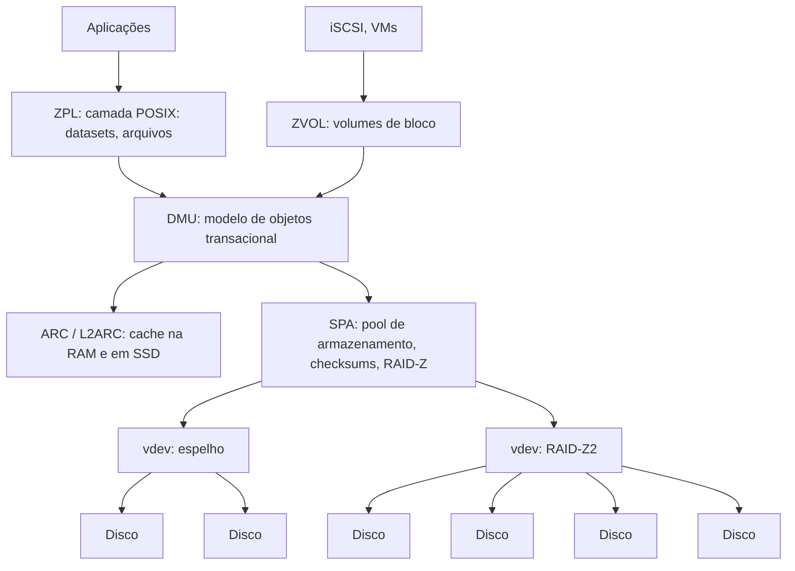

# ZFS

## Resumo

O **ZFS** (Sun, 2005; hoje **OpenZFS**) combina **gerenciador de volumes** e **sistema de arquivos** em um só. É **copy-on-write**, com **checksums ponta a ponta**, **autocorreção**, snapshots, clones, compressão, deduplicação e **RAID-Z**. Roda em Solaris/illumos, [[FreeBSD]] (nativo), e [[Linux]] (módulo OpenZFS, fora do kernel principal por licença CDDL).

## Arquitetura



- **Pool (zpool)**: conjunto de **vdevs** (espelhos, RAID-Z) que fornece espaço a **datasets** (sistemas de arquivos) que o compartilham.
- **Árvore de Merkle**: cada ponteiro de bloco guarda o **checksum do bloco filho**; a corrupção é detectada em toda leitura e **reparada com redundância** (self-healing).

## Recursos

| Recurso | Descrição |
|---|---|
| **CoW transacional** | Estado sempre consistente; sem `fsck` |
| **Checksums** (fletcher4, sha256...) | Dados e metadados; autocorreção com espelho ou paridade |
| **RAID-Z1/2/3** | Paridade simples, dupla, tripla; sem *write hole* (stripes de largura variável) |
| **Snapshots e clones** | Instantâneos; `send`/`receive` para replicação incremental |
| **Compressão** | `lz4` (padrão recomendado), `zstd`, `gzip` |
| **Deduplicação** | Online; **consome muita RAM**: use com cuidado |
| **ARC / L2ARC / SLOG** | Cache adaptativo em RAM, cache em SSD, log de escritas síncronas (ZIL) em dispositivo rápido |
| **Criptografia nativa** | Por dataset |
| **Quotas e reservas**, **propriedades herdáveis** | Gestão fina por dataset |
| **Limites** | 256 quatrilhões de ZiB; na prática, limitado por hardware |

## Comandos essenciais

```bash
# Criar pool (espelho) e datasets
sudo zpool create tank mirror /dev/sdb /dev/sdc
sudo zpool create dados raidz2 /dev/sd{b,c,d,e,f}        # RAID-Z2: tolera 2 discos
sudo zfs create tank/home
sudo zfs set compression=lz4 tank/home
sudo zfs set quota=100G tank/home

# Estado e integridade
zpool status -v tank
zpool list; zfs list
sudo zpool scrub tank                  # verifica todos os checksums

# Snapshots, rollback e replicação
sudo zfs snapshot tank/home@antes-upgrade
zfs list -t snapshot
sudo zfs rollback tank/home@antes-upgrade
sudo zfs send -i tank/home@s1 tank/home@s2 | ssh backup zfs receive pool/home

# Clone
sudo zfs clone tank/home@antes-upgrade tank/teste
```

Saída comentada (`zpool status`):

```text
  pool: tank
 state: ONLINE
  scan: scrub repaired 0B in 00:42:11 with 0 errors    # nenhum erro de checksum
config:
        NAME        STATE   READ WRITE CKSUM
        tank        ONLINE     0     0     0
          mirror-0  ONLINE     0     0     0           # vdev espelhado
            sdb     ONLINE     0     0     0
            sdc     ONLINE     0     0     0
```

> [!warning] Cuidados
> - **Não** use RAID por hardware sob o ZFS: ele precisa ver os discos diretamente (HBA em modo IT).
> - O número de discos de um vdev **não** pode ser reduzido; expansão de RAID-Z existe só em versões recentes (2.3+).
> - Mantenha o pool **abaixo de ~80%** de uso para evitar queda de desempenho.
> - Deduplicação exige muita RAM (cerca de 1-5 GiB por TiB). Compressão `lz4` quase sempre compensa.

## ZFS x Btrfs x ext4

| Critério | [[ext4]] | [[Btrfs]] | ZFS |
|---|---|---|---|
| Tipo | Journal | CoW | CoW |
| Checksums de dados | Não | Sim | Sim |
| RAID integrado | Não | Parcial | Maduro (RAID-Z) |
| Snapshots | Não | Sim | Sim |
| Integração no kernel Linux | Nativa | Nativa | Módulo externo (licença) |
| Uso de RAM | Baixo | Médio | Alto (ARC) |
| Maturidade em servidores | Alta | Média | Muito alta |

## Vantagens e desvantagens

| Vantagens | Desvantagens |
|---|---|
| Integridade de dados excepcional (self-healing) | Alto uso de RAM (ARC), especialmente com dedup |
| RAID-Z sem *write hole* | Licença CDDL incompatível com GPL: não integrado ao kernel Linux |
| Snapshots/send/receive maduros | Menos flexível para alterar topologia depois de criada |
| Cache avançado (ARC, L2ARC) | Curva de aprendizado e planejamento |
| Gestão unificada de volumes e FS | Desempenho cai com pool muito cheio |

## Pontos-chave

- Pool + datasets, CoW e checksums em árvore.
- Self-healing com redundância; `scrub` periódico.
- Planeje topologia, RAM e margem de espaço.

## Veja também

[[Btrfs]] · [[Journaling e Copy-on-Write]] · [[APFS]] · [[MOC - Sistemas de Arquivos]]
