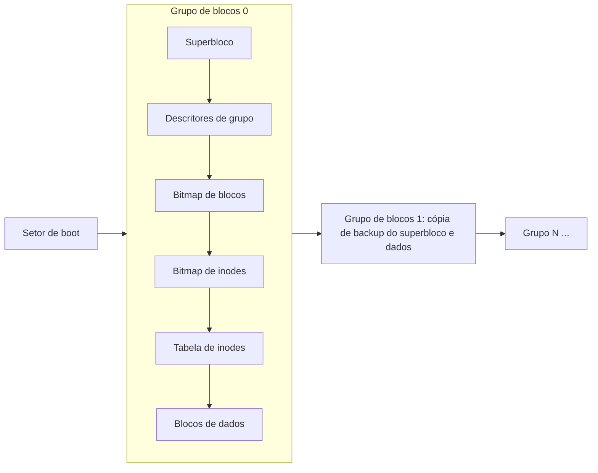

# ext4

## Resumo

O **ext4** (*fourth extended filesystem*) é o sistema de arquivos padrão de muitas distribuições [[Linux]]. Evolui do ext2/ext3 com **extents**, journaling robusto, alocação tardia e suporte a volumes e arquivos muito maiores. Prioriza estabilidade, compatibilidade e bom desempenho geral.

## Arquitetura em disco



- O disco é dividido em **grupos de blocos**, mantendo inodes próximos aos dados (localidade).
- **flex_bg**: agrupa metadados de vários grupos para melhor desempenho.

## Recursos principais

| Recurso | Descrição |
|---|---|
| **Extents** | Faixas contíguas (até 128 MiB) em vez de ponteiros de blocos; menos metadados |
| **Journal** | Jbd2; modos `ordered` (padrão), `journal`, `writeback` ([[Journaling e Copy-on-Write]]) |
| **Alocação tardia (delalloc)** | Adia a escolha de blocos até a escrita real: menos fragmentação |
| **Multi-block allocation** | Aloca vários blocos de uma vez |
| **Persistent preallocation** | `fallocate` reserva espaço |
| **Checksums de metadados** | Journal e metadados com CRC32c |
| **Subdiretórios ilimitados**, **HTree** | Diretórios grandes indexados |
| **Inline data** | Arquivos minúsculos dentro do inode |
| **Criptografia por diretório** (`fscrypt`) e **verity** | Segurança de dados em repouso |
| **Limites** | Volume até 1 EiB; arquivo até 16 TiB (blocos de 4 KiB) |

## Criar e inspecionar

```bash
sudo mkfs.ext4 -L dados /dev/sdb1              # cria
sudo mkfs.ext4 -i 8192 /dev/sdb1               # mais inodes: 1 por 8 KiB
sudo tune2fs -l /dev/sdb1 | head -30           # parâmetros do superbloco
sudo dumpe2fs -h /dev/sdb1                     # detalhes
sudo e2fsck -f /dev/sdb1                       # verificação (desmontado)
sudo resize2fs /dev/sdb1 200G                  # redimensionar (suporta online para ampliar)
sudo tune2fs -m 1 /dev/sdb1                    # reserva 1% para root (padrão 5%)
```

Montagem e opções comuns em `/etc/fstab`:

```text
UUID=3f9c...  /dados  ext4  defaults,noatime,errors=remount-ro  0  2
```

| Opção | Efeito |
|---|---|
| `noatime` / `relatime` | Evita gravar o tempo de acesso a cada leitura (`relatime` é o padrão) |
| `data=ordered/journal/writeback` | Modo de journaling |
| `discard` | TRIM contínuo em SSD (ou use `fstrim` periódico) |
| `errors=remount-ro` | Em erro, remonta somente leitura |

```bash
sudo fstrim -v /            # TRIM manual em SSD
filefrag -v arquivo.bin     # mostra os extents de um arquivo
lsattr arquivo; sudo chattr +i arquivo   # atributo imutável
```

## Vantagens e desvantagens

| Vantagens | Desvantagens |
|---|---|
| Muito estável e maduro; suporte universal no Linux | Sem snapshots nem checksums de dados |
| Bom desempenho geral e baixa fragmentação | Sem compressão ou deduplicação |
| Compatível com ext2/ext3; ferramentas robustas | Número fixo de inodes na criação |
| Pode ser ampliado e (desmontado) reduzido | Limites de escala menores que XFS/ZFS |
| Recuperação rápida por journal | Corrupção silenciosa de dados não detectada |

## Quando usar

Sistemas gerais, desktops, servidores, boot e `/` quando se prioriza estabilidade e simplicidade. Para snapshots, compressão e integridade, considere [[Btrfs]] ou [[ZFS]]; para arquivos gigantes e alto paralelismo, XFS.

## Pontos-chave

- Evolução do ext2/3 com extents, delalloc e journal.
- Limite de inodes definido no `mkfs`.
- Use `noatime`/`relatime` e `fstrim` em SSD.

## Veja também

[[Journaling e Copy-on-Write]] · [[Inodes]] · [[Btrfs]] · [[MOC - Sistemas de Arquivos]]
