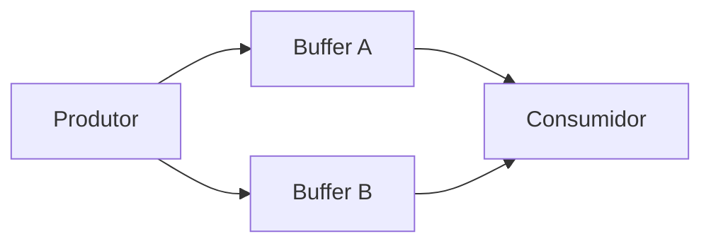
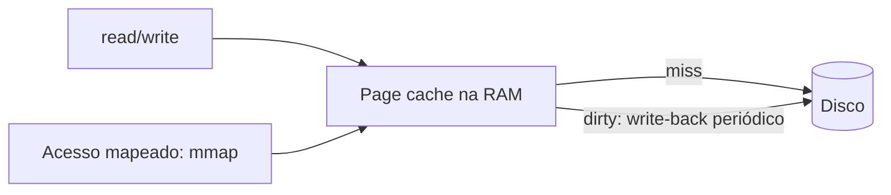

# Buffering, Cache e Spooling

## Resumo

Três técnicas diferentes, muitas vezes confundidas:

| Técnica | Propósito | Característica |
|---|---|---|
| **Buffering** | Absorver diferenças de velocidade ou de tamanho de transferência entre produtor e consumidor | Dados em trânsito; geralmente única cópia |
| **Cache** | Guardar **cópia** de dados lidos frequentemente em meio mais rápido | A fonte original continua existindo |
| **Spooling** | Enfileirar saídas para dispositivos de acesso exclusivo e lento | Impressoras, filas de jobs |

## Buffering

Motivos: **descompasso de velocidade** (rede x disco), **tamanhos de bloco diferentes** (aplicação escreve 10 bytes, disco quer 4 KiB) e **semântica de cópia** (aplicação pode alterar o buffer após `write`, pois o kernel já copiou).

Tipos: **simples**, **duplo** (um enche enquanto o outro é esvaziado) e **circular** (anel).



### Buffering em user space (stdio)

```c
#include <stdio.h>
int main(void) {
    printf("sem newline");          // fica no buffer do stdio, não aparece imediatamente
    fflush(stdout);                 // força o write
    setvbuf(stdout, NULL, _IONBF, 0);   // desabilita buffering
    return 0;
}
```

| Modo do stdio | Quando descarrega |
|---|---|
| Totalmente bufferizado | Buffer cheio (arquivos) |
| Por linha | `\n` (terminal) |
| Sem buffer | Imediatamente (`stderr`) |

## Cache de disco: page cache

O Linux usa **toda a RAM livre** como cache de arquivos (**page cache**): leituras repetidas não acessam o disco; escritas ficam **sujas** (*dirty*) e são gravadas depois (*write-back*) por threads do kernel (`flush`/`writeback`).



Políticas importantes:

- **Read-ahead**: lê blocos seguintes por antecipação em acessos sequenciais.
- **Write-back**: agrupa escritas; risco de perda em queda de energia sem `fsync`.
- **Write-through**: grava sempre no meio; mais lento e mais seguro.
- Bypass: `O_DIRECT` (bancos de dados com cache próprio), `O_SYNC`, `posix_fadvise`.

```bash
free -h                                   # buff/cache mostra o que é cache
grep -E "^(Dirty|Writeback|Cached|Buffers)" /proc/meminfo
cat /proc/sys/vm/dirty_ratio /proc/sys/vm/dirty_background_ratio   # limites de sujeira
sync                                      # força gravação das páginas sujas
echo 3 | sudo tee /proc/sys/vm/drop_caches   # descarta cache (só para testes!)
dd if=/dev/zero of=teste bs=1M count=1024 oflag=direct   # ignora o cache
vmtouch -v arquivo_grande                 # quanto do arquivo está em cache (se instalado)
```

> [!tip] "Memória livre" baixa não é problema
> O cache é descartado automaticamente quando processos precisam de RAM. Observe a coluna **available** do `free`, não **free**.

## Cache de CPU e cache de disco em hardware

- Cache de CPU L1/L2/L3 (hardware, transparente).
- Cache de escrita do disco/SSD (volátil: use barreiras e `fsync`).
- **Cache em camadas**: bcache, dm-cache, ZFS L2ARC (SSD na frente do HDD).

## Spooling

```bash
lpr documento.pdf               # envia ao spooler de impressão (CUPS)
lpstat -o                       # fila de impressão
cancel 42                       # cancela job
```

O spooler aceita jobs rapidamente do aplicativo e entrega à impressora no seu ritmo, evitando que processos esperem pelo dispositivo.

## Armadilhas

> [!warning] Durabilidade
> `write` retorna quando os dados estão no **buffer do kernel**, não no disco. Para durabilidade: `fsync(fd)`. Bancos de dados fazem isso a cada *commit*. Ver [[Journaling e Copy-on-Write]].

## Vantagens e desvantagens

| Técnica | Vantagens | Desvantagens |
|---|---|---|
| Buffering | Reduz syscalls; suaviza picos | Latência; risco de perda se não descarregado |
| Page cache | Acelera E/S drasticamente; uso total da RAM | Memória "ocupada"; dados sujos podem ser perdidos |
| Spooling | Evita bloqueio por dispositivos lentos | Espaço em disco; jobs enfileirados |

## Pontos-chave

- Buffer = trânsito; cache = cópia reaproveitável; spool = fila para dispositivo exclusivo.
- Page cache usa RAM ociosa; `available` é a métrica certa.
- `fsync` é o contrato de durabilidade.

## Veja também

[[Entrada e Saída (E-S)]] · [[Sistemas de Arquivos - Conceitos]] · [[MOC - Entrada e Saída]]
