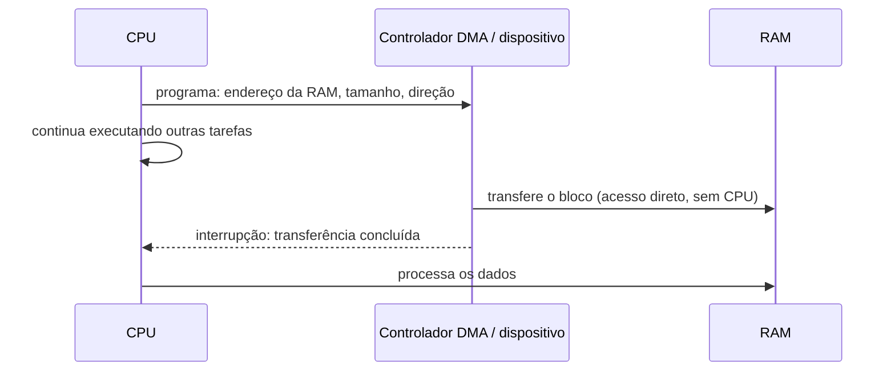

# DMA - Acesso Direto à Memória

## Resumo

O **DMA** (*Direct Memory Access*) permite que um dispositivo **leia ou escreva na RAM diretamente**, sem a CPU copiar cada byte. A CPU apenas programa a transferência e recebe uma [[Interrupções|interrupção]] ao final.

## Sem DMA x com DMA



Sem DMA (E/S programada), a CPU copiaria cada palavra do dispositivo para a memória, ocupada durante toda a transferência.

## Descritores e anéis (ring buffers)

Dispositivos modernos (NVMe, placas de rede) usam **filas em anel na RAM**:

- O driver preenche **descritores** (endereço do buffer, tamanho, flags) e avança o *tail* (*doorbell*).
- O dispositivo consome, grava os dados e avança o *head*; sinaliza por interrupção (ou *polling*).
- Isso permite **scatter-gather**: um único comando referencia vários blocos não contíguos.

```c
// Esquema de descritor de recepção de rede
struct rx_desc {
    uint64_t buffer_phys;   // endereço FÍSICO (ou de E/S) onde o dispositivo grava
    uint16_t length;        // preenchido pelo dispositivo
    uint16_t status;        // bit DD (descriptor done)
};
```

## Problemas e soluções

| Problema | Solução |
|---|---|
| **Coerência de cache**: CPU pode ter dados antigos em cache após o DMA escrever na RAM | Em x86, hardware coerente; em ARM sem coerência: `dma_sync_*`, invalidar/limpar cache |
| **Endereços**: o dispositivo usa endereços físicos ou de barramento, não virtuais | API `dma_map_single`/`dma_alloc_coherent` do kernel |
| **Memória contígua** | Scatter-gather, ou **CMA** (*contiguous memory allocator*) |
| **Dispositivos limitados a 32 bits** | *Bounce buffers* ou máscara DMA (`dma_set_mask`) |
| **Segurança**: dispositivo malicioso lê toda a RAM | **IOMMU** (Intel VT-d, AMD-Vi): traduz e restringe endereços de E/S |

> [!warning] Ataques DMA
> Dispositivos Thunderbolt/FireWire/PCIe maliciosos podem ler memória via DMA. A **IOMMU** (com `intel_iommu=on`) e **Kernel DMA Protection** (Windows) limitam a janela acessível.

## API de DMA no Linux (esquemático)

```c
// Driver mapeia um buffer para DMA de leitura do dispositivo
dma_addr_t handle = dma_map_single(&pdev->dev, buf, len, DMA_FROM_DEVICE);
if (dma_mapping_error(&pdev->dev, handle)) return -ENOMEM;

writel(lower_32_bits(handle), regs + REG_DMA_ADDR);   // programa o dispositivo
writel(len,                   regs + REG_DMA_LEN);
writel(1,                     regs + REG_START);       // dispara; interrupção ao fim

/* na ISR de conclusão */
dma_unmap_single(&pdev->dev, handle, len, DMA_FROM_DEVICE);   // sincroniza caches
```

## IOMMU e virtualização

A IOMMU também permite **passagem direta de dispositivos** (*PCI passthrough*, VFIO) para máquinas virtuais com isolamento ([[Virtualização]]) e **SR-IOV**, em que uma placa se divide em funções virtuais.

## Observando

```bash
cat /proc/iomem | head          # regiões de memória de E/S
dmesg | grep -iE "iommu|dmar|dma"
lspci -vv | grep -iE "bus master|MSI"
ls /sys/kernel/iommu_groups/    # grupos de isolamento
cat /proc/interrupts | grep -i nvme
```

## Vantagens e desvantagens

| Vantagens | Desvantagens |
|---|---|
| CPU livre durante grandes transferências | Complexidade (mapeamentos, coerência) |
| Alta vazão (NVMe, 100 GbE) | Risco de segurança sem IOMMU |
| Scatter-gather evita cópias | Depuração difícil (corrupção silenciosa de memória) |
| Base de *zero-copy* e RDMA | Overhead de configurar para transferências muito pequenas |

## Pontos-chave

- DMA move dados entre dispositivo e RAM sem a CPU.
- Descritores e anéis organizam as transferências modernas.
- IOMMU protege a memória e viabiliza passagem de dispositivos a VMs.

## Veja também

[[Entrada e Saída (E-S)]] · [[Drivers de Dispositivo]] · [[Buffering, Cache e Spooling]] · [[MOC - Entrada e Saída]]
