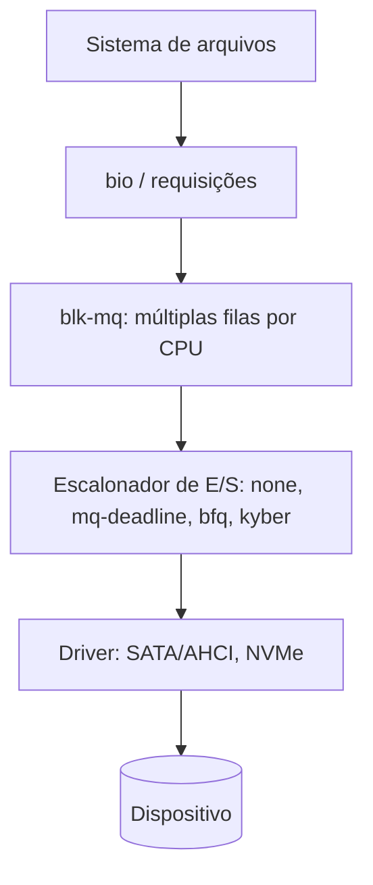

# Dispositivos de Bloco e de Caractere

## Resumo

O SO classifica dispositivos por forma de acesso:

| Classe | Acesso | Exemplos |
|---|---|---|
| **Bloco** | Blocos de tamanho fixo, **acesso aleatório** (endereçável), com cache | HDD, SSD, NVMe, pen drive, loop devices, LVM |
| **Caractere** | **Fluxo de bytes**, sequencial, em geral sem cache | Teclado, mouse, terminais (`tty`), porta serial, `/dev/null`, `/dev/random` |
| **Rede** | Pacotes via interface, não aparecem em `/dev` | `eth0`, `wlan0`; acessados por [[Sockets]] |

## Em `/dev` (UNIX)

No UNIX, dispositivos são **arquivos especiais**, com tipo (`b` ou `c`), **major** (qual driver) e **minor** (qual instância).

```bash
ls -l /dev/sda /dev/tty0 /dev/null /dev/nvme0n1
# brw-rw---- 1 root disk   8,  0 out 26 /dev/sda        <- b = bloco, major 8, minor 0
# crw--w---- 1 root tty    4,  0 out 26 /dev/tty0       <- c = caractere
# crw-rw-rw- 1 root root   1,  3 out 26 /dev/null       <- sorvedouro
```

| Arquivo | Função |
|---|---|
| `/dev/null` | Descarta tudo que é escrito; leitura = EOF |
| `/dev/zero` | Fornece bytes zero |
| `/dev/urandom`, `/dev/random` | Aleatórios criptograficamente seguros |
| `/dev/full` | Escrita falha com `ENOSPC` (testes) |
| `/dev/tty` | Terminal de controle do processo |
| `/dev/loopN` | Arquivo tratado como dispositivo de bloco |

```bash
ls -l /sys/block/                  # dispositivos de bloco
lsblk -o NAME,TYPE,SIZE,MOUNTPOINT,MODEL
cat /proc/devices                  # majors registrados (caractere e bloco)
sudo blkid                         # UUIDs e tipo de FS
```

## Camada de bloco (Linux)



- **blk-mq** usa filas por CPU e por dispositivo; essencial para NVMe (milhões de IOPS).
- Empilhamento (*stacking*): **LVM**, **device-mapper**, **dm-crypt** (LUKS), RAID por software (`md`), **loop**.

```bash
# Criar e usar um dispositivo de bloco a partir de um arquivo
dd if=/dev/zero of=disco.img bs=1M count=100
sudo losetup -f --show disco.img          # /dev/loop0
sudo mkfs.ext4 /dev/loop0 && sudo mount /dev/loop0 /mnt
sudo umount /mnt && sudo losetup -d /dev/loop0
```

## Dispositivo de caractere em ação

```bash
head -c 16 /dev/urandom | xxd                # 16 bytes aleatórios
dd if=/dev/zero of=/dev/null bs=1M count=10000   # benchmark de memória e syscalls
echo "teste" > /dev/null
stty -a < /dev/tty                           # parâmetros do terminal
```

```python
# Lendo bytes aleatórios do kernel
import os
with open("/dev/urandom", "rb") as f:
    print(f.read(8).hex())
print(os.urandom(8).hex())        # mesma fonte, API portátil
```

## Em outros SOs

| SO | Modelo |
|---|---|
| Windows | `\\.\PhysicalDrive0`, `\\.\C:` (objetos do gerenciador de objetos); `\Device\...` |
| macOS | `/dev/disk0`, `/dev/rdisk0` (bruto, sem cache) |
| FreeBSD | `/dev/ada0`, `/dev/nvd0`; devfs |

```powershell
Get-Disk; Get-PhysicalDisk
Get-Partition | Select DiskNumber, PartitionNumber, DriveLetter, Size
```

```bash
diskutil list          # macOS
```

## Vantagens e desvantagens

| Aspecto | Bloco | Caractere |
|---|---|---|
| Acesso aleatório | Sim | Não (geralmente) |
| Cache | Sim (page/buffer cache) | Em geral não |
| Uso típico | Armazenamento e FS | Periféricos de fluxo |
| Prós | Alto desempenho com cache e escalonamento | Simplicidade e baixa latência |
| Contras | Complexidade de filas e caches | Sem reordenação nem cache |

> [!info] "Tudo é arquivo"
> Esse princípio do UNIX permite usar `cat`, `dd`, redirecionamento e permissões em qualquer dispositivo.

## Pontos-chave

- Bloco = endereçável com cache; caractere = fluxo.
- `/dev` usa major/minor para ligar nó ao driver.
- A camada de bloco com `blk-mq` e escalonadores otimiza HDD/SSD/NVMe.

## Veja também

[[Escalonadores de Disco]] · [[Drivers de Dispositivo]] · [[MOC - Entrada e Saída]]
