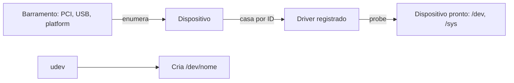

# Drivers de Dispositivo

## Resumo

Um **driver** é o software que **conhece os detalhes de um dispositivo** (registradores, protocolos, temporização) e expõe ao SO uma **interface padronizada**. Em kernels monolíticos ([[Kernel Monolítico]]), roda em modo kernel e representa a maior parte do código (cerca de 60-70% do Linux).

## Responsabilidades

- Inicializar o dispositivo e detectá-lo (*probe*).
- Traduzir requisições genéricas (`read`, `write`, `ioctl`) em comandos do hardware.
- Tratar [[Interrupções]] do dispositivo.
- Configurar [[DMA - Acesso Direto à Memória]] e gerenciar buffers.
- Gerência de energia (suspender/retomar) e *hot-plug*.
- Relatar erros.

## Modelo de dispositivo no Linux



- **Bus, device, driver**: o *driver core* associa cada dispositivo a um driver por **IDs** (vendor/device).
- **sysfs** (`/sys`) expõe a hierarquia; **udev** cria os nós em `/dev` e aplica regras.
- Dispositivos podem ser descritos por **ACPI** (PCs) ou **Device Tree** (ARM/embarcados).

## Esqueleto de driver de caractere

```c
#include <linux/module.h>
#include <linux/fs.h>
#include <linux/uaccess.h>

static int major;
static char msg[] = "ola do kernel\n";

static ssize_t meu_read(struct file *f, char __user *buf, size_t n, loff_t *off) {
    return simple_read_from_buffer(buf, n, off, msg, sizeof msg - 1);
}
static const struct file_operations fops = {
    .owner = THIS_MODULE,
    .read  = meu_read,
};

static int __init init_drv(void) {
    major = register_chrdev(0, "meudrv", &fops);   // major dinâmico
    pr_info("meudrv: major %d\n", major);
    return 0;
}
static void __exit exit_drv(void) { unregister_chrdev(major, "meudrv"); }

module_init(init_drv); module_exit(exit_drv);
MODULE_LICENSE("GPL");
```

```bash
make -C /lib/modules/$(uname -r)/build M=$PWD modules
sudo insmod meudrv.ko
sudo mknod /dev/meudrv c <major> 0 && cat /dev/meudrv
sudo rmmod meudrv; dmesg | tail
```

## Ferramentas de inspeção

```bash
lsmod                          # módulos carregados
modinfo e1000e                 # informações do driver
lspci -nnk | grep -A3 -i net   # driver em uso por dispositivo PCI
lsusb -t                       # árvore USB e drivers
udevadm info -a -n /dev/sda    # atributos para regras udev
journalctl -k | grep -i firmware
```

```powershell
Get-PnpDevice -PresentOnly | Select -First 10 FriendlyName, Status
driverquery /v | more
pnputil /enum-drivers
```

## Drivers em user space

| Mecanismo | Uso |
|---|---|
| **UIO / VFIO** (Linux) | Driver em user space com acesso a registradores/interrupções; DPDK, SPDK, passagem de GPU a VMs |
| **FUSE** | Sistemas de arquivos em user space |
| **libusb** | Drivers USB em user space |
| **UMDF** (Windows) / **DriverKit** (macOS) | Frameworks modernos para tirar drivers do kernel |
| **Microkernels** | Drivers são processos ([[Microkernel]]) |

## Riscos

> [!warning] Drivers são a maior fonte de falhas
> Rodando com privilégio total, um bug de driver causa *kernel panic* / BSOD ou vulnerabilidade de escalonamento de privilégio. Mitigações: **assinatura obrigatória** (Windows, Secure Boot), **IOMMU**, **lockdown**, drivers em Rust no Linux, mover lógica para user space.

## Vantagens e desvantagens

| Vantagens | Desvantagens |
|---|---|
| Abstração uniforme de hardware | Maior fonte de bugs e vulnerabilidades |
| Hot-plug e gerência de energia padronizados | Fabricantes sem driver aberto: suporte limitado |
| Módulos carregáveis facilitam extensão | Compatibilidade entre versões do kernel (API instável no Linux) |

## Pontos-chave

- Driver traduz comandos genéricos em operações do dispositivo.
- Bus/device/driver, udev e sysfs organizam o modelo no Linux.
- Há uma tendência a mover drivers para user space por segurança.

## Veja também

[[DMA - Acesso Direto à Memória]] · [[Dispositivos de Bloco e de Caractere]] · [[MOC - Entrada e Saída]]
